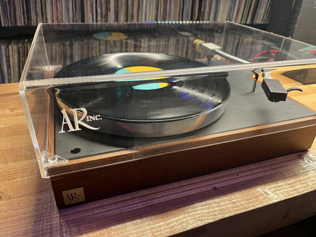
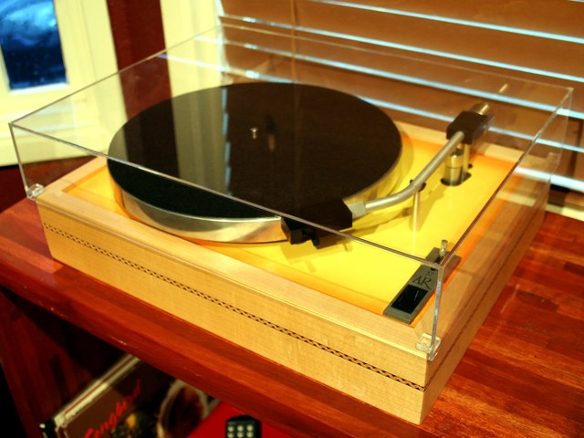
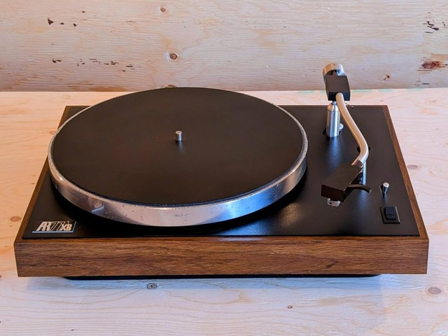
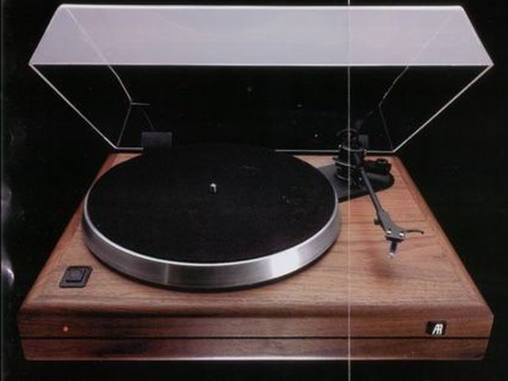
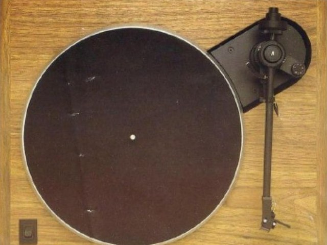
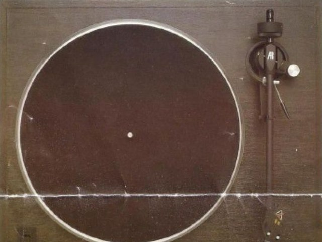
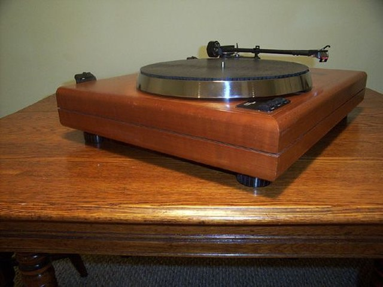

# ARTT: the open reference for Acoustic Research turntables

A sourced workshop reference for the **XA, XB, and AR77XB**. The model guide also covers the 1980s tables, for identification only.

| XA | XB | AR77XB | The AR Turntable |
| --- | --- | --- | --- |
|  |  |  |  |
| 1961 to 1979. No cueing lever | From about 1972. Cueing lever and rocker switch | From 1977. AR77XB badge on the top plate; lever and switch with no panel | From late 1983. Arm on a black board |

| The Legend | EB-101 | ES-1 | ETL-1 |
| --- | --- | --- | --- |
|  |  | No stock photo yet |  |
| The British name for The AR Turntable | The budget model, square-edged | Solid wood sides, sapphire bearing | The large one, sold without an arm |

Not sure which one you have? Use the [model guide](models/README.md). Photos: Gig Harbor Audio (XA), the repository owner's files (XB, AR77XB), Vinyl Nirvana (ETL-1), AR factory brochures (The AR Turntable, The Legend, EB-101). The XA and XB shown have new covers, and the XB a new plinth and top-plate colour; every arm is the original.

| Start here | |
| --- | --- |
| Does it perform? | [The evidence](docs/evidence/README.md): 0.05 percent speed error, the lowest a testing laboratory had met in a fixed-speed table (Period, *High Fidelity*, 1963); rumble −38 dB unweighted against a −35 dB broadcast standard (Period, *HiFi/Stereo Review*, 1963); 19 dB more gain before acoustic feedback than a direct-drive reference on the same bench, on the 1983 table (Period, *Audio*, 1984). The [weaknesses](docs/evidence/weaker.md) are on the same pages |
| Which model is it? | [Model guide](models/README.md): every model and variant, how to recognise it, dates, and published figures |
| Your model | [XA](models/xa/README.md) · [XB](models/xb/README.md) · [AR77XB](models/ar77xb/README.md) |
| Upgrades | [XA mods](models/xa/mods/README.md) |
| Small parts explained | [What it is and where it goes](docs/what-goes-where.md) |
| A part in hand, or one you need | [Find your part](parts/README.md#find-your-part): its versions, which tables each fits, the drawing, and what to keep if you make one |
| Buying parts | [Parts and makers](parts/README.md#replacement-parts) |
| Making parts | [Part index](parts/reproduction.md) · [CAD drawings](cad/README.md) |
| Original documents | [Manuals and factory drawings](docs/README.md) |
| Archived articles | [Local copies of community and maker pages](docs/archive/README.md) |
| Open questions | [Things to confirm](TO-CONFIRM.md) |

## How to read this reference

Each value carries one label and its source, in parentheses.

- **Factory**: a manufacturer document.
- **Owner report**: a firsthand restoration account or measurement.
- **Maker claim**: a supplier describing its own product.
- **Unconfirmed**: evidence is missing or contradictory.

Every source link opens a copy kept in this repository, so the reference still works when the original site is gone. The copy names its original address, and the [archive index](docs/archive/README.md) lists them all.

A measurement from one table stays tied to that table. Do not carry a value across models. Nothing is confirmed for the AR77XB unless its page gives a source. None of the mods or CAD parts has been built or fit-tested. Advice with no source is our assessment.

Last reviewed: 2026-11-18. To add or correct something, see [CONTRIBUTING.md](CONTRIBUTING.md).

## License

Text, models, and drawings: [CC BY-SA 4.0](LICENSE). Build script: [MIT](cad/tools/LICENSE). Scans under `docs/` are third-party material and keep their own rights. Not affiliated with Acoustic Research or Grado.
