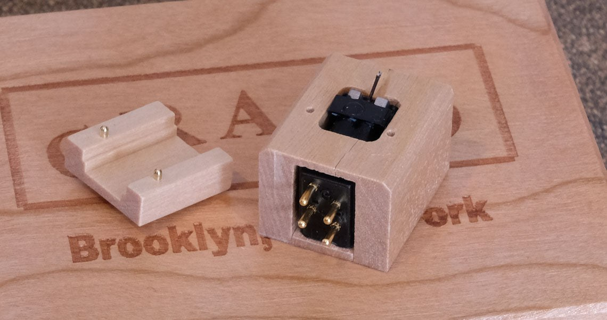
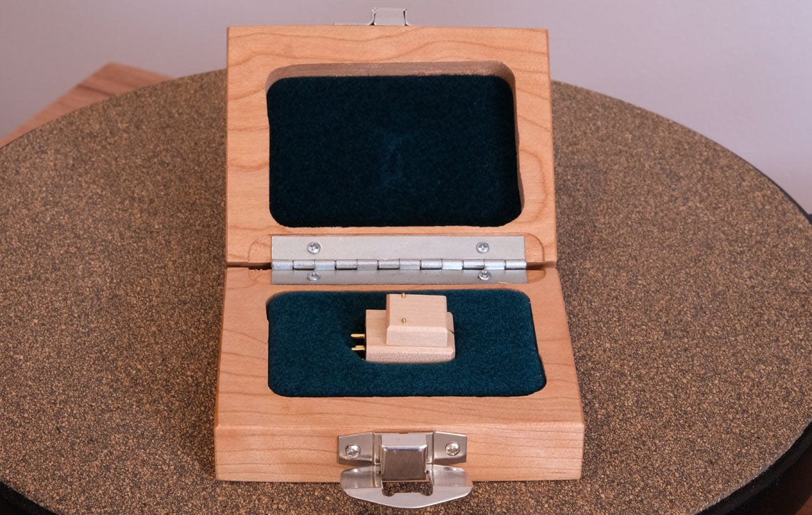
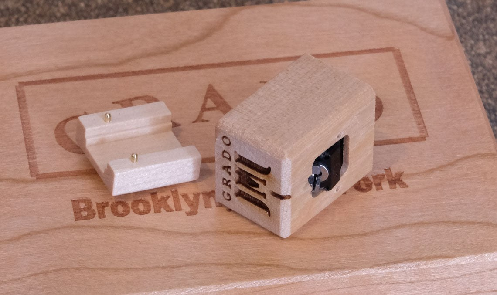
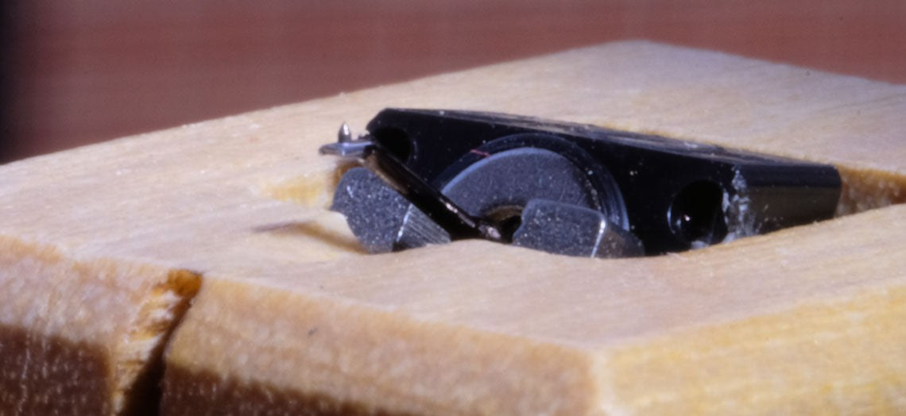

# Grado Timbre Series Opus3 cartridge

> Archived copy, saved 2026-11-18. Original: <https://addictedtoaudio.co.nz/blogs/reviews/grado-timbre-series-opus3-cartridge>. Site: Addicted to Audio. Rights remain with the author and the original site.

A large proportion of phono cartridges are quite similar in look: a thinnish metal body containing the working parts, set into a plastic top for bolting to the tonearm head shell, and with a plastic housing for the stylus. Sometimes various models are distinguished from others from the same manufacture by changing the colour of the plastic.

Inside, of course, we’re talking metal wire, and cantilevers, magnets, a diamond stylus and various modes of operation, but that’s how most of them look.

Which sets the Grado Timbre Series well and truly apart. Because with each model from this series the body of the cartridge is fashioned from wood. The Grado Timbre Series Opus3 cartridge is Grado’s entry level model to the range and is the first to employ maple for the body.

## tl;dr

- Moving iron phono cartridge
- Four coils
- Hand built in Brooklyn, New York
- Elliptical diamond with aluminium cantilever
- Maple wood housing
- Recommended tracking force: 1.6 to 1.9 grams
- 20µm/mN compliance
- 10 to 60,000 hertz “controlled” frequency response
- Average 30dB channel separation from 10 to 30,000 hertz
- Available in high (4.5 mV @ 5 cm/sec) and low (1.0 mV @ 5 cm/sec) output models
- Inductance 55mH (high output model) or 6mH (low output model)
- Resistance 660O (high output model) or 70O (low output model)
- Body dimensions: 20.1mm wide, 16.3mm tall, 25.3mm deep; 29.6mm deep including pins; 18.3mm top to stylus tip
- 9 grams weight (without hardware), 9.0 grams (with hardware)
- The Grado Timbre Series Opus3 cartridge is a bargain, delivering excellent sound from a particularly stylish package
- Price: $459
- Available at fine high fidelity retail outlets, and direct from distributor's retail division [here](https://addictedtoaudio.co.nz/products/grado-timbre-series-opus3-cartridge)

## More about the Grado Timbre Series Opus3

Of course, you can’t just saw off a chunk of wood and make it into a cartridge. Some stability and consistency is vital. Grado says that it uses a thermal aging process for the wood. It notes that the housing is better able to dampen and control resonant frequencies, helping the cartridge produce a “vibrant and luscious sound, while staying consistent and clear.”

The cartridge uses what Grado calls “a derivation of the moving iron principle”. That is, rather than having a heavy magnet attached to the cantilever (the principle of moving magnet cartridges), or a very lightweight coil of only a minimal number of turns attached to the cantilever (the principle of moving coil), it uses a small, lightweight piece of iron attached to the cantilever. The movement of the stylus is transferred to this and its movement within the magnetic field of a nearby permanent magnet changes its own magnetism, which in turn generates an electrical signal in the nearby pickup coils. Of which there are four in this design.

The design of the cartridge makes user stylus replacement impractical, so if and [when a new stylus is require](https://addictedtoaudio.co.nz/products/grado-timbre-series-opus3-stylus)d, you simply return the cartridge to your place of purchase and receive a new one on a “trade-in” basis. The cost of this for the Opus3 is $349.

The model I reviewed was the high output model. The low output version actually offers a relatively high output when compared to traditional moving coil cartridges. At 1mV it supplies at least double the typical moving coil output. If your phono amplifier allows you to set the gain, then I’d suggest starting at 54dB would be suitable. I used the standard moving magnet 40dB of gain on the review model, which equates to 0.45 volts output for 1kHz modulated at 5cm/sec.

## Installation

The cartridge is supplied in a lovely wooden case. Even the stylus guard is wooden. Mounting bolts are supplied. They screw in from the top. It was unclear if there were threaded metal nuts embedded in the wood. I don’t think so. In any case, secure mounting was straightforward and much easier to manage than most cartridges, seeing as there was no need to try to match the thread on the bolt to all-too-easy-to-drop nuts. Because the cartridge body is quite wide – wider than the headshell – I found it fairly easy to align closely with a cartridge alignment protractor.

I used the Avid HiFi Ingenium Plug&Play turntable for this review. I thought the Opus3 cartridge looked rather handsome on this unit, especially when there was no record in place. The visual tones of the cartridge and the cork mat were a good match. Because the Ingenium does not have adjustable antiskating, I set the stylus pressure – I used a third-party gauge – to the top end of the recommended range: 1.9 grams, as close as possible to the 2 grams of the default unit. Nonetheless, the antiskating force was a touch on the low side.

It is unclear whether the construction of the Opus3 cartridge also includes an internal metal case for the magnetic and electrical parts. I suspect not. I found that the cartridge turntable was more susceptible than usual to picking up power supply hum from a nearby amplifier. I rearranged the equipment – something I should have done ages ago anyway – so that the turntable was at the right-hand end of the equipment, and thus the arm was as far as possible away from everything else. That did the trick. There was no perceptible noise.

I also had to be a little careful using the Milty Zerostat 3 antistatic gun. This generated quite marked noise when I used it too close to the cartridge.

## Listening with the Grado Timbre Series Opus3 cartridge

Playback equipment:

- [Avid HIFI Ingenium Plug&Play turntable](https://addictedtoaudio.co.nz/products/avid-ingenium-plug-play-turntable) (review [here](https://addictedtoaudio.co.nz/blogs/reviews/avid-hifi-ingenium-plug-play-turntable))
- [Moon 110LP V2 phono preamplifier](https://addictedtoaudio.co.nz/products/simaudio-moon-110lp-v2-mm-mc-phono-preamplifier)
- [Schitt Audio Freya S preamplifier](https://addictedtoaudio.co.nz/products/schiit-audio-freya-s-balanced-stereo-pre-amplifier) with the high gain setting
- [Moon 330A power amplifier](https://addictedtoaudio.co.nz/products/simaudio-moon-neo-330a-stereo-power-amplifier)
- [Dynaudio Contour 20i loudspeakers](https://addictedtoaudio.co.nz/products/dynaudio-contour-20i-standmount-speakers).

I span a dozen or so records with this cartridge before setting fingers to computer keyboard and ears to the proper critical listening mode. And I have to say, I’m finding it hard to keep the ears and mind in that mode as Ernestine Anderson sings “I’m Walkin’” from the 1980 Concord Jazz album *Sunshine*. That’s because I keep forgetting what I’m supposed to be doing as I’m drawn into the performance.

A tip for vinyl lovers: when you’re looking through second-hand offerings, strongly consider jazz. They likely were originally owned by one of two kinds of people. Jazz lovers tended, as a group, to use higher quality gear and be more solicitous towards their vinyl collections than average. The other kind of original owner was even better for our purposes: someone who didn’t like jazz but had been gifted the album. In that case it has likely been played only once or twice.

Back to Ms Anderson. Her voice is presented up front and dead centre, since she is the main artist. But the slightly recessed backing musicians aren’t diminished because of the clarity of presentation by the Grado Opus3. Even as everything is let to rip towards the end of an abbreviated rendition of “You Are My Sunshine”, every note from Monty Alexander’s piano, every tap from Jeff Hamilton’s drum sticks, every pluck on the strings of Ray Brown’s bass, were distinct and well placed in space.

Speaking of placement in space, one record I like to bring out for these kinds of tests is a recent pressing of 1966’s *Blues Breakers – John Mayall with Eric Clapton*. The recording is rough as guts, it being 1966. But this mono recording is pretty hot, as in cut at a quite high level. I have found it unplayable [by at least one turntable](https://www.gadgetguy.com.au/pro-ject-t1-phono-sb-turntable/). But no such problems here. The footing of the Grado Opus3 was utterly steady. The image was nicely centred and very stable. Not as pin sharp as it would have been had there been a mono switch on my playback gear, but impressive nonetheless.

Moving forward in time by more than half a century, I placed an anything but rough, highly and beautifully produced LP on the turntable. This was Ólafur Arnalds’ 2020 album *some kind of peace*. This album depends on equipment being able to reproduce layer upon layer of subtle sounds which are all brought together into a musical whole. The opening track “Loom” includes some very powerful, sustained bass notes that were nicely captured by the Grado Opus3. With this album, it was clear that the Grado Opus3 is sweet, smooth – oh so smooth – and very detailed in its presentation.

Ernestine Anderson’s performance had been swinging, but it was time to go back to something more percussive just to check out that side of things. There is nothing more percussive than Rodion Shchedrin’s *Carmen Suite*, a magnificent reinterpretation for ballet of Bizet’s opera *Carmen*. It being the 1960s and the music being such a radical departure from the well-known work, the Soviet Minister of Culture banned it after the first performance (“insulting” she said). Thankfully Shostakovich put in a good word and she relented.

I put on side two of the 1981 EMI recording with Gerard Schwarz leading the Los Angeles Chamber Orchestra. The percussive power in the closing moments of “Fortune Telling” on Side 2 were pretty incredible, the tympani power was fully captured and delivered, along with snare drums and some underlying bass drum. The orchestral elements were layered with a nice stage depth. That bass drum positively punched out into the room moments later when the “Finale” it its stride. The climax with its massed drums all pounding in unison came through without the slightest hint of mistracking or distortion, while the string section continued sweetly in the background.

For what I thought would be the LOLs, I played another version, performed by the Bolshoi Theatre Orchestra directed by Gennadi Roshdestwensky (People’s Artist of the RFSFR at the time, no less, and later to become a Hero of Socialist Labour!) It’s quite possible that this is the same crew that left the Minister of Culture so unimpressed in 1967. This one had been given to my grandmother circa 1970, so I’m pretty sure it spent some time being rotated on a Panasonic three-in-one with a heavily pressing ceramic cartridge. There were some unfortunate scratches in parts, and a significant warp that even the clamp on Avid HIFI Ingenium Plug&Play couldn’t quite iron out. But the Grado Opus3 on the Avid turntable was totally comfortable with the warp, and it seemed to track in a different part of the groove, avoiding Panasonic-inflicted damage. There was a certain raw naivety in those Soviet recordings that could result in a real sense of life and stage presence, and that’s what this cartridge delivered in abundance. I think I preferred Grandma’s gift over the more refined, but less exciting, 1981 version.

I finished off with music from the same year – 1967 – but on a nice new pressing: *Strange Days* by The Doors. This would be from the period when [Harrison Ford was their occasional roadie, sometime documentarian](http://hifi-writer.com/wpblog/?p=4520). Again, a relatively naïve style of recording. And that results in marked stage depth and a beautiful delivery of the drum kit. The Grado Opus3 has a rated channel separation of 30dB average over the (more than) full audio bandwidth. That looks like a shockingly low figure in these days of digital stuff which routinely manages 100dB+ in channel separation. Don’t be fooled, 30dB produces a superb sound stage. There’s width, depth and plenty of ambient space.

That was going to be my last notes on listening, but I returned home a couple of days later with a used copy of *Four Moments* by Sebastian Hardie, the masterpiece work of that early Australian progressive rock band. Sadly there was a layer of groove noise, which seems to be embedded dust. I shall attack that with various record cleaning techniques. However the grooves were undamaged by poor playback equipment, and by golly after a couple of decades hearing only a digital version of this, the performance was astonishing, with a richness and body quite absent from the CD and streaming versions. The bass guitar in particular was wonderfully powerful, while the drum kit was projected out into the room with extraordinary power and precision. This cartridge certain does deliver.

## Conclusion

The Grado Timbre Series Opus3 cartridge really does produce a vibrant and luscious sound. And it’s remarkably well-priced for such an unusual and effective phono cartridge. It’s well worth checking out.
