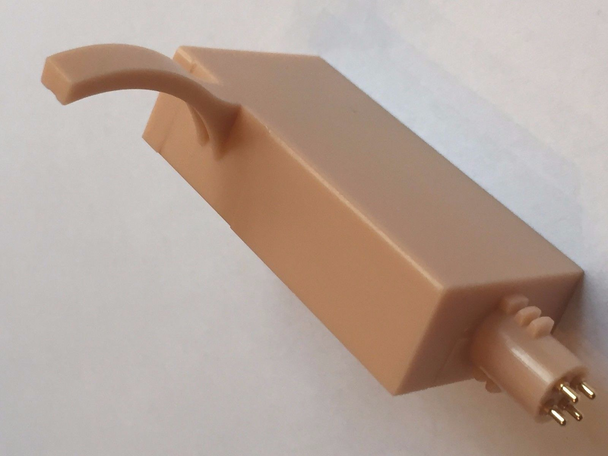
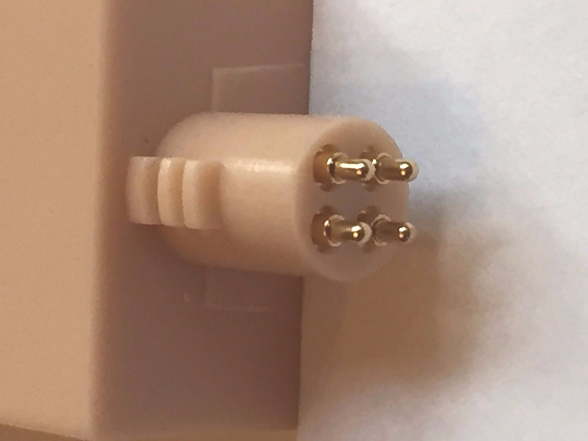
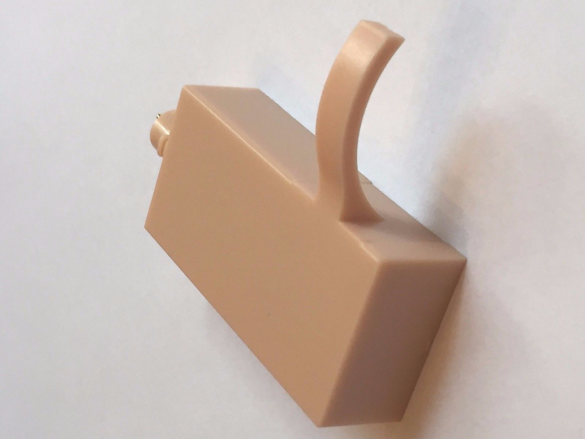
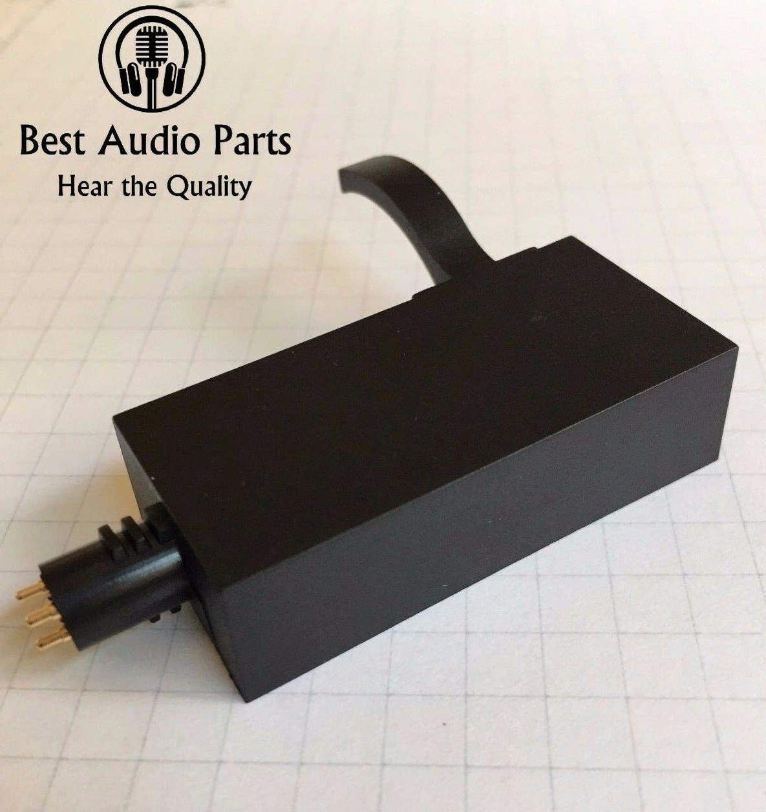
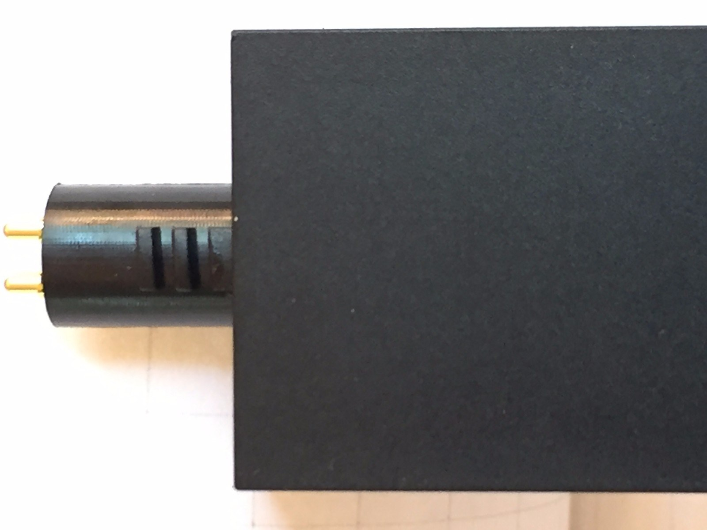
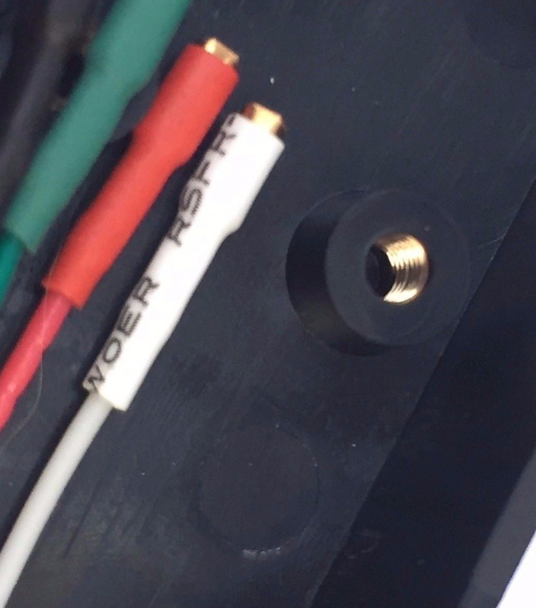

# Best Audio XA Headshell for AR XA and XB Turntables

> Record of an eBay listing, made 2026-11-18. Original: <https://www.ebay.com/itm/332509547009> (Tan) and <https://www.ebay.com/itm/332290103217> (Black), seller bestaudioparts. eBay refuses automated requests, so the text below is a point-by-point record of each listing as read through PicClick's public mirror of it on that day, not a copy of the page; the photographs are the listing's own. Rights remain with the seller.

Seller: bestaudioparts, Menlo Park, California, United States. Feedback 5,971, 99.7 percent positive. Brand: Best Audio. Condition: new. Country of manufacture: United States.

Price when recorded: $89.00 each colour, Buy It Now. The Tan listing showed 91 sold, 5 left, 58 watchers, listed for about 3,240 days.

## Item specifics

| Field | Value |
| --- | --- |
| Type | Headshell |
| Brand | Best Audio |
| Compatible brand | Acoustic Research |
| Compatible models | AR XA, AR XB |
| MPN | XA Headshell |
| Colour | Tan (332509547009); Black (332290103217). The seller also lists Gray (332407064039), Red (332276734703), and Champagne (335067591589) |
| Features | "Injection Molded, not an inferior 3D print" |
| Country of manufacture | United States |
| Warning | California Proposition 65 notice for lead and lead compounds |

## What the listing says

- The shell is injection moulded, not 3D printed, with a glossy finish made to resemble the original XA shell.
- It replaces a broken shell, or a 3D-printed one. Buyers had told the seller that printed shells look gritty against a shiny record, so the seller changed its manufacturing process to get a smooth, original-style surface.
- The connections are sealed, not exposed solder joints, as on the original.
- The audio contacts are gold plated against oxidation.
- The shell takes M2.5 cartridge screws (Black listing). Mounting screws and washers are sent on request (Tan listing).
- Best Audio of Menlo Park, California, describes itself as the only maker of injection-moulded AR parts.
- The Black listing pictures an original AR shell for comparison only; it is not for sale.
- Import duties, taxes, and charges are the buyer's responsibility outside the United States.

Not stated: the plastic, the pin count, the shell mass, and whether wires are fitted.

## Photographs

Tan, item 332509547009:

Black, item 332290103217:

