# Linn Sondek LP12 Turntable (Equip. Profile, Nov. 1983)

> Archived copy, saved 2026-11-18. Original: <https://gammaelectronics.xyz/audio_11-1983_linn.html>. Site: Gamma Electronics; article by Edward M. Long from Audio, November 1983. Rights remain with the author and the original site.

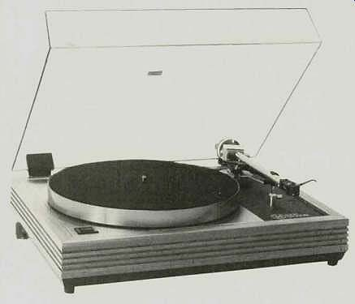

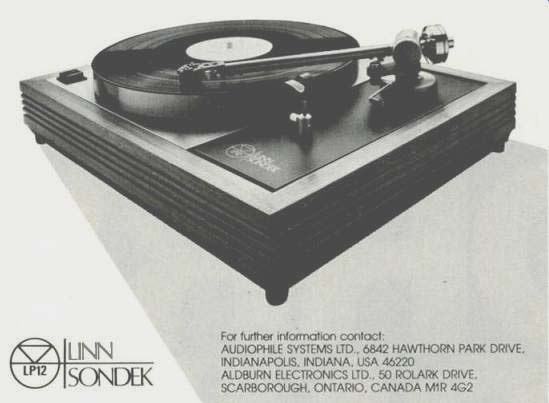

**Manufacturer's Specifications**

Speeds: 33 1/2 rpm.

Drive Type: Belt.

Rumble: 70 dB unwtd.

Wow and Flutter: 0.02%.

Speed Accuracy: ± 0.02%.

Dimensions: 17 1/2 in. (44.5 cm) W x 14 in. (35.6 cm) D x 5 1/2 in. (14.0 cm) H.

Price: $995.00.

Company Address: Audiophile Systems, 6842 Hawthorn Park Dr., Indianapolis, Ind. 46220.

Back in 1972, while working as a tool maker in his father's engineering company, Ivor Tiefenbrun decided to build a turntable for his personal use. One thing led to another and Linn Products, Ltd. was formed in 1973 to manufacture the Sondek LP12 turntable as its first product. The company is located in Scotland and has expanded its products to include tonearms, phono cartridges and loudspeakers. Ivor Tiefenbrun, the Managing Director of Linn Products, has become known as an iconoclast as far as turntables are concerned. His ideas about the importance of the turntable in extracting information from recordings, while first received with skepticism, have caused a lot of rethinking on the part of turntable designers. He was able to demonstrate what he termed "Loss Of Information" (LOI) from other turntables when compared to the Sondek LP12.

Ivor's approach to the problems of LOI seems to consist of looking at what a turntable is meant to do from a different perspective than that of the past. For example, if you consider that a 60 dB dynamic range from a recording means that the groove modulation for the softest signal is about one millionth of an inch, you can see that very small vibrations can tend to obscure detail. The LP12 is designed with such things in mind. Also, since he was realistic enough to know that every detrimental vibration could not be totally eliminated, he designed the LP12 so that such vibrations would occur where they would cause the least LOI. The Linn Sondek LP12 gives the appearance of being a very simple design, which belies its many, very carefully executes design factors. Only a single 33 1/2 rpm speed is offered as standard, although a special pulley and drive belt are available for 45 rpm. Since the latest versions of the turntable feature electronic motor drive, you might expect the speed to be electronically selectable; however, the policy of Linn Products has always been to make any improvements to the LP12 available to owners of earlier versions. Retrofitting an electronic speed control switch would have been a difficult task and, in the interests of uniformity, it was decided not to offer electronic speed selection. The electronic-drive retrofit kit is still available for older versions of the LP12 and is called the Valhalla kit.

Another revision which is incorporated in all new LP12 turntables is called the Nirvana kit and consists of suspension parts which improve the isolation of the motor and platter suspension. Both of these retrofits can be installed on older LP12 turntables by Linn dealers.

As you might gather from the above, Linn shows a high regard for their turntables and the customers who have bought them. If you decide to buy the LP12, the Linn dealer should set up and adjust the turntable for you and install the tonearm and cartridge which you select. For, while the technical manual (available on request) is excellent and very detailed, the dealer's experience in adjusting the turntable/tonearm/cartridge combination for optimum performance is very valuable. Of course, this is true of any combination which you might buy, but the adjustments necessary to obtain optimum performance from the LP12 are particularly fussy.

**Features**

The main bearing of the LP12 is a conically machined point on a hardened tool-steel shaft. This tiny point rides on a steel thrust plate which is machined, hardened, ground and then lapped to a mirror finish. The shaft is oil lubricated and is supported by two low-friction plastic bearing inserts in the side of the bearing well. The platter is made as two concentric pieces, the inner being driven by a belt, much the same as the old AR turntable designed by Ed Villchur back in the early '60s. The platter is machined on all surfaces to within 0.001 inch (0.025 mm) from a zinc-aluminum alloy casting. The flat drive belt is made of chloroprene rubber and couples the drive from a pulley on the 24-pole, 300-rpm synchronous motor. The drive pulley is machined from the same material as the turntable platter to within 0.0004 inch (0.01 mm), which causes the coefficient of expansion to be the same for both. This means that the speed will remain constant with changes in temperature.

The motor mounting is adjustable to provide the correct tension for the belt between the pulley and the turntable hub. This not only provides the proper speed and isolates the motor vibrations from the platter, it also tunes the resonance of the belt compliance and the platter mass to a frequency high enough to minimize flutter oscillations, which can be caused by dynamic groove modulation drag effects.

A felt mat is provided, which will be discussed later.

The electronic speed control is meant primarily to provide a source of undistorted a.c. power to drive the motor. As time goes on, the difficulty of obtaining undistorted a.c. power becomes more difficult, and in many places the power line to which you connect your audio system is far from clean. This can be a definite problem, especially for turntable and tape-machine drive motors. While more people are becoming aware of the problems which can result from distorted a.c. power lines (mainly due to the widespread use of computers, which are easily affected by power-line surges and spikes), the problem is really not new.

I remember a story told to me by Bob Fine, who engineered the pace-setting Mercury Living Presence recordings of the '50s-'60s era and who died just recently. He told me that he and George Piros, one of the unsung heroes of the disc cutting art, were doing a tape-to-disc transfer one day and noticed that the sound was really "grungy." They checked out everything and found that the power line waveform was distorted. The power company was not able to cure the problem, so Bob called Larry Scully, the designer and manufacturer of the famous Scully disc-cutting lathe.

Larry came down from Bridgeport, Conn. to Fine Studios in New York City, and between them, they installed a power conditioning interface for the drive motors on the lathe. This cleaned up the sound of the disc master.

The effect of distorted a.c. power can vary from one brand of turntable to another, and I always monitor the a.c. power when testing or auditioning them. The LP12 should be little affected by a.c. power problems but since I have, at present, no way to supply the motor with distorted a.c. power, I can't positively verify this with a controlled laboratory test.

The platter/bearing assembly and tonearm board are mounted on a steel subchassis which is isolated from the motor and main chassis by three conically wound springs.

The springs have rubber inserts at each end, and their tension can be adjusted to achieve a low-O resonance at about 5 to 6 Hz. The base plate is made of nonmagnetic stainless steel which acts as shield for motor hum and as an absorber of motor vibrations. The arm mounting board is three-ply and is designed to absorb vibrations from the tonearm in the region around 200 Hz to 1 kHz. The LP12 is sold with an integral mounting base made of seasoned hardwood, which means that stress-causing warps, which might develop later, are pretty well eliminated. This might seem like a minor point, but makers of fine musical instruments would certainly agree that such procedures will help eliminate changes in sound quality caused by temperature and humidity. The bottom cover is made of soft hardboard, which also plays a part in absorbing unwanted vibrations. The hinged cover is of clear plastic which needs about 10 inches (250 mm) above and 2.5 inches (64 mm) to the rear when open.

**Measurements and Listening Tests**

**MEASURED DATA**

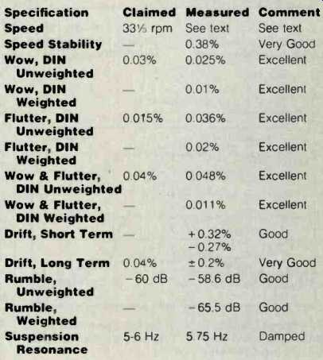

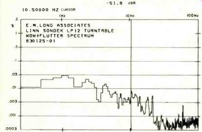

Fig. 1--Computer plot of wow and flutter spectrum, from 0 to 100 Hz. Spectral components are evenly distributed and very low in level, both excellent.

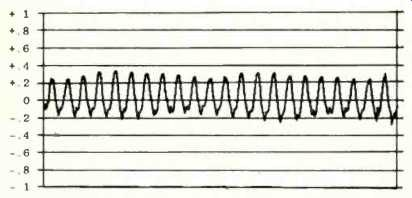

Fig. 2--Speed drift over a 41-S period. The variation at 5.6 Hz is related to one revolution at 33 1/3 rpm. The drift varies between +0.32% and -0.27%.

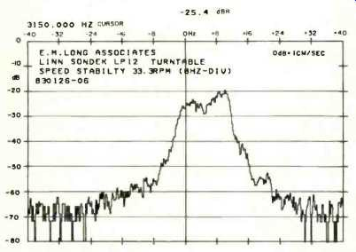

Fig. 3--Speed stability referenced to 3,150-Hz tone on B & K 2010 test record. The speed tends to vary on the fast side.

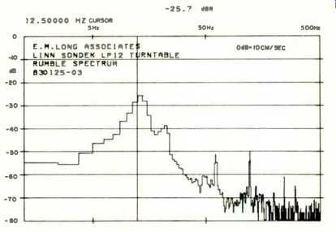

Fig. 4--Rumble spectrum, to 500 Hz. Main output is from tonearm/cartridge resonance at 12.5 Hz.

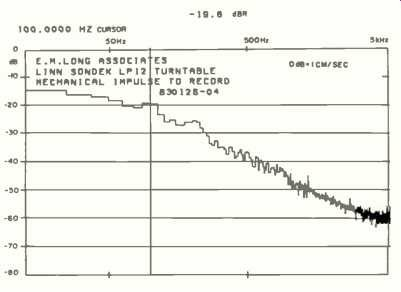

Fig. 5--Spectrum, to 5 kHz, due to mechanical impulse applied to edge of stationary record with stylus in groove. Though not great, the damping is very uniform except around 100 and 200 Hz.

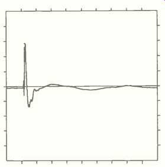

Fig. 6--Output vs. time response of the impulse of Fig. 5 (which was derived from this, using a Fast Fourier Transform analyzer). The shape of this pulse is very good. Total measurement period shown is 0.205 S.

As in past reports, I will try to relate the listening panel's comments about the sound quality to the data gathered from the technical measurements, presenting them simultaneously. There is a continuing debate over relative merits of technical measurements versus listening evaluations, but I think that the issue is over-worked and I contend that both have validity and are complementary if done properly. The effect upon sound quality of a very small amount of wow and/or flutter can be extremely subtle and hard to detect. This is certainly the case with the LP12 turntable.

The measured numbers for wow and flutter in the table are excellent. This single-number way of rating wow and flutter is fairly crude however, and therefore very hard to correlate with effects upon sound quality. Figure 1 shows the spectrum of the wow and flutter and is more revealing. The wow (that is, the cyclical variations in turntable speed occurring at a rate of 10 times per second or less) was very low and fairly evenly distributed. This means that slow, wavering effects should be inaudible, and this was confirmed by the listening panel: No one made any comments about this, even when they were listening for such effects, particularly during piano selections. The flutter (variations in speed at a rate higher than 10 times per second) was a possible cause for the comments made by one panel member about the lack of clarity in the sound of the piano as compared to our reference turntable. I have some doubt that this is the sole cause for the comment, as we shall see later. Figure 2 shows the cyclical variation in speed of the LP12 over a 41-second period. The main variation occurred at 1.8 seconds per cycle; this is directly related to the speed of the turntable at 33 1/3 rpm, since 1.8 seconds is the time for one complete revolution. There is evidence of some uncertainty in the electronic speed control as it tried to correct for the slowing down of the turntable. (Positive values indicate that the speed is faster than 33 1/3 rpm and negative values indicate that the speed is slower than 33 1/3.) This cogging was much less than I have measured for most electronic speed-control turntables. The value of the electronic speed control in isolating the turntable from dirty a.c. power lines far outweighs this minor effect and is certainly worthwhile.

This measurement was obtained from the Drift output of the wow and flutter meter, while the number read from its Drift meter is listed in the table as Drift (short term). A very high resolution measurement of speed variations is shown in Fig. 3. The shift in frequency of the 3150-Hz wow and flutter test signal on the B & K 2010 test record is shown as it varied over a long period of time. The change in frequency was converted to a speed variation and is shown as Drift (long term) in the Measured Data table. The average speed as indicated by Fig. 3 was 3154 Hz or 0.13% fast.

This was then used as the center frequency for the Drift (long term) calculation which is ± 0.2%. I have measured at least one turntable with ± 0.1%, but this is extremely rare and the LP12 has to be ranked very high in this regard. Those listeners with sensitivity to long-term pitch variations should have no problem using the LP12.

The measurement of rumble can be extremely frustrating if it is done without a clear understanding of the factors which contribute to the final number. I have long felt that a simple rumble specification number for a turntable can be quite misleading. I therefore sympathize with turntable manufacturers who must, out of long standing tradition, provide such a number. The simple, unweighted rumble number I measured is shown in the Measured Data table as -58.6 dB. This is 1.4 dB worse than specified by Linn but is relatively meaningless. The spectrum of the rumble shown in Fig. 4 indicates that most of the energy is centered at 12.5 Hz which is the frequency of the tonearm/cartridge resonance. This means that it was the tonearm/cartridge resonance which provided most of the energy which produced the final rumble number! The rumble actually caused by the turntable itself is much lower than either the Linn specification or my measurement indicates, and the rumble measurement would give different results for different tonearm/cartridge combinations. As might be expected, no comments were made by any listening panel members which would indicate that rumble was a problem.

Since the effects of turntable mats and clamping systems are so pronounced, and because Linn eschews the use of clamps and weights, I decided not to use any clamping system or weights on either the LP12 or reference turntable during the listening evaluations. After all, it is the turntable that is being evaluated, and the effects of various vacuum or mechanical record-clamping systems and weights should be evaluated separately from the effects of the basic turntable. I am convinced, though, that the removal of stored energy in the record by the use of correctly adjusted clamping devices is truly worthwhile. (However, I must admit that I apparently confused the issue in a recent report. The very slight additional brightness attributed to the SOTA turntable by listening panel members was due to the fact that the reference turntable had a highly effective clamping system while the SOTA did not. I understand that SOTA is now offering a vacuum clamping system and perhaps we will be able to report on it.) Figure 5 shows the spectrum of the energy caused by a mechanical impulse applied to the edge of a stationary record with the stylus in a quiet groove. The absorption of energy was quite uniform, with a slope indicating that the felt mat was more effective in removing energy from the record at higher frequencies than at lower ones. However, the energy picked up by the stylus was quite high, and there are peaks of energy at 100 and 200 Hz. The output versus time produced by the mechanical impulse is shown in Fig. 6. This also indicates that the LP12 gave a smooth performance in energy control but with a high level of lower frequency energy. Comments made by listening-panel members correlated well with the data in these figures. The LP12 produced more upper-bass sound when reproducing such recordings as Dark Side of the Moon by Pink Floyd, while the reference turntable produced a more-solid low frequency output for symphonic recordings with 36-inch bass drum. Apparently, the energy storage at 100 and 200 Hz is heard as an increase in output in this range. At higher frequencies, the delayed energy, which was not removed, was most probably responsible for the comments by the listening panel about a very slight lack of clarity or blurring of the piano sound, rather than the extremely low amount of flutter mentioned earlier. This delayed energy was most likely responsible for the comments that classical guitar sounded just a tiny bit more harsh with the LP12 than with the reference turntable.

Figures 7 and 8 show the output versus frequency spectrum and the output versus time response of the LP12 suspension caused by a mechanical impulse applied to the massive platform upon which the turntable rested during the technical measurements. The stylus is still in a quiet groove of a stationary record. The suspension shows resonances at 75 to 87.5 Hz and at 150 Hz, which would also tend to cause upper-bass response to be reinforced a bit as heard by the listening panel.

Figure 9 shows the output-versus-frequency spectrum of the LP12 caused by a 100-dB SPL acoustic field at the position of the cartridge, with the stylus still in a quiet groove of a stationary record. This is one aspect of performance in which the LP12 excels. The LP12 could be operated in very high-intensity sound fields with little effect upon the quality of sound reproduction, as long as it was well isolated from mechanically transmitted energy.

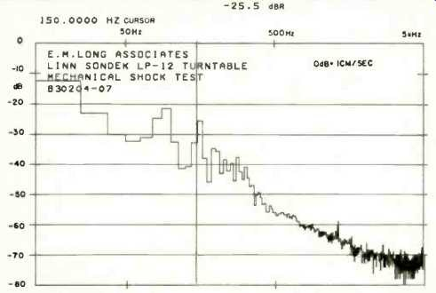

Fig. 7--Spectrum, to 5 kHz, due to mechanical shock applied to massive platform on which the turntable rested during test. The turntable shows good resistance to mechanical shock, but should be placed carefully.

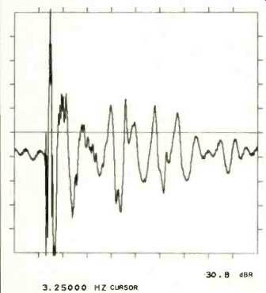

Fig. 8--Output vs. time response of the mechanical impulse of Fig. 7. Many vibration modes are indicated. The period of measurement is 2.05 S.

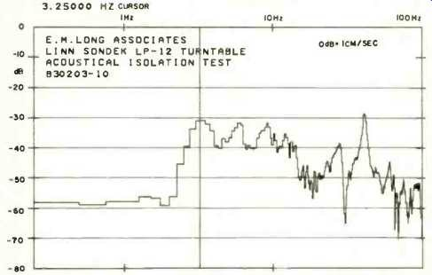

Fig. 9--Spectrum, to 100 Hz, due to a 100 dB SPL acoustic field at the cartridge position.

Cartridge is resting in a groove near the middle of a record, and isolation from the acoustic field is excellent.

**Conclusions**

I realize that, like me, the majority of people who read reports such as this go right to the last part, hoping to find a capsule summary. If you have done this, I would like to tempt you to read the complete report by saying that I have made some comments about rumble measurements and energy-storage effects which you should find interesting. I would also caution you that anything I say in this section must be tempered by what I have said above in the body of the report. After all, you must remember that the panel members are being asked to compare turntables which have an exceptional level of performance compared with the vast majority of available turntables. The panel's ability to hear tiny differences is remarkable. The fantastic resolution of the technical measurements should also be appreciated. Figure 3 is a good example; the center frequency is 3150 Hz while the total window for the measurement is 80 Hz wide and each data point represents 0.2 Hz! We can see a change in frequency of 0.0063%! With this kind of resolution, we can see truly minuscule defects. So what can we say about the LP12 which will put all this in perspective? The balance of design and performance aspects is very good to excellent. This is the turntable that set the trend for improved performance which other designers have tried to match or beat. The LP12 will improve the sound of the majority of music reproducing systems, but at this price level only you can determine its value for the money. I can say that there are few turntables which can legitimately claim to be as good, and even fewer that can legitimately claim to beat it.

--Edward M. Long

(adapted from *Audio* magazine, Nov. 1983)
