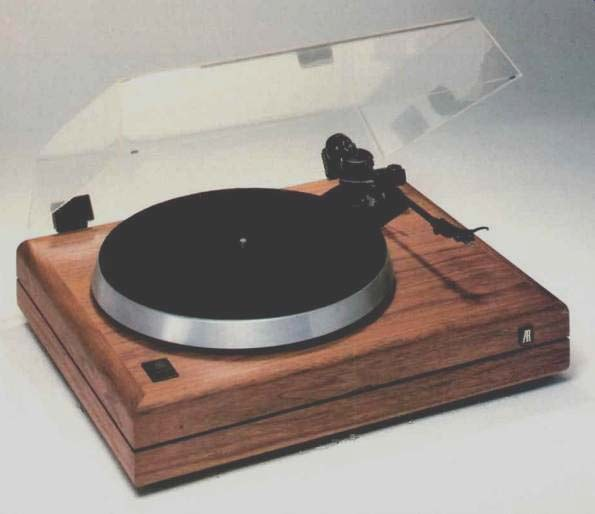

# Acoustic Research Turntable (Equip. Profile, July 1984)

> Archived copy, saved 2026-11-18. Original: <https://gammaelectronics.xyz/audio_07-1984_ar.html>. Site: Gamma Electronics; article from Audio, July 1984. Rights remain with the author and the original site.

  
**Manufacturer's Specifications**

*Turntable*

Drive System: Belt.

Motor Type: 24-pole synchronous, 300 rpm.

Speeds: 33 1/3 and 45 rpm.

Wow & Flutter: 0.04%, DIN weighted.

Rumble: -73 dB, DIN B weighted.

*Tonearm*

Effective Mass: 13 grams without cartridge.

Pivot Friction: Less than 20 mg, horizontal or vertical.

Effective Length: 9 in. (229 mm).

Stylus Overhang: 0.6 in. (15 mm).

Allowable Cartridge Weight: 3 to 9 grams

Tracking Force Range: 0 to 3 grams.

Cable Capacitance: 85 pF.

*General Specifications*

Dimensions: 18.2 in. (46.2 cm) W x 15.25 in. (38.7 cm) D x 7 in. (17.8 cm) H with dust cover closed; 17 in. (43.2 cm) H with dust cover open. Weight: 18 lbs. (8.2 kg). Price: $450.00 with tonearm, $325.00 without tonearm. Company Address: 10 American Dr., Norwood, Mass. 02062.

The September and October 1962 issues of Audio contained a two-part article by Edgar Villchur, Acoustic Re search's founder, which belongs in the library of every turntable designer. By studying the best features of older turntables (such as the late-'50s Weathers and H. H. Scott designs), and digging out long-buried engineering data (such as the correct equations for minimizing lateral tracking error in pivoted tonearms), Villchur put together quite a "... thorough analysis of the physical principles and geometry involved in the design of an arm and turntable."

Villchur emphasized ideas such as:

Mounting the platter and the tonearm on a rigid sub-chassis in order to minimize unwanted relative motion of the stylus and platter:

Using very compliant springs to obtain a suspension frequency below 5 Hz. in order to provide maximum isolation of the platter and stylus from external vibration;

Minimizing the effective inertial mass of the tonearm (regardless of its total mass), for dramatically improved stylus tracking;

Locating the arm's vertical pivot in the same plane as the record surface, to eliminate warp wow;

Maintaining constant platter speed despite the drag of the stylus in the groove and that of a Dust Bug disc cleaner, and Evaluating turntable performance with "weighted" measurements of rumble and flutter that correctly reflect their audibility.

The culmination of Villchur's analysis was the original Acoustic Research turntable. It was introduced in 1962 at a list price of $58 (a remarkable bargain even in those pre-inflationary days), becoming both a popular best-seller and a critical reference standard. More than a third of a million AR turntables were sold over a 17-year period, and, thanks to its simple and reliable design, many of those are still in use today.

Minor faults in the product, such as a foam mat that decomposed and a drive motor that often ran backward, were soon corrected. But AR made the mistake of continuing to use its original tonearm, which lacked such niceties as anti-skating, cueing, end-of-side lift-off, and a convenient means of adjusting the tracking force. Most seriously, the arm had enough pivot friction to compromise the tracking of high-compliance cartridges. (By coincidence the AR turntable was born at the same time as the original ADC-1, the first of the new generation of ultra-high-compliance cartridges that proved to be the old AR tonearm's downfall.) By the mid-'70s, the direct-drive revolution was in full cry, and the AR turntable was outclassed by many imported models which, though sonically inferior, had the advantage of modern conveniences and good tonearms. So five years ago, when AR's accountants discovered that rising manufacturing and overhead costs had made the turntable a money-loser, they chose to shelve it rather than investing in a new arm. Ironically, even as the AR turntable was being phased out here, a counterrevolution in turntable design was already underway in Europe, with companies such as Linn. Thorens, and Ariston (and currently a dozen more) producing new high-performance audiophile models whose design is fundamentally similar to the AR's. Ultimately, Villchur may turn out to have been as seminal an influence in the turntable field as he was in loudspeakers (he invented the acoustic-suspension woofer in 1953).

The excellence of the basic AR mechanism was never in doubt; some of the best-sounding record-playing systems of my acquaintance are 15-year-old AR tables fitted with modern tonearms. Happily, AR has now brought back this classic mechanism, in a restyled base and with a fine, Japanese-made tonearm.

The new AR turntable is also available without arm, for audiophiles who prefer to choose their own. AR modified the original T-bar suspension, shortening the I-beam and adding an open frame to which a wood-composite tonearm mounting board is bolted, so other arms may be substituted if one simply replaces the mounting board. The excellent bilingual (English/French) instruction manual explains in de tail how to trim the spring tension to compensate for the different weight of another arm, and how to determine whether the motor must be shimmed to re-center the drive belt on the pulley.

**Measurements**

The following measurements were made by my colleagues Alvin Foster and J. K. Pollard of the Boston Audio Society:

The turntable speed, which is not user-adjustable, was unaffected by variations in power-line voltage from 75 to 130 V, and was exactly correct at both 33 1/3 and 45 rpm. (The speed is changed by lifting off the outer platter and moving the belt to the larger or smaller of two pulleys on the motor shaft.) The DIN-weighted wow and flutter was 0.05%, which is excellent.

The drive torque was relatively low: under a 10-gram load the platter speed dropped by 0.27%, so if you plan to use a Dust Bug brush you may want to reduce its drag by taping a coin on its rear end as a counterweight. The instruction manual recommends dusting the drive belt annually with talcum powder to minimize slippage, which will help the platter to maintain correct speed despite modest variations in drag. Nevertheless, a Discwasher brush stops the platter completely, as it will most belt-drive units.

The new AR tonearm, a straight, black anodized-aluminum medium-mass arm, comes with a carbon-fiber head-shell that is similar to (but, unfortunately, not plug-compatible with) the ADC-type headshells that are used by several brands of turntables. The tonearm's indicated vertical tracking force was accurate within 0.1 gram at all settings.

Evidently, the anti-skating control is calibrated to balance the side-thrust on the stylus at average groove-modulation levels; with a 1-gram tracking force, an indicated 1.5-gram setting of the anti-skating control was required to obtain optimum tracking of very heavily modulated grooves.

The damped cueing worked well, but, since the cueing lever is on the floating subchassis, the entire platter/arm assembly tended to rock when the lever was touched. As with many other designs, the anti-skating force moves the arm slightly outward when it is raised.

The new AR tonearm, like most of today's arms, violates one of Villchur's dicta: The vertical pivots are nearly a half-inch above the record surface, which means that some warp wow may be audible when playing imperfectly flat records.

The captive tonearm cable, after emerging from the tonearm pillar, is looped in a semi-circle before being attached to the base of the turntable. This is to minimize the stiff cable's tendency to transmit vibration to the floating subchassis, bypassing the soft suspension. (Some turntable makers neglect this important detail.) The remaining length of cable, which terminates in gold-plated phono plugs, is a relatively short 32 inches. The measured cable capacitance was only 82 pF per channel.

Although AR has made no special claims about the damping of the infrasonic tonearm/cartridge resonance, their new arm turned out to be remarkably well damped. Its infrasonic behavior was assessed with the Shure V15 Type IV cartridge, to allow comparison with previous tonearms tested with the same cartridge. With the pickup's damping brush disengaged, the amplitude of the infrasonic resonance typically exceeds 20 dB in tonearms that have low pivot friction and no damping, but in the new AR arm, the resonance, at 7.5 Hz, peaked at only 8 dB. The combination of the V15's damping brush and the tonearm's damping yielded virtually ideal behavior: With the brush down, the infrasonic resonance became a gentle 2-dB rise in the 11 to 16 Hz range, with a rapid roll-off below 9 Hz.

In normal tonearms, the infrasonic resonance produces exaggerated cantilever deflection in response to record surface irregularities and warps, with a consequently large variation in the effective vertical tracking force holding the stylus in the groove. We used a strain-gauge cartridge to observe these effects. On a visibly flat record, the variation in effective tracking force was 0.2 gram peak-to-peak, in creasing to 0.5 gram on a disc with a severe, 4-mm warp.

These are excellent results, bettered only by a reference arm, which is equipped with paddles and a trough of silicone oil for optimum damping.

The spectrum of the rumble was measured with the aid of the Thorens Rumpelmesskoppler, a device which attaches to the spindle to provide data uncontaminated by the cut ting-lathe rumble inherent in test records. The AR turntable had less rumble than any other turntable we have measured to date. Its low-level rumble was mainly infrasonic, with a narrow peak of -40 dB (unweighted) centered at 6 Hz, dropping to -60 dB at 12 Hz,-70 dB at 20 Hz. -80 dB at 30 Hz. and -90 dB at audible frequencies. With this turntable, the only rumble that you ever hear will be the fault of the record manufacturer.

The new AR turntable, like the original, has one remark ably serendipitous characteristic. The inner and outer cast-aluminum platters, tested separately, had very pronounced resonances, with clear, bell-like tones when tapped. But when the outer platter was installed on the inner platter (even without a mat), the assembly became, quite amazingly, dead! Since these is no need for a rubber platter mat to absorb metallic ringing, AR provides a simple felt mat to cushion the disc.

In an informal test of the turntable's isolation from external vibration, we placed the unit on the test bench 1 meter away from a full-range speaker and turned up the preamp's volume control until a low-frequency feedback howl occurred.

The test was repealed with a second turntable in the same location (a Kenwood KD-500 direct-drive model fitted with an SME Series III Improved tonearm), and the difference in system gain was noted. The gain could be raised 19 dB higher with the AR than with the reference turntable, an impressive confirmation of the legendary effectiveness of the AR's suspension. However, the very low frequency (3 Hz) of the suspension resonance also means that the turntable must be placed on a stable cabinet or shelf that will not transmit any lateral or tipping motion to the turntable base.

Such motions (which can be caused by heavy footfalls on a poorly supported wooden floor) will cause severe flutter or groove-skipping.

The AR turntable's thin felt mat is not as effective as a soft-rubber platter mat at suppressing the microphonic behavior of LP discs (the tendency of the large, thin disc to pick up the loudspeaker's sound directly from the air and couple it to the stylus). This was assessed by placing the stylus in the groove with the platter rotation stopped, playing midrange white noise at a high level, and measuring the cartridge output. The microphonic sensitivity of the AR was about average. It was improved about 6 dB by substituting a Platter Matter mat, Out the latter's 1-pound weight nearly bottomed the turntable's soft suspension. While the spring tension could have been adjusted to compensate for this extra weight, doing so would have probably raised its frequency and so this is not recommended. Audiophiles who are concerned about disc microphonics may wish to investigate the use of a spindle clamp, perhaps with a thinner soft-rubber mat.

**Conclusion**

In listening tests, the new AR turntable/tonearm system sounded every bit as good as its measurements suggest. Its most notable characteristic (thanks, no doubt, to its freedom from rumble and acoustic feedback) is the clarity of the reproduced sound-with bass that is well-defined and non boomy, open and transparent midrange, a deep and stable stereo image, and an almost palpable sense of hall ambience with good recordings. The splendid performance of this product is matched by its elegant appearance-which is in gorgeous contrast to the plain-Jane box of yore. Welcome back, AR!

-Peter W. Mitchell

Peter W. Mitchell is a freelance writer (specializing in audio, video, and microcomputers) and a consultant providing design advice and technical writing to NAD and other manufacturers.

(*Audio* magazine, July 1984)

Also see:

Heybrook TT2 Turntable and Tonearm (Nov. 1984)

AR SYSTEM DRIVES NEW TURNTABLE

Acoustic Research 338 Speaker (Nov. 1995)

Acoustic Research AR98LS Speaker (Equip. Profile, Jan. 1985)

= = = =
