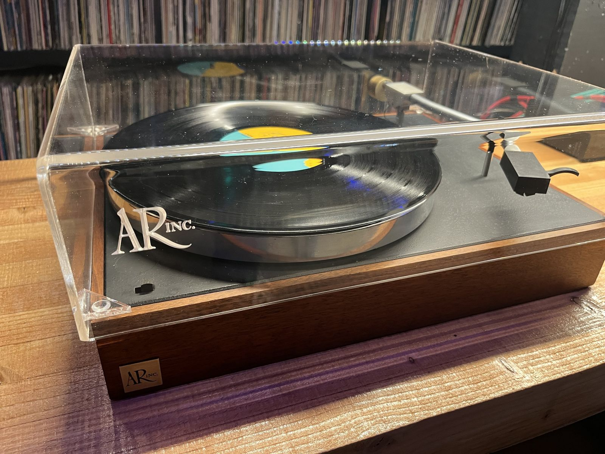
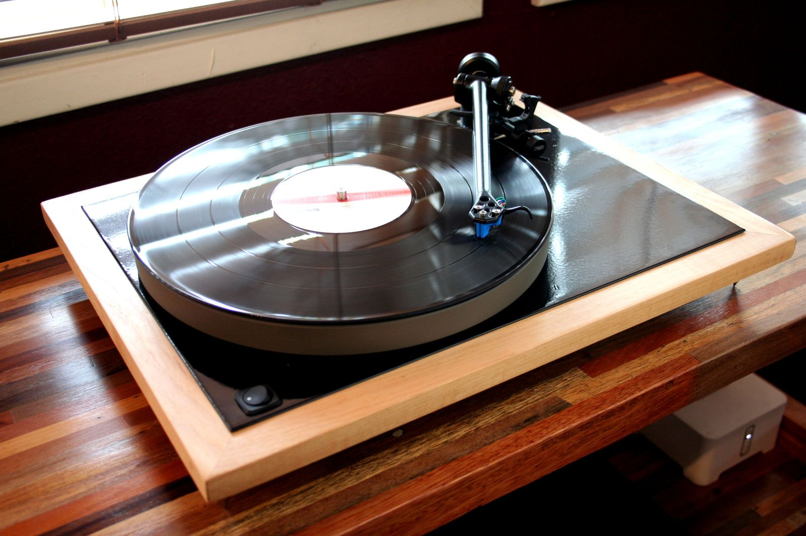
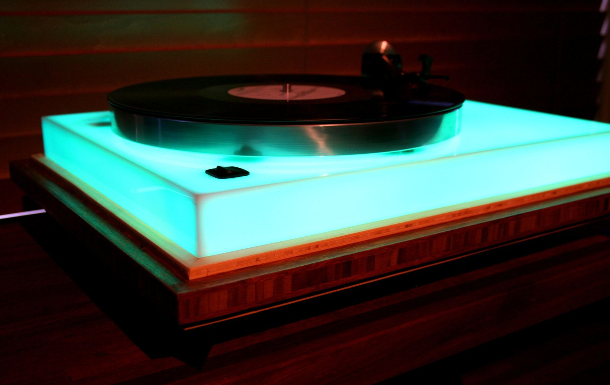
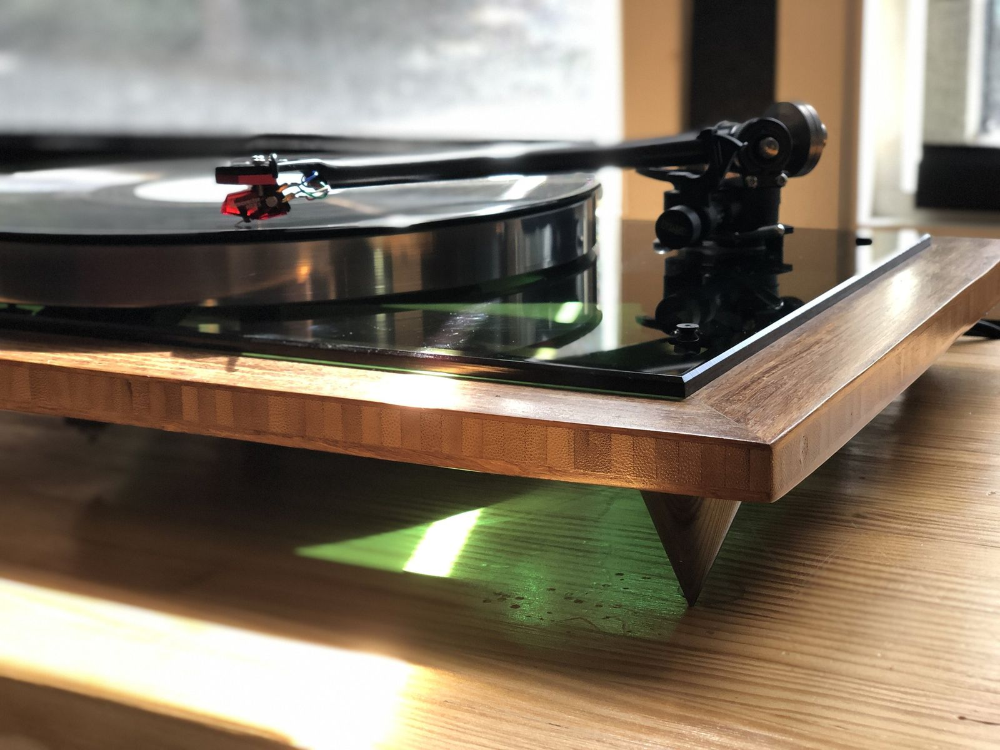

# GHA custom AR-XA tables — Gig Harbor Audio

> Archived copy, saved 2026-11-05. Original: <https://www.gigharboraudio.com/gha-custom-units>. Site: Gig Harbor Audio. Rights remain with the author and the original site.

# GHA ACOUSTIC RESEARCH TURNTABLES

GHA loves the simplicity and great sound produced by a well put together Acoustic Research turntable.  AR originally produced these low-cost ($78!) belt drive turntables using a cast aluminum 3.3 lb platter suspended with a T-bar sub-chassis that greatly reduced acoustic feedback. A 24-pole hysteresis-synchronous, permanent magnet Hurst AC motor propelled the platter via a precision ground rubber belt to produce very low wow and flutter, exceeding the National Association of Broadcasters standards for turntable measurements.  These are some of the latest tables we have restored and modified.  Enjoy.

Classic AR-XA

All stock, everything in excellent shape, motor spins at perfect 33.3, upgraded locking tone-arm rest, upgraded custom AR branded dustcover, Denon DL103R low output moving coil cartridge. One of the best sounding turntables in our shop. $1499.

Black and White

Acoustic Research T-bar, platter, sub-platter, original AR metal top powder coated gloss black, Rega 303 tonearm, Hurst 300 motor, Rega Elys2 moving magnet cartridge, real pine custom built base, rocker on/off switch, 2.5 inch metal spikes. On display at GHA. Sold.

Color

Acoustic Research T-bar, platter, sub-platter, opaque white plexiglass lined with 16 ft of LEDs/remote control, Rega 101 tonearm, Hurst 300 motor, AudioNote high output moving coil cartridge, real bamboo custom built base, rocker on/off switch, 2.5 inch metal spikes. On display at GHA. SOLD..

Green

Acoustic Research T-bar, platter, sub-platter, green plexiglass top plate, Rega 303 tonearm, Hurst 300 motor, bamboo custom built base, rocker on/off switch, 2.5 inch metal spikes, custom dust-cover. SOLD (to a really cool dude!).

The Sunken Living Room

Acoustic Research T-bar, platter, sub-platter, clear plexiglass top plate, Rega 202 tonearm, Hurst 300 motor, Ortofon 10 moving magnet cartridge, real bamboo custom built base, rocker on/off switch, 0.5 inch metal spikes, custom dust-cover. SOLD.

**The Naked Bamboo**

Acoustic Research T-bar, platter, sub-platter, sparkle silver top plate, Rega 303 tonearm, Hurst 300 motor, real bamboo base, rocker on/off switch, 2.5 inch metal spikes, custom dust-cover. SOLD..

**The Tiki Quad**

Acoustic Research T-bar, platter, sub-platter, teal top plate, Rega 202 tonearm, Hurst 300 motor, Audio-Technica AT15Sa Dual Magnet Quad (Shibata Nude Diamond) that can play quad recorded LPs, real bamboo base, rocker on/off switch, custom dust-cover. Sold.

**The Sunburst XB**

Custom oak base with Purple Heart wood inlay, GHA custom sunburst top, original AR tone-arm, platter, T-bar, motor, arm lift. Brand new Rega Carbon cartridge. Custom dust-cover. Sold.

**The Delmas**

Gloss White AR-XA with fixed Rega RB-303 tone-arm, Custom GHA mahogany base, gloss white top, Tungston Heavy counterweight, Denon DL-110 HOMC cartridge. Sold.

**The AR77XB**

Custom Acoustic Research AR77 XB with Rega 202 tonearm, Ortofon OM10 cartridge, custom dustcover, original AR motor, power cable, and RCA cables. Sold.

**AR-XA Twin 1**

Classic AR-XA with original tone-arm and Denon DL-110 cartridge. Refinished walnut base, gloss black top plate, flat black coated T-bar, original AR motor. Upgraded grounded power cable and upgraded AR RCA cables and custom GHA dustcover. Sold.

**AR-XA Twin 2**

Classic AR-XA with original tone-arm and Denon DL-110 cartridge. Refinished walnut base, gloss black top plate, flat black coated T-bar, original AR motor. Upgraded grounded power cable and upgraded AR RCA cables. Sold.

**The ProJect Red**

ProJect tone-arm, Ortofon 2M Red cartridge, custom GHA mahogany plinth, gloss black top, and custom GHA dustcover. Sold.

**Hi-Fi Heaven Orange**

Gloss Orange AR-XA with fixed Rega RB-202 tone-arm, Ortofon MC-1 Turbo HOMC cartridge, Original AR walnut base, original AR motor, modified T-bar, original power cable and RCA cables. Custom GHA dustcover. Sold.

**AR-XA**

Classic AR-XA with original tone-arm and Ortofon OM5 cartridge. Refinished walnut base, flat dark grey top plate, original T-bar, original AR motor. Upgraded grounded power cable and upgraded AR RCA cables. Sold.

**The Suspension 202**

Rega 202 tonearm (top modified to allow original T-bar suspension), Sumiko Oyster cartridge, original AR dark walnut base, custom GHA dustcover, original AR XA motor. Sold.
