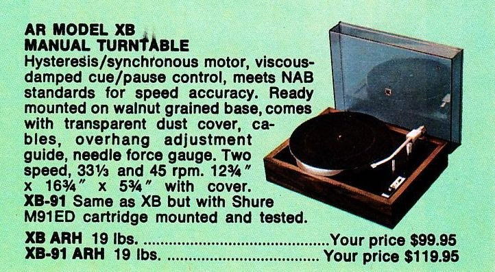

# Acoustic Research Model XB

> Archived copy, saved 2026-11-18. Original: <https://hifi-wiki.com/index.php/Acoustic_Research_Model_XB>. Site: hifi-wiki.com. Rights remain with the author and the original site.

## Data

**General**

- Manufacturer: Acoustic Research
- Model: Model XB
- Type: Turntable
- Year of manufacture: 1972
- Made in: USA
- Color: Silver / Black, Walnut cabinet
- Original price approx.: 100 US-$ (1972), 400 DM

**Technical Data**

