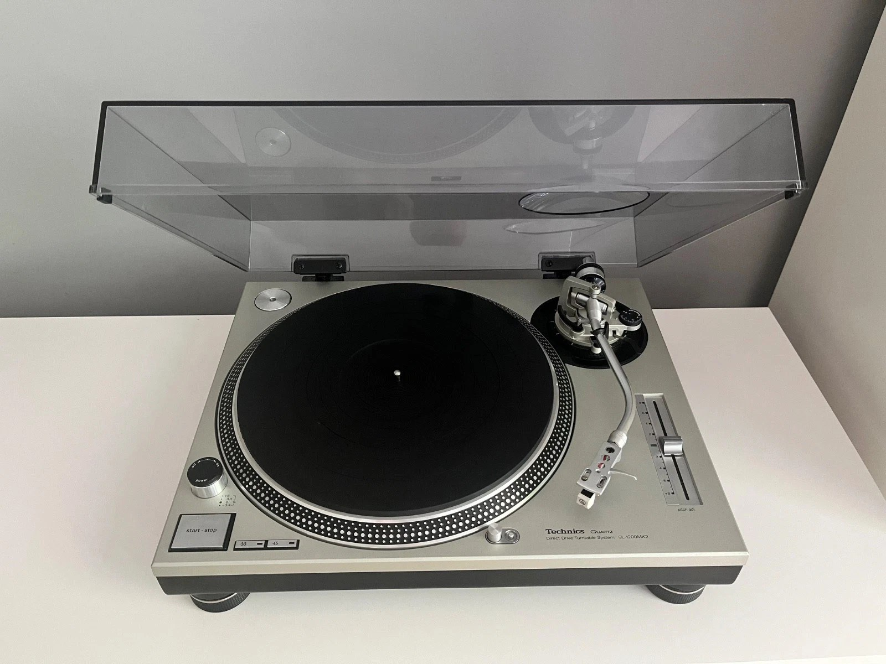
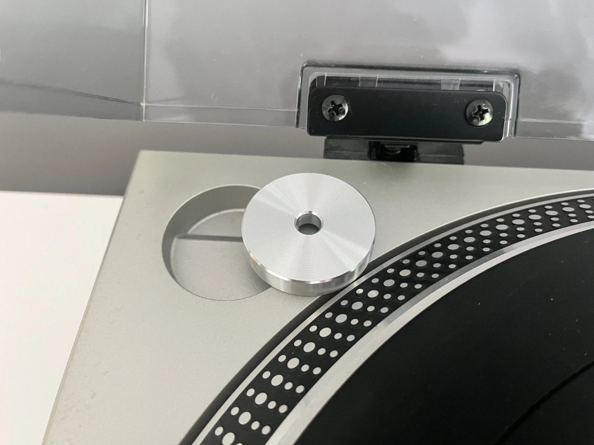
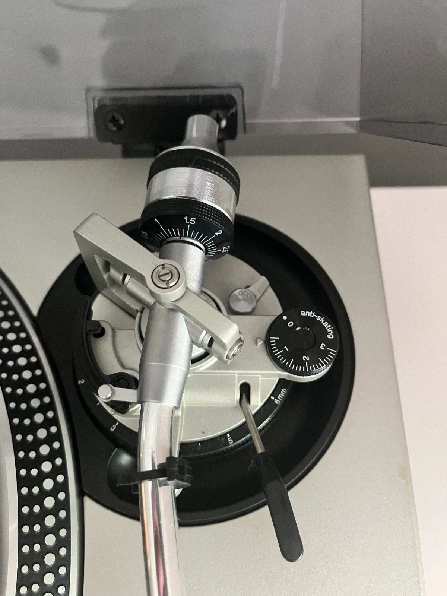
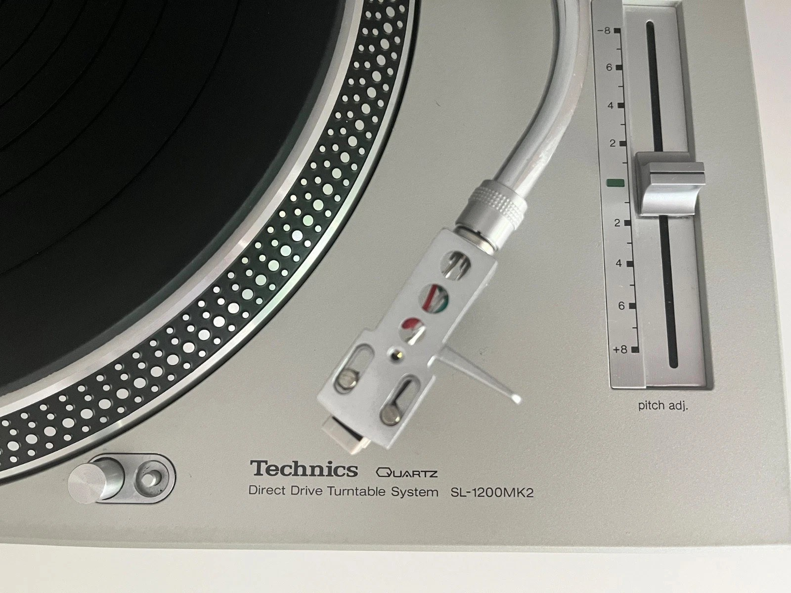
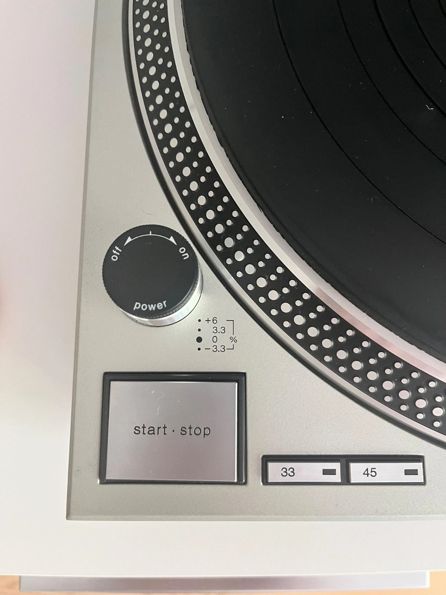
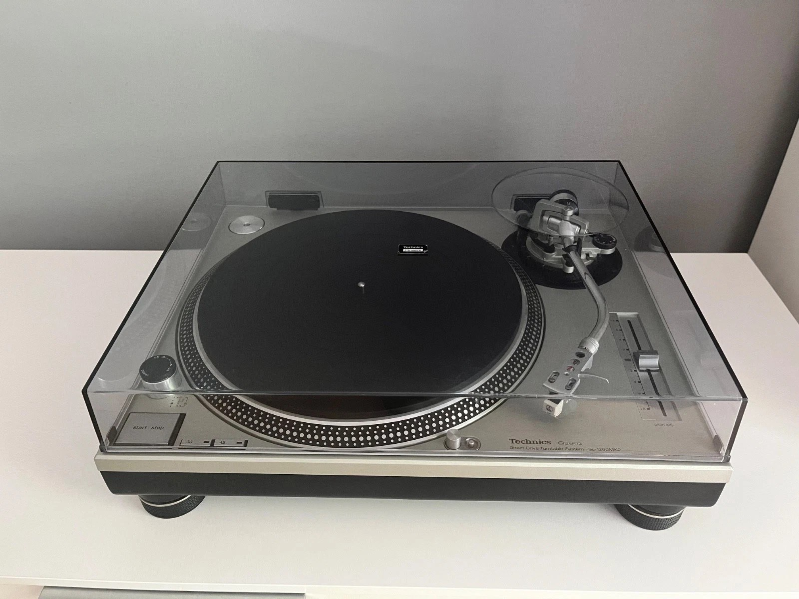
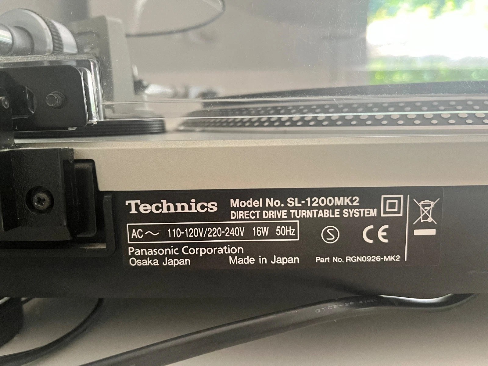
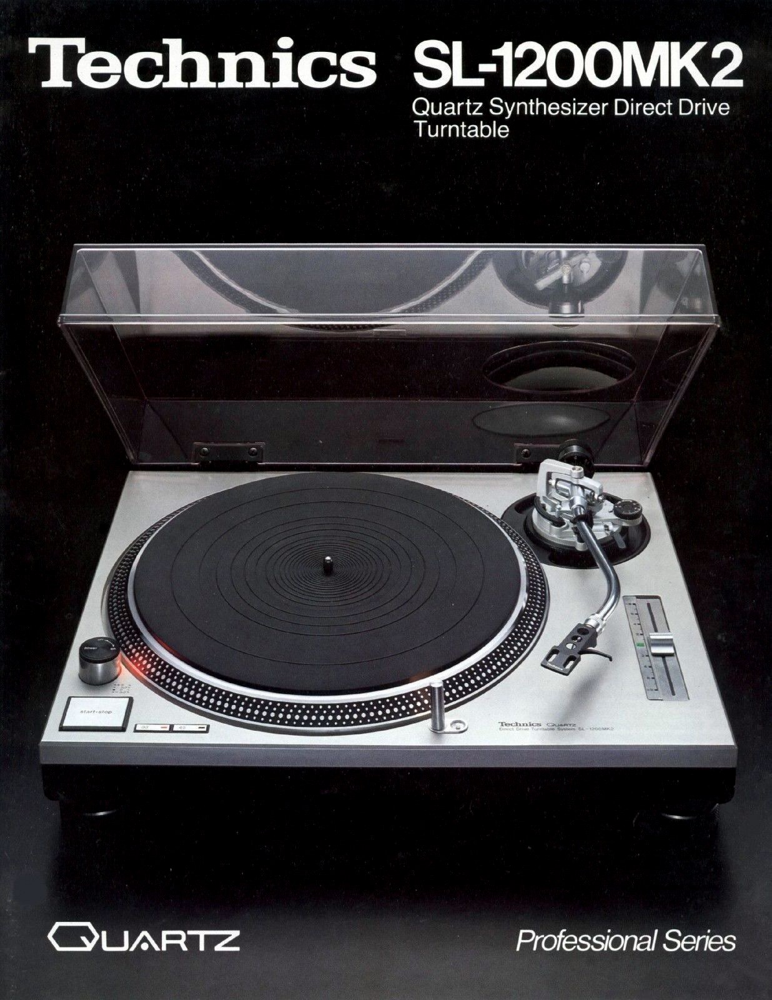

# Technics SL-1200MK2

> Archived copy, saved 2026-11-18. Original: <https://hifi-wiki.com/index.php/Technics_SL-1200_MK2>. Site: hifi-wiki.com. Rights remain with the author and the original site.

## Short description

Manual record player with direct drive. Heavily modified successor of the Technics SL-1200. Achieved great fame through the use in discotheques and work equipment for DJs.

## Data

**General**

- Manufacturer: Technics
- Model: SL-1200MK2
- Type: Turntable
- Years of manufacture: 1979 - 2010
- Made in: Japan
- Colour: Silver-grey
- Power consumption: 12 W (documented early 120 V version)
- Dimensions: 453 x 162 x 360 mm (WxHxD)
- Weight: 12.5 kg
- Original price approx.: 990 DM

**Connections**

- Outputs: 1x RCA cable

**Technical data**

- Drive: direct drive, quartz-controlled
- Motor: DC motor, brushless
- Speed: 33.33/min, 45/min
- Wow and flutter: 0.025 % (WRMS)
- Rumble noise ratio: -56 dB (IEC, unweighted). -78 dB (IEC, rated)
- Platter: aluminium die-cast, 33.2 cm, 2 kg (documented early 120 V version)
- Operating mode: manual
- Pitch: ±8 %
- Tonearm: Technics
- Material:
- Total length: 
- Length pivot point - tip: 230 mm
- Offset angle: 22º
- Pickup overhang: 15 mm
- Counterweight overhang: 
- permissible pickup weights: 3.5 - 13 g / 11 - 20.5 g (including headshell).
- inertial mass of the arm: 12 g
- Tracking force: 0 - 2.5 g (documented early 120 V version)
- height adjustment range: 6 mm
- cable capacity:
- pickup: Technics EPC-207 C (MM), later without pickup

**Special Features**

- Four-row stroboscope with illumination
- Illumination for pickup (incandescent lamp)
- Electronic brake
- Rubber disc mat
- Speed control (pitch)
- Starting torque: 1.5 kg·cm
- Start-up time: 0.7 s

## Documented version

The early manufacturer instructions for the 120 V version specify 12 W power consumption, dimensions of 453 x 162 x 360 mm (W x H x D), a total weight of 12.5 kg and a 2 kg platter. The tracking-force range in these instructions is 0 - 2.5 g. These figures apply to the version documented there; different production or regional versions require their own source.
The rating plate of another SL-1200MK2 shown below specifies 16 W at 110-120/220-240 V and 50 Hz.

## Remarks

Other models in the same series:
Technics SL-120, Technics SL-1200, Technics SL-1200G/GAE, Technics SL-1200GR, Technics SL-1200GLD, Technics SL-1200LTD, Technics SL-1200MK2, Technics SL-1200MK3, Technics SL-1200MK4, Technics SL-1200MK5, Technics SL-1210, Technics SL-1210MK2, Technics SL-1210MK3, Technics SL-1210MK4, Technics SL-1210MK5, Technics SL-1210M3D, Technics SL-1210M5G.

## Pictures

*Overall view with dust cover open*

*45 rpm adapter storage*

*Tonearm bearing with tracking force and antiskating controls*

*Pitch control and model marking*

*Start/stop and speed buttons with power switch*

*Overall view with dust cover closed*

*Rating plate of a 16 W version*

*Extract from brochure: Technics SL-1200MK2*

## Reports

image hifi issue 1/2006, single test: without final score
"What likes: workmanship; reliability; ease of use; straight-as-an-arrow sound."
"What's missing: a show-off version in piano lacquer. Oops, there is (as a limited edition)."
HiFi Test issue 2/2009, 4 products tested.
Grade 1.1; top class price/performance: good
"Plus: very good sound; extremely robust construction; universal use."
hifitest.de
"Impressive also, how the bear-strong drive pulls the heavy cast plate up to the target speed in fractions of a second and then maintains this unshakably. Just as stable as the stroboscopic display of the speed is the musical performance of the Technics: calm, powerful and with a lot of clarity, it captivates even the non-disc jockeys among the listeners. At the same time, it offers a perfectly prepared playing field for a wide range of pick-ups, even of the highest quality, and impressively dispels the myth that large DJ turntables are not for sophisticated music listening. On the contrary, young up-and-coming DJs should watch out that dad doesn't dust off their work equipment for his old classical and jazz records!"
