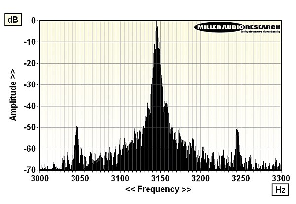
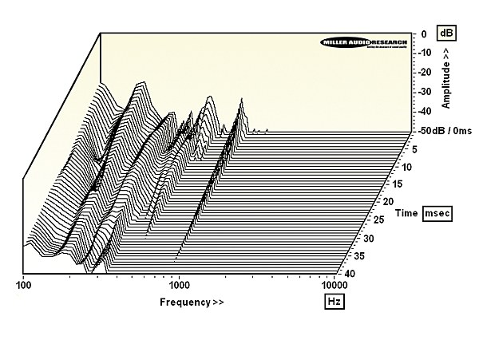

# Linn Majik LP12/Krane Turntable Package Lab Report

> Archived copy, saved 2026-11-18. Original: <https://www.hifinews.com/content/linn-majik-lp12krane-turntable-package-lab-report>. Site: Hi-Fi News. Published online 2021-09-09; measurements by Paul Miller. Rights remain with the author and the original site.

Our sample was supplied with left and right channels reversed, so Linn either needs to look again at its end-of-line QC or, perhaps, this was just a dastardly plan to confirm whether reviewers are paying attention... Captive L/R tonearm leads swapped, the Majik LP12 offered up a reliably fine set of measurements. The single-point Karousel bearing was responsible for –68.5dB rumble (DIN-B wtd, re. 5cm/sec) which reduced to a good –70.1dB through-the-groove, proving the effectiveness of Linn's familiar two-part platter and lightweight felt mat. The 110V synchronous AC motor was running just –0.2% slow but was exceptionally pitch-stable, the platter rotating with just 0.02% peak wow at ±2Hz, albeit with sidebands at ±12Hz and ±50Hz contributing to a slightly higher 0.04% peak flutter [see Graph 1, below]. The latter 50Hz AC noise was also picked up in the –55dB residual noise measurement (unwtd. re. 5cm/sec) but this is a perfectly 'average' figure for a contemporary turntable.

The partnering Krane tonearm, built to Linn's specification by Clearaudio, is derived from the brand's popular 9.5in Satisfy Kardan arm, equipped with magnetic anti-skate compensation, alloy armtube and fully adjustable alloy headshell. The 10g effective mass makes it very compatible with Linn's Adikt MM pick-up while its resonant behaviour is impressively benign [see Graph 2, below]. The principal tube resonance occurs at 95Hz (lower than with the carbon-tubed variant, see HFN Jul '16] with a cluster of harmonic/torsional modes at 140Hz, 185Hz and 270Hz. All modes above ~200Hz are swiftly damped. The sapphire/ceramic bearings are suitably tensioned, offering very low <10mg friction with no perceptible play.

*Wow and flutter re. 3150Hz tone at 5cm/sec (plotted ±150Hz, 5Hz per minor division)*

*Cumulative tonearm resonant decay spectrum, illustrating various bearing, pillar and 'tube' vibration modes spanning 100Hz-10kHz over 40msec*

**Hi-Fi News measured specifications**

| Item | Result |
| --- | --- |
| Turntable speed error at 33.33rpm | 33.26rpm (–0.22%) |
| Time to audible stabilisation | 4sec |
| Peak Wow/Flutter (Peak wtd) | 0.02% / 0.04% |
| Rumble (silent groove, DIN B wtd) | –70.1dB |
| Rumble (through bearing, DIN B wtd) | –68.5dB |
| Hum & Noise (unwtd, rel. to 5cm/sec) | –55.0dB |
| Power Consumption | 4W (1W standby) |
| Dimensions (WHD) / Weight | 445x140x356mm / 10kg |
| Price | £3450 (inc. arm/cartridge) |

**Company info**

Linn Products Ltd  
Glasgow  
Supplied by: Linn Products Ltd  
0141 307 7777  
www.linn.co.uk
