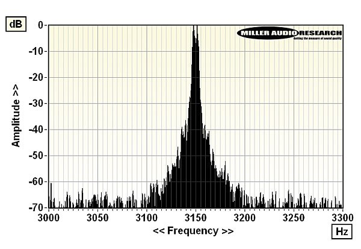
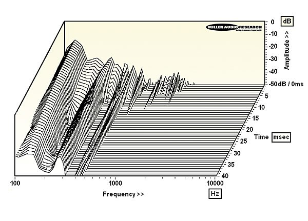

# Thorens TD 124 DD Turntable Lab Report

> Archived copy, saved 2026-11-18. Original: <https://www.hifinews.com/content/thorens-td-124-dd-turntable-lab-report>. Site: Hi-Fi News. Published online 2021-08-05; measurements by Paul Miller. Rights remain with the author and the original site.

Employing direct-drive in place of the belt-drive pulley and rubber idler wheel solution of the original deck, the TD 124 DD's 12-pole Hall effect motor and radial magnet (attached to the underside of the 3.5kg alloy platter) is still very 'traditional'. For example, rumble – measured through the spindle – is a fine –69.2dB (DIN-B wtd) but the isolation of the platter from this central shaft, and the added damping afforded by the rubber mat, yields a truly sensational through-groove rumble of just –76.2dB. So the TD 124 DD not only embodies sufficient torque for a swift 1-2sec start-up, but it's also very quiet. Speed stability needs a little work, however, for while absolute pitch is accurate to within 0.05% there was, I presume, some slight asymmetry between the phases of one or more of the 12 coils in our sample, yielding the (inaudible?) ±2.2Hz 'split' seen on the W&F spectrum [Graph 1]. Production tolerances might see the moderate 0.15% peak-wtd wow measured here drop to ~0.02% in other samples...

The matching EMT-inspired TP 124 tonearm combines a rear counterweight with spring-loaded downforce and is accurately calibrated to within –5% over a 0-2g range, albeit under-reading by 10% above 3g. Bear in mind that the SPU 124 pick-up has a recommended downforce range of 2.5-3.5g. Not unexpectedly, this robust arm has a high 16g effective mass (standard headshell) and is best suited to low compliance MCs. The arm resonances are not as complex as we might see with a full S-shaped tube [ HFN Sep '18] but they are still bold and persistent at 130Hz, 280Hz and 410Hz/480Hz [see Graph 2]. The heavyweight encapsulated cardan bearing enjoys low levels of friction (typically ~15mg) and betrays little or no play.

*Wow and flutter re. 3150Hz tone at 5cm/sec (plotted ±150Hz, 5Hz per minor division)*

*Cumulative tonearm resonant decay spectrum, illustrating various bearing, pillar and 'tube' vibration modes spanning 100Hz-10kHz over 40msec*

**Hi-Fi News measured specifications**

| Item | Result |
| --- | --- |
| Turntable speed error at 33.33rpm | 33.32rpm (–0.05%) |
| Time to audible stabilisation | ~1-2sec |
| Peak Wow/Flutter (Peak wtd) | 0.15% / 0.02% |
| Rumble (silent groove, DIN B wtd) | –76.2dB |
| Rumble (through bearing, DIN B wtd) | –69.2dB |
| Hum & Noise (unwtd, rel. to 5cm/sec) | –65.7dB |
| Power Consumption | 4W (1W standby) |
| Dimensions (WHD) / Weight | 425x185x350mm / 19kg |
| Prices | £7999 (£1999, SPU 124 pick-up) |

**Company info**

Thorens GmbH  
Bergisch Gladbach, Germany  
Supplied by: Signature Audio Systems  
07738 007776  
www.thorens.com
