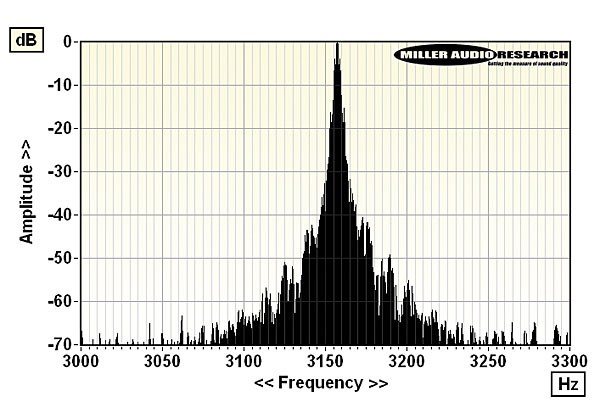
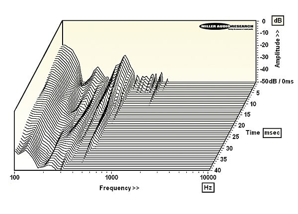

# Thorens TD 148A Turntable Lab Report

> Archived copy, saved 2026-11-18. Original: <https://www.hifinews.com/content/thorens-td-148a-turntable-lab-report>. Site: Hi-Fi News. Published online 2021-05-03; measurements by Paul Miller. Rights remain with the author and the original site.

Unlike the semi-automatic TD 1601 [ HFN Nov '20] which employs a synchronous AC motor, the fully-auto TD 148A uses a DC motor system that, bucking the trend for such solutions, suffers minimal low-rate speed drift while closely matching its AC-driven cousin with its impressively low wow and flutter – just 0.05% (peak-wtd). Higher frequency flutter components only amount to 0.03%, coinciding with the 20Hz/40Hz clusters seen on the rumble and W&F spectra [see Graph 1, below] but these and other modes between 80-120Hz and 140-170Hz push up the bearing rumble to a below-average –57.0dB (DIN-B wtd, re. 1kHz/5cm/sec). Fortunately this figure improves substantially to –65.6dB (through groove). I would endorse the supplied felt mat, but not advise using a clamp or LP weight with this deck.

The partnering TP95 tonearm is an evolution of the TP92 first fitted to the Perpetuum Ebner PE 4040 turntable [ HFN Sep '17] and then upgraded in the Thorens TD 1601 [ HFN Nov '20]. Unlike the TP92, the TP95 combines a rear counterweight with spring-loaded downforce, but this under-reads by 30% (so 1g = 0.7g in practice). The cold-drawn alloy tube still has a rubber/alloy ring situated midway along its length by way of controlling resonances, principal of which is the complex beam bending mode at a low 80Hz/105Hz with harmonic/twisting modes at 290Hz and 450Hz [see Graph 2]. The gimbal bearing enjoys low levels of friction (typically ~15mg) and betrays little or no play. The alloy cartridge platform bolted to the end of the light alloy tube increases its effective mass, but 10g remains ideal for the 18-20cu dynamic compliance of the supplied Ortofon 2M Blue, bringing the arm/cartridge resonance in at ~9Hz.

*Wow and flutter re. 3150Hz tone at 5cm/sec (plotted ±150Hz, 5Hz per minor division)*

*Cumulative tonearm resonant decay spectrum, illustrating various bearing, pillar and 'tube' vibration modes spanning 100Hz-10kHz over 40msec*

**Hi-Fi News measured specifications**

| Item | Result |
| --- | --- |
| Turntable speed error at 33.33rpm | 33.42rpm (+0.26%) |
| Time to audible stabilisation | 2-3sec |
| Peak Wow/Flutter (Peak wtd) | 0.02% / 0.03% |
| Rumble (silent groove, DIN B wtd) | –65.6dB |
| Rumble (through bearing, DIN B wtd) | –57.0dB |
| Hum & Noise (unwtd, rel. to 5cm/sec) | –54.4dB |
| Power Consumption | 2W (1W standby) |
| Dimensions (WHD) / Weight | 430x140x370mm / 7.9kg |
| Price | £1500 |

**Company info**

Thorens GmbH  
Bergisch Gladbach, Germany  
Supplied by: Signature Audio Systems  
07738 007776  
www.thorens.com
