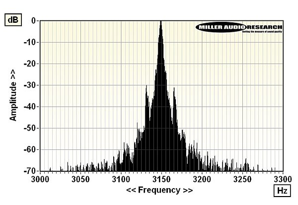
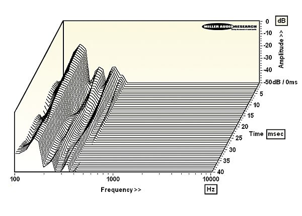

# Thorens TD 1500 Turntable Lab Report

> Archived copy, saved 2026-11-18. Original: <https://www.hifinews.com/content/thorens-td-1500-turntable-lab-report>. Site: Hi-Fi News. Published online 2022-04-14; measurements by Paul Miller. Rights remain with the author and the original site.

While the TD 1500's 1.4kg die-cast alloy platter is belt-driven, the speed of the motor and pulley is governed by what Thorens describes as an 'incremental encoder'. This clearly results in a very fine absolute speed accuracy of –0.03% and also a very low wow of just 0.02% (peak wtd) although there is a clear flutter component at ±17Hz visible on the W&F spectrum [see Graph 1, below], possibly linked to the aforementioned 'increment'. However at a peak-wtd 0.04% these sidebands look worse than their subjective impact. Rumble – measured through the spindle of the sealed bearing assembly – is a usefully low –67.1dB (DIN-B wtd) but the isolation of the platter from this central shaft, and the added damping afforded by the heavy rubber mat, yields a far lower through-groove rumble of just –70.2dB. These figures are all illustrative of good performance, and fully commensurate with a £2k deck, let alone one that includes an arm and pick-up.

The rear counterweight on the dynamically-balanced TP 150 tonearm is very accurately calibrated to within ~3% over a 0-2g range (1g = 1.05g; 2g = 2.07g downforce) and while its design is based on the TP 124 [ HFN Jul '21] its effective mass is reduced to 14g here, enhancing its compatibility with the supplied 7g/23cu Ortofon 2M Bronze pick-up. The substantial encapsulated cardan bearing enjoys low levels of friction (typically ~10mg) and betrays little or no play. Also, resonances within the arm itself are not as complex as we might see with a full S-shaped tube [ HFN Sep '18] just as, being lighter/stiffer than the TP 124, the TP 150 has its primary modes deferred to higher frequency at 160Hz, 235Hz and 345Hz. Mid/treble-frequency resonances are better attenuated too [see CSD waterfall, Graph 2].

*Wow and flutter re. 3150Hz tone at 5cm/sec (plotted ±150Hz, 5Hz per minor division)*

*Cumulative tonearm resonant decay spectrum, illustrating various bearing, pillar and 'tube' vibration modes spanning 100Hz-10kHz over 40msec*

**Hi-Fi News measured specifications**

| Item | Result |
| --- | --- |
| Turntable speed error at 33.33rpm | 33.32rpm (–0.03%) |
| Time to audible stabilisation | 3-4sec |
| Peak Wow/Flutter (Peak wtd) | 0.02% / 0.04% |
| Rumble (silent groove, DIN B wtd) | –70.2dB |
| Rumble (through bearing, DIN B wtd) | –67.1dB |
| Hum & Noise (unwtd, rel. to 5cm/sec) | –58.3dB |
| Power Consumption | 2W (1W standby) |
| Dimensions (WHD) / Weight | 420x150x360mm / 7.9kg |
| Price | £1999 |

**Company info**

Thorens GmbH  
Bergisch Gladbach, Germany  
Supplied by: Signature Audio Systems  
07738 007776  
www.thorens.com
