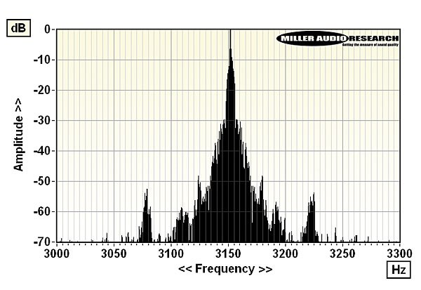
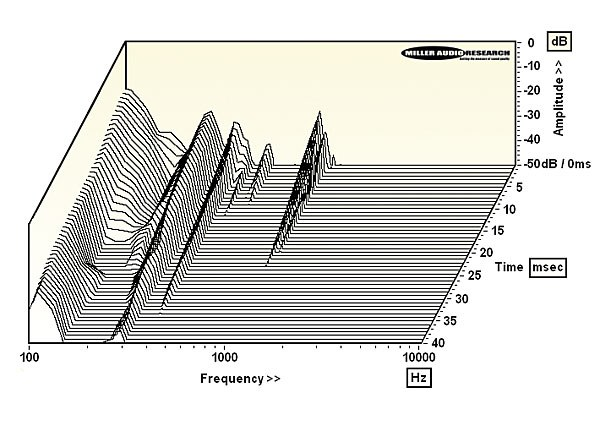

# Thorens TD 1601 Turntable Lab Report

> Archived copy, saved 2026-11-18. Original: <https://www.hifinews.com/content/thorens-td-1601-turntable-lab-report>. Site: Hi-Fi News. Published online 2020-12-03; measurements by Paul Miller. Rights remain with the author and the original site.

Measured directly through its captive, hardened steel bearing, rumble is just a little higher than average at –65.5dB (DIN-B wtd, re. 1kHz/5cm/sec) thanks to clusters of resonant modes at ~70Hz and ~30Hz. However, this figure improves substantially to –67.7dB (through groove) with the default rubber mat in place and to a slightly less effective –66.3dB with the lower mass suede option. However, the isolated synchronous AC motor is the TD 1601's key strength, for even if the 33.33/45rpm trimpots are rather coarse in operation, the deck's low frequency speed stability is exceptional – peak wow is just 0.02% [see Graph 1]. Higher frequency flutter components amount to 0.06% – coinciding exactly with the 30Hz/70Hz clusters seen on the rumble spectrum.

We first saw the partnering 9.1in TP92 tonearm fitted to the Perpetuum Ebner PE 4040 turntable [ HFN Sep '17] since when the counterweight has been improved with a 'dial-up' tracking force ring – this under-reads by 10% (so 1g =1.1g in practice). The cold-drawn alloy tube has a rubber/alloy ring situated midway along its length by way of controlling resonances, principal of which is the main beam bending mode at a low 95Hz with harmonic/twisting modes at 270Hz and 380Hz [see Graph 2]. These modes are similar to those recorded for the Thorens TP17 [ HFN Jun '13], though appear better damped in the TP92. The gimbal bearing enjoys low levels of friction (typically ~15mg) and betrays little or no play. The alloy cartridge platform bolted to the end of the light alloy tube increases its effective mass, but 10-11g remains ideal for the 18-20cu dynamic compliance of the new TAS 1600 MC cartridge.

*Wow and flutter re. 3150Hz tone at 5cm/sec (plotted ±150Hz, 5Hz per minor division)*

*Cumulative tonearm resonant decay spectrum, illustrating various bearing, pillar and 'tube' vibration modes spanning 100Hz-10kHz over 40msec*

**Hi-Fi News measured specifications**

| Item | Result |
| --- | --- |
| Turntable speed error at 33.33rpm | 33.35rpm (+0.02%) |
| Time to audible stabilisation | 5-6sec |
| Peak Wow/Flutter (Peak wtd) | 0.02% / 0.06% |
| Rumble (silent groove, DIN B wtd) | –67.7dB (–66.3dB suede mat) |
| Rumble (through bearing, DIN B wtd) | –65.5dB |
| Hum & Noise (unwtd, rel. to 5cm/sec) | –58.5dB |
| Power Consumption | 17W (8W standby) |
| Dimensions (WHD) / Weight | 440x180x370mm / 11kg |
| Price: £3000 |  |

**Company info**

Thorens GmbH  
Bergisch Gladbach, Germany  
Supplied by: Signature Audio Systems  
07738 007776  
www.thorens.com
