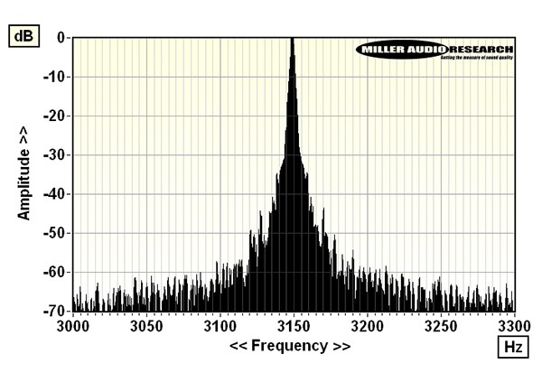
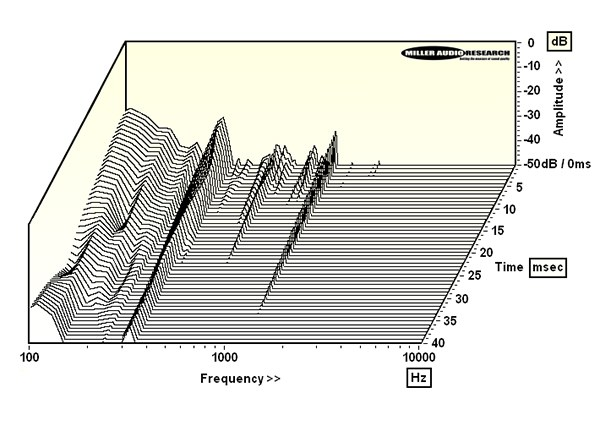

# Thorens TD 404 DD turntable/arm Lab Report

> Archived copy, saved 2026-11-18. Original: <https://www.hifinews.com/content/thorens-td-404-dd-turntablearm-lab-report>. Site: Hi-Fi News. Published online 2026-04-29; measurements by Paul Miller. Rights remain with the author and the original site.

The TD 404 DD’s 12-pole/24V Hall effect motor and radial magnet (attached to the underside of the 3.8kg alloy platter) are derived from the drive solution used in Thorens’ earlier TD 124 DD model [ HFN Jul ’21]. In this implementation the direct, through-spindle, rumble is reduced from –69.2dB to –70.0dB (DIN-B wtd, re. 1kHz/5cm/sec) while the through-groove rumble is a very low –74.5dB. The latter might be further improved, as would resistance to acoustic noise, if the silicone rubber platter pads supported the LP over its entire surface rather than leaving pockets of air beneath. Otherwise the TD 404 DD’s motor has sufficient torque to boast a swift 1-2sec start-up, while the deck’s mechanical brake ensures the platter stops almost instantly. Low-rate speed stability is very good, showing a mere 0.02% peak-wtd wow [see Graph 1, below], but there are discrete sidebands at ±20Hz, ±27Hz and ±33Hz that amount to a modest 0.035% – these all correlate with modes visible on the unweighted rumble spectrum [not shown here].

The rear counterweight on the dynamically balanced TP 160 tonearm is calibrated to within ~5% over a 0-2g range (1g = 1.05g; 2g = 2.1g downforce) and while its tube design is based on earlier J-shaped ‘TPs’ and the auto lift mechanism taken from earlier decks [ HFN Nov ’20], the magnetically stabilised knife-edge bearing and spring-loaded anti-skate are new. Effective mass of 18g is higher, too, which delivers a ~10Hz arm/cartridge resonance with the optional TAS 1600 MC. Otherwise, the arm’s main bending mode is around 120Hz, with lower-Q resonances at 170Hz/230Hz, and a sharper break at 310Hz. We’ve seen the high 1.3kHz mode previously when Thorens’ auto lift has been employed [CSD waterfall, Graph 2].

*Wow and flutter re. 3150Hz tone at 5cm/sec (plotted ±150Hz, 5Hz per minor division)*

*Cumulative tonearm resonant decay spectrum, illustrating various bearing, pillar and ‘tube’ vibration modes spanning 100Hz-10kHz over 40msec*

**Hi-Fi News measured specifications**

| Item | Result |
| --- | --- |
| Turntable speed error at 33.33rpm | 33.32rpm (–0.05%) |
| Time to audible stabilisation | 1-2sec |
| Peak Wow/Flutter | 0.02% / 0.035% |
| Rumble (silent groove, DIN B wtd) | –74.5dB |
| Rumble (through bearing, DIN B wtd) | –70.0dB |
| Hum & Noise (unwtd, rel. to 5cm/sec) | –63.1dB |
| Power Consumption | 4W |
| Dimensions (WHD) / Weight | 450x155x368mm / 12.5kg |

**Company info**

Thorens GmbH  
Bergisch Gladbach, Germany  
Supplied by: Signature Audio Systems, Westerham, UK  
Telephone: 07738 007776  
www.thorens.com
