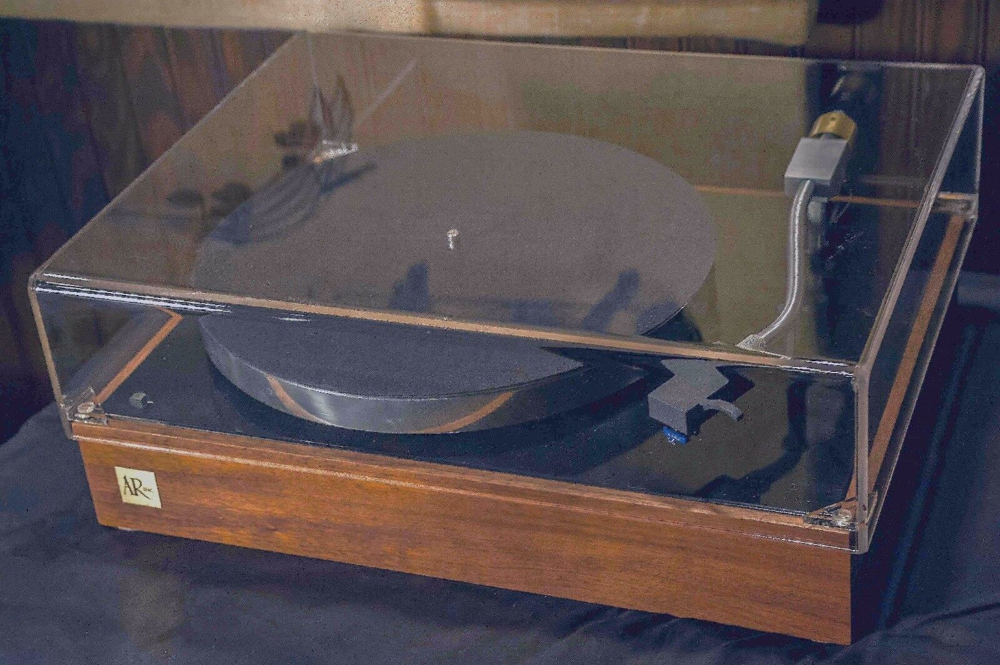
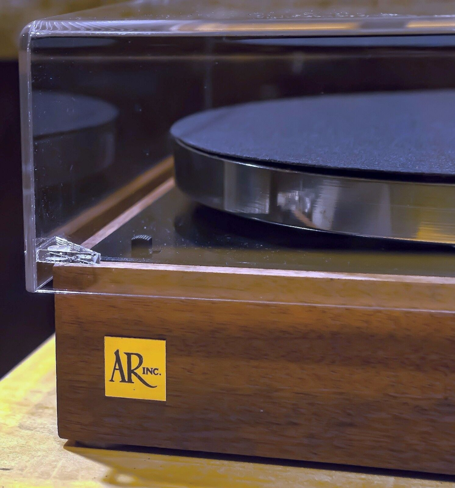
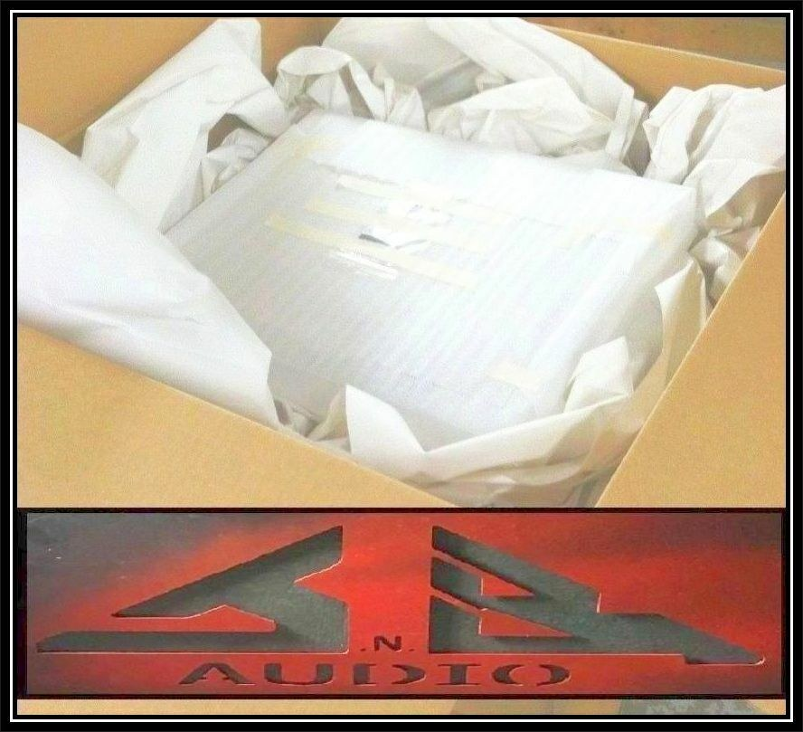

# Acoustic Research AR XA Turntable Dust Cover

> Archived copy, saved 2026-11-18. Original: <https://jnb-audio.com/products/acoustic-research-ar-xa-new-jnb-audio-turntable-dust-cover-pst-made-in-usa>. Site: JnB Audio. Rights remain with the author and the original site.

Price when saved: $168.32

Acoustic Research Dust Cover For the Following Model(s): AR-XA ARXA

Style is plinth set top lock

We have updated this cover from the OEM version and what we feel improves it stylistically and functionally.  
The cover height has been raised for what we feel offers better tone arm clearance. And the cover only sits on the 4 corners of the player when in use and locks it in place.

### Product Includes:

- Replacement Dust Cover
- Replacement Bumpers
- Cleaning & Care Instructions

Stock photo(s): J-n-B Stock Photo

Acrylite Material: 1/8" clear acrylic

