# AR XA Turntable Rebuilding

> Archived copy, saved 2026-11-05. Original: <https://www.johnsweather.com/Turntable1.html>. Site: John's Weather. Rights remain with the author and the original site.

AR XA Turntable Restoration

**August 1, 2009**

**It all started a couple of months ago.   I was
getting back into stereophonic sound and the final thing to get was a
good turntable for my setup. Did a lot of reading online as to what was
the turntable of choice these days.   I didn't want to spend a
fortune on one and it looked like the Technics 1210 M5G for under
$500.00 was the answer.  I bought it and listened to it for a while
but no matter what I did with it, it just didn't have the sound I
remember I use to get with my old AR XA turntable. What happened to that
turntable, I honestly don't remember what I did with!  So sure enough
I went to eBay for the answer.  Low and behold there were a few AR
XA turntables up for auction.  Two days later I won one for
$110.00.  Not to bad considering it sold for a whopping $78.00
brand new back in the seventies. It looked to be in pretty good shape
for a 35 year old piece of equipment. Once I received it I knew I was
going to tear it apart and rebuild it......why?  Because I wanted
it to be a prefect looking and sounding turntable.   There
wasn't a whole lot of work to do because it is a pretty simple
turntable. Below  are a few pictures I took during the rebuilding
process.  I ended up doing a few modifications to make the
turntable look a little better and also some of the original parts are
no longer available.   Now, when the rebuilding process was
complete I hooked her up and gave her a test spin.......how did it
sound?   You find out at the bottom of this little pictorial.
I finished a second AR XA Turntable restoration,
if your interested in seeing it here's the link to it:
[AR XA Turntable Rebuilding](http://johnsweather.com/Turntable.html)**

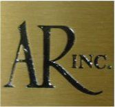

[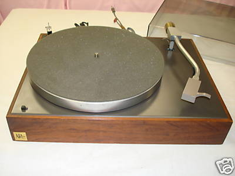](https://www.johnsweather.com/Turntable/5d96_1.JPG)

[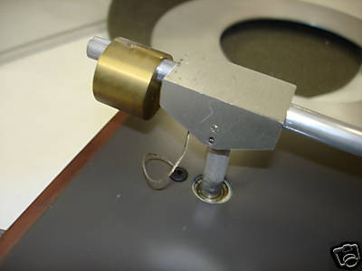](https://www.johnsweather.com/Turntable/62cd_1.JPG)

[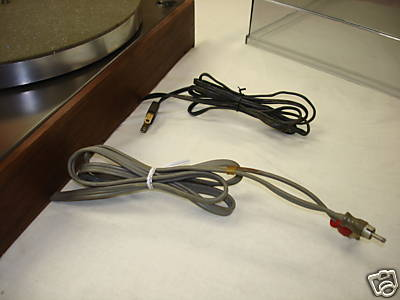](https://www.johnsweather.com/Turntable/616a_1.JPG)

**Here's how the turntable looked
when I received it. As you can see it's in pretty good shape.....but
there's work to be done!**

**Tonearm with original wiring.
I think there was a short in it somewhere. I could only get one channel
to work when I first tried it.**

**Original power cord and audio
connects. Both were looking pretty frail.**

[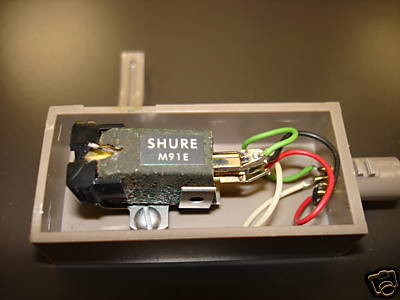](https://www.johnsweather.com/Turntable/6454_1.JPG)

[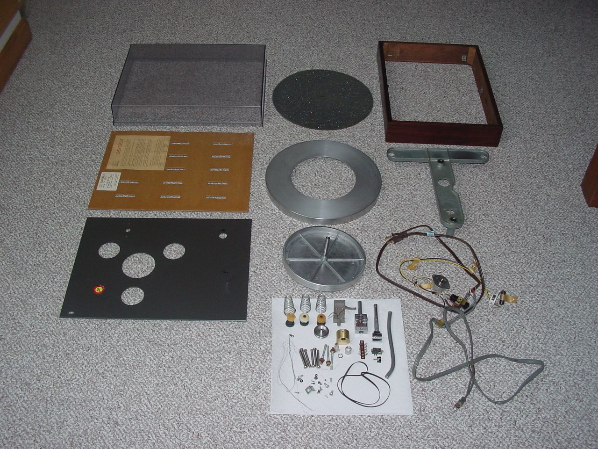](https://www.johnsweather.com/Turntable/DSC00093.JPG)

[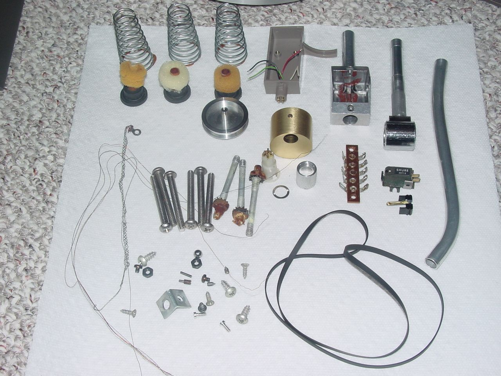](https://www.johnsweather.com/Turntable/DSC00094.JPG)

**Headshell with original Shure 91E
cartridge.  The stylus was shot.**

**Ok, now the work begins. First thing to
do.....rip everything apart and start from scratch.**

**As you can see, there's not a whole lot of parts.**

**Close up of all the hardware and misc
parts.**

[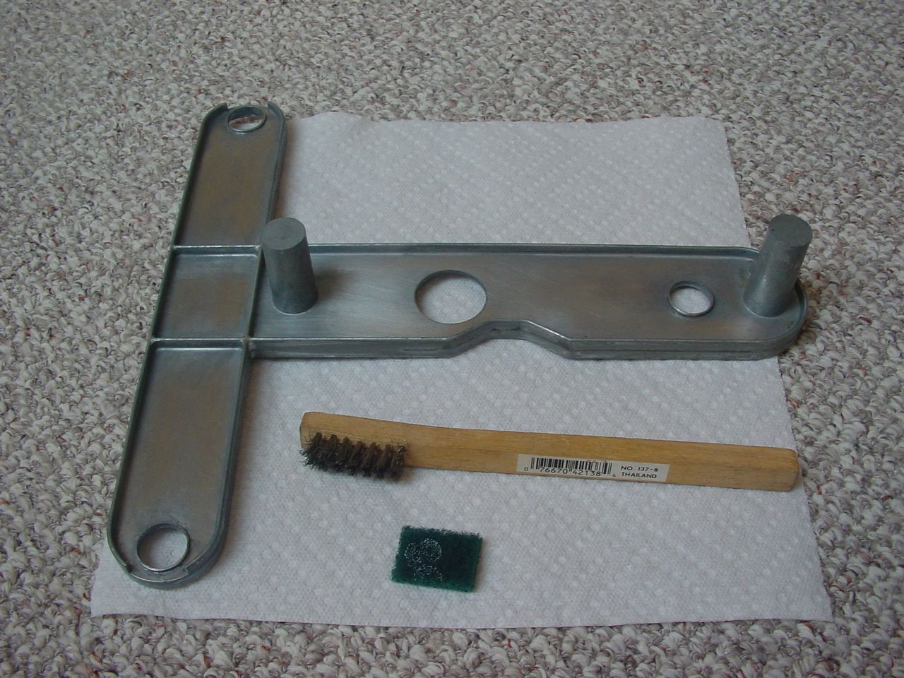](https://www.johnsweather.com/Turntable/DSC00095.JPG)

[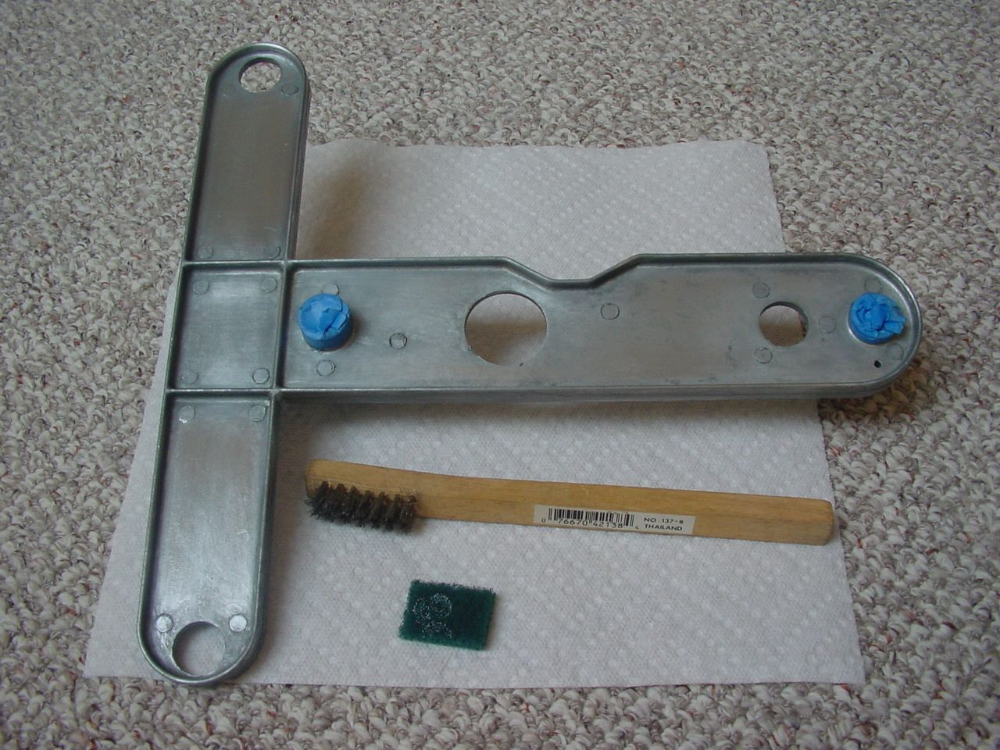](https://www.johnsweather.com/Turntable/DSC00096.JPG)

[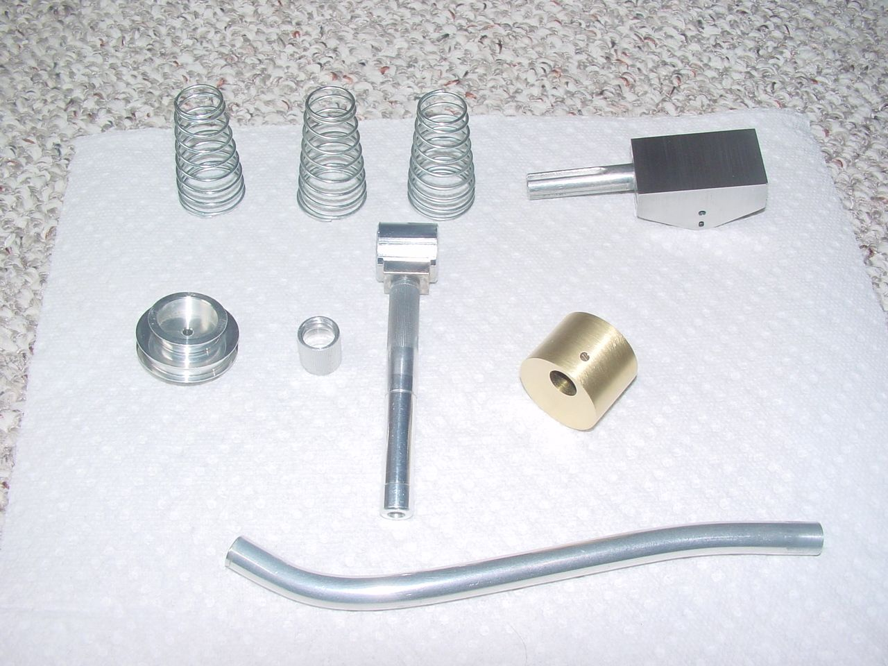](https://www.johnsweather.com/Turntable/DSC00098.JPG)

**The suspension T bar was a little dirty
and a little oxidation had set up. I found using ~1" X 1" Scotch
Brite green pads did a nice job of cleaning it up. The wire brush
helped to get in the corners and clean the crud out.**

**The other side after cleaning.**

**Both bearing wells had been cleaned out
with Isopropyl alcohol. Lot of gunk had built up over the years.
After about twenty cotton swaps and Isopropyl alcohol they were
ready for use again. The painters tape was used to keep any debris
from falling in well cleaning the T bar.**

**The suspend springs had all the old epoxy
removed with a wire disk on the drill press.**

**The brass counter weight was cleaned with Scotch Brite.**

**The rest of the components were cleaned with**
**Isopropyl alcohol and a lot of hand rubbing.**

[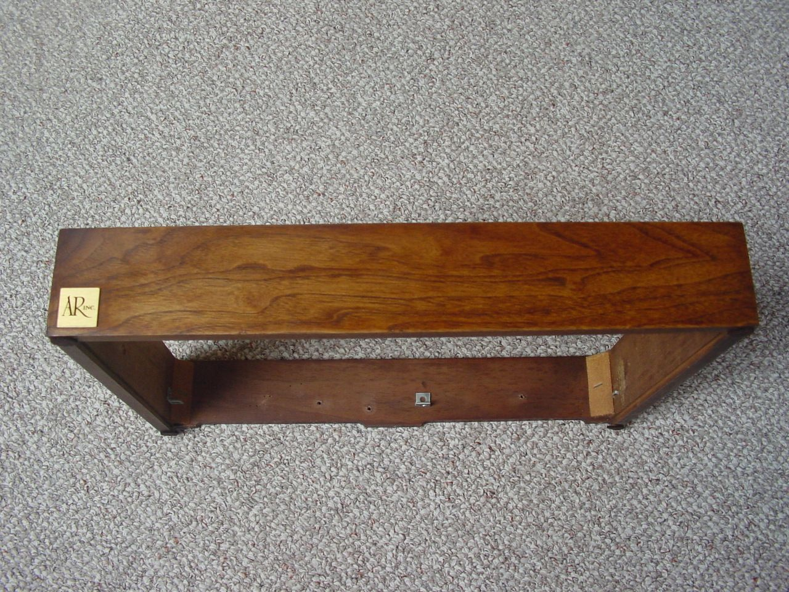](https://www.johnsweather.com/Turntable/DSC00100.JPG)

[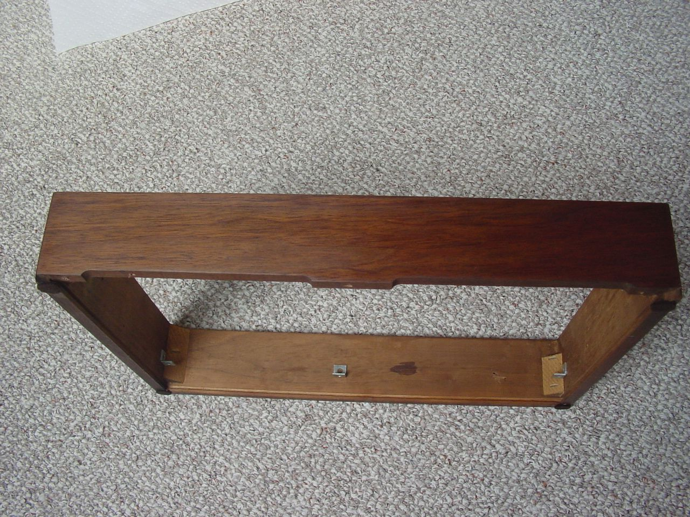](https://www.johnsweather.com/Turntable/DSC00103.JPG)

[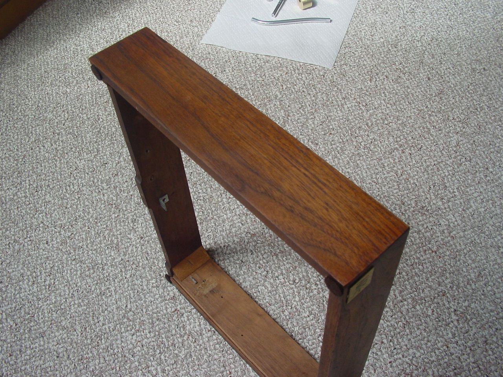](https://www.johnsweather.com/Turntable/DSC00102.JPG)

**The base was in pretty good shape too. All
I had to do was sand it down with some 180 grit sandpaper. Then
apply a coat of satin.  Looked almost brand new after this.**

**The back of the base after refinishing.**

**And the side after refinishing.**

[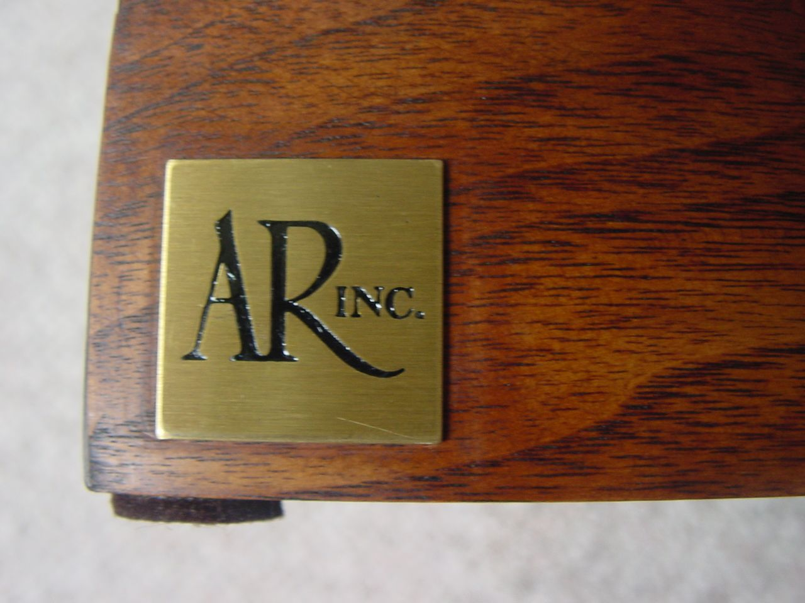](https://www.johnsweather.com/Turntable/DSC00101.JPG)

[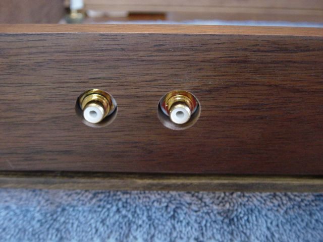](https://www.johnsweather.com/Turntable/DSC00160.JPG)

[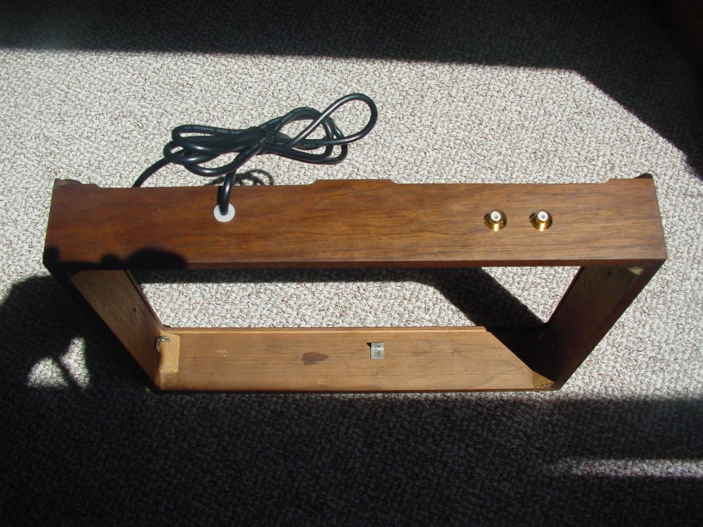](https://www.johnsweather.com/Turntable/DSC00105.JPG)

**Scotch brite to the rescue again Did a
nice job on the logo.**

**I never liked the way the audio cables
were wire directly to the turntable. So I decided to add a couple of
nice RCA connector right into the base.  I don't no why AR
didn't do this in the first place. I think it looks a lot nicer too.**

**I never liked the way the power cord came from between the
base and the flimsy bottom cover. And it was a very cheap cord.
I made a little plastic bushing and press fit in into the base.
Then fed a new power cord through it. Again, much better looking
in my opinion.**

[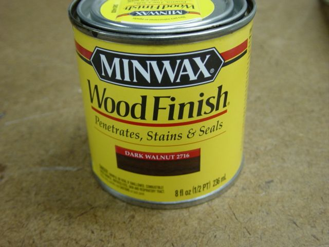](https://www.johnsweather.com/Turntable/wax.JPG)

[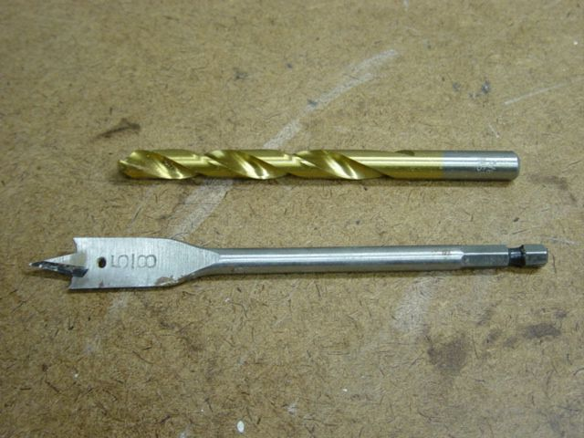](https://www.johnsweather.com/Turntable/drills.JPG)

[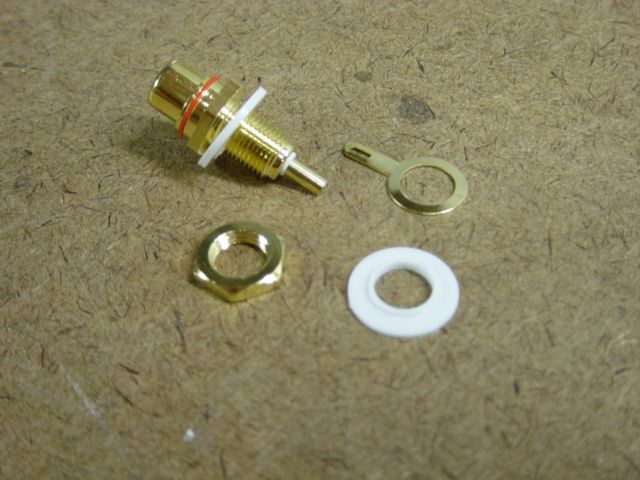](https://www.johnsweather.com/Turntable/jack.JPG)

**This is the Minwax
stain I used to restain the base.
Dark Walnut 2716
I dipped the corner of a paper towel in the stain and wiped it on
the base.  Then took a dry paper towel and wiped all the excess
stain off.**

**These are the
drills used to drill the holes for the RCA jacks. First I used the
5/8" spade drill and drilled about 5/16" deep.  Be careful not
to drill all the way through the base.
Then used a 3/8" drill and drilled through the center of the first
hole all the way through the base.**

**Picture of the RCA
jacks I used.  If you notice the plastic washer has a small
shoulder on it. The diameter of the shoulder is 3/8". This helps to keep the
jack centered in the 3/8" dia. hole drilled through the base.
I bought the jacks here
[RCA JACKS](http://www.parts-express.com/pe/showdetl.cfm?Partnumber=091-1120)**

[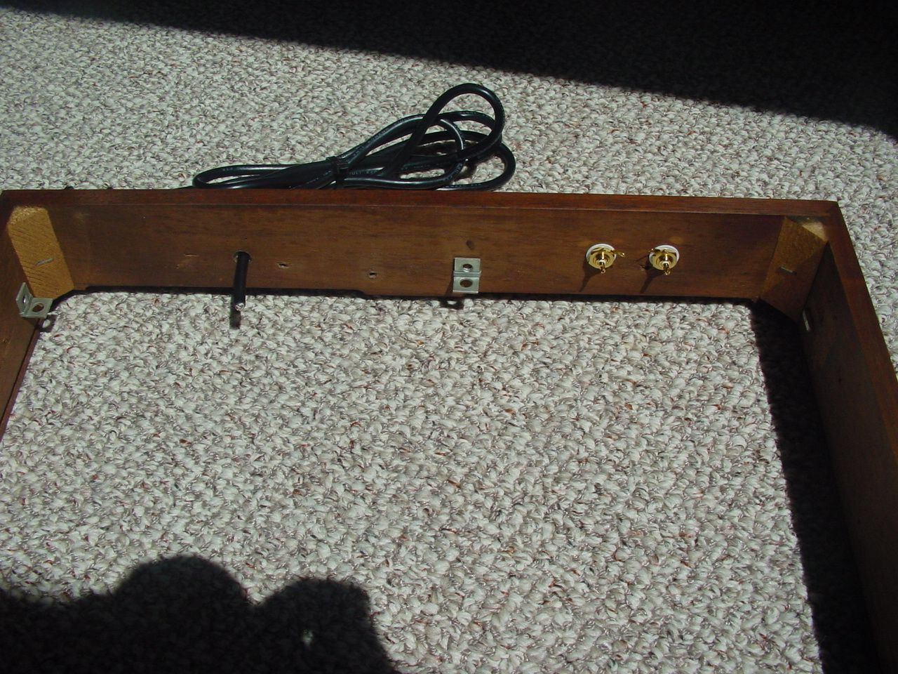](https://www.johnsweather.com/Turntable/DSC00107.JPG)

[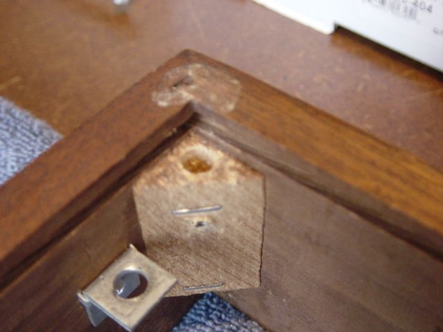](https://www.johnsweather.com/Turntable/DSC00154.JPG)

[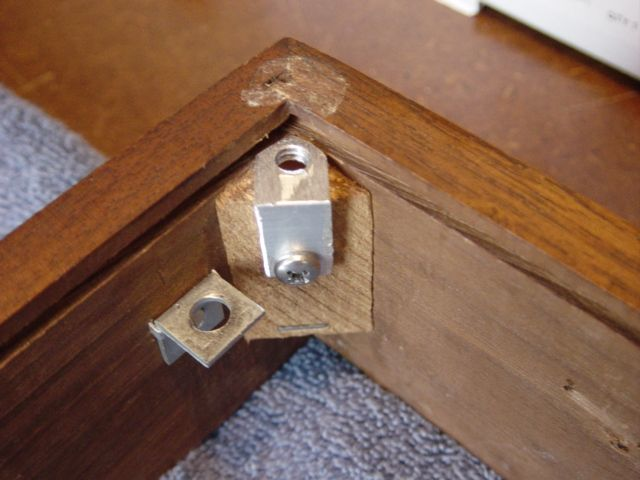](https://www.johnsweather.com/Turntable/DSC00153.JPG)

**A picture of how the connectors and cord
look from the inside of the base.**

**Next, I had to get rid of the cheapo
little felt pads AR used for feet.**

**I had some brass spikes laying around and figured they would
look nice for feet.(I'm not going to get into the improvement of
sonic quality they made....if any!)**

**First I drilled a hole about 3/4" deep in each of the 4
corner braces. The hole was just a little bigger than the diameter
of the threaded stud on the spikes.**

**Then I took a piece of aluminum angle iron and cut four
piece about 1/2" wide.
Drilled and tapped a 1/4" X 20 thread.
Also drilled a small hole for a screw that would screw into the
corner brace.
Had to grind off the corners of the angle iron so it would fit
in place.  You will see what I  mean by clicking on
the picture for a larger view.**

[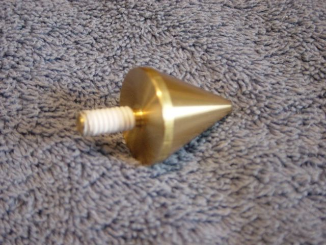](https://www.johnsweather.com/Turntable/DSC00159.JPG)

[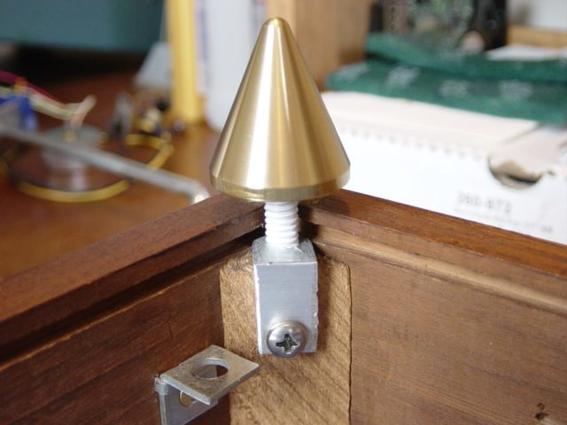](https://www.johnsweather.com/Turntable/DSC00157.JPG)

[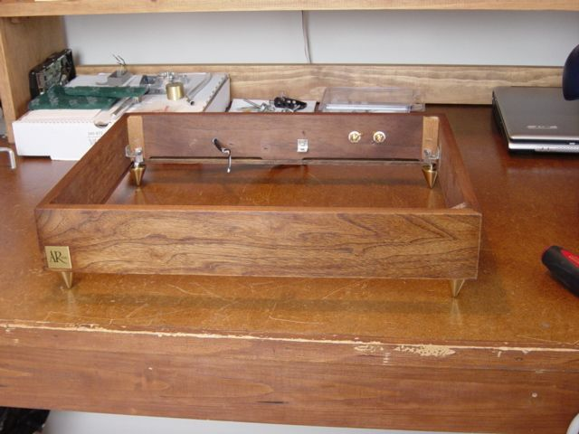](https://www.johnsweather.com/Turntable/DSC00161.JPG)

**Wrapped some Teflon tape around the
threaded stud to give it a firm grip in the threaded hole.**

**Screwing the spike into the angle iron.**

**All four spikes in place.  I think it
looks pretty nice with the spikes!**

[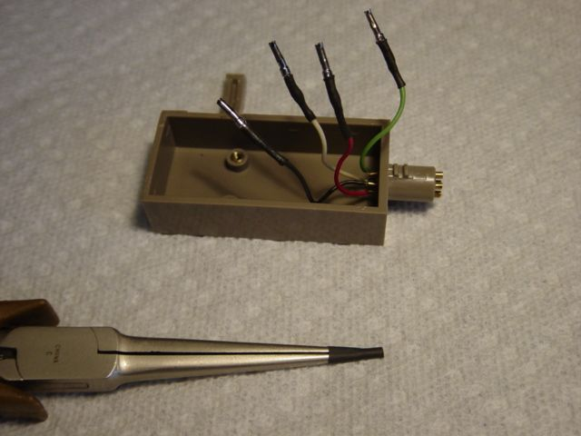](https://www.johnsweather.com/Turntable/DSC00167.JPG)

[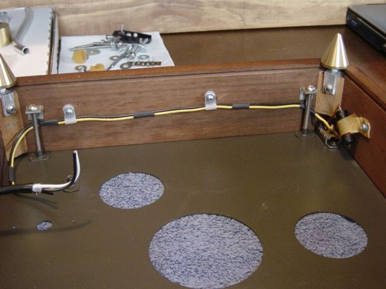](https://www.johnsweather.com/Turntable/DSC00170.JPG)

[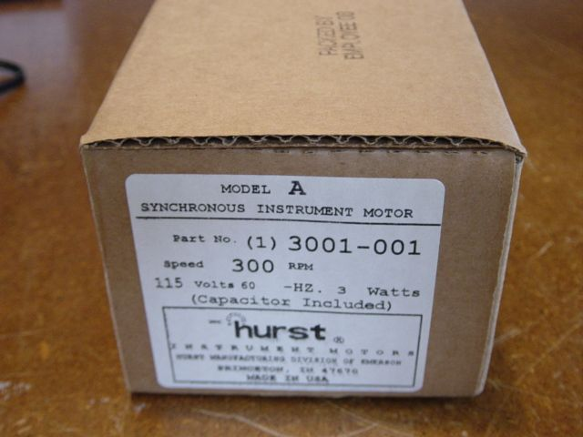](https://www.johnsweather.com/Turntable/DSC00173.JPG)

**Oh yes, the headshell!
While removing the old cartridge I noticed the little brass insert were
loose......boy what a surprise that was!
So I pulled them out and turned them upside down so the knurled edge was
facing down. Pushed them back in very gently.**  **Nice and secure now.
I replaced the old clips with new Cardas clips. Because these clips are
longer than the old stock clips I put a little piece of heat shrink
tubing on each one. 1/16" tubing was just a little to small to fit over
the clip so I used one of my old tricks....took a small pair of needle
nose pliers and stretched it just a little. Worked like a charm.**

**Rewiring of the ON/OFF
switch.  Got rid of the old stapled  tape holding the wires
and replaced with small cable clips.**

**The old motor had
way to much wobble in the spindle, so I decided it had to be replaced.
From reading on other forums it appeared that the Hurst motor 3001-001
was the best substitute. It was about $65.00.**

[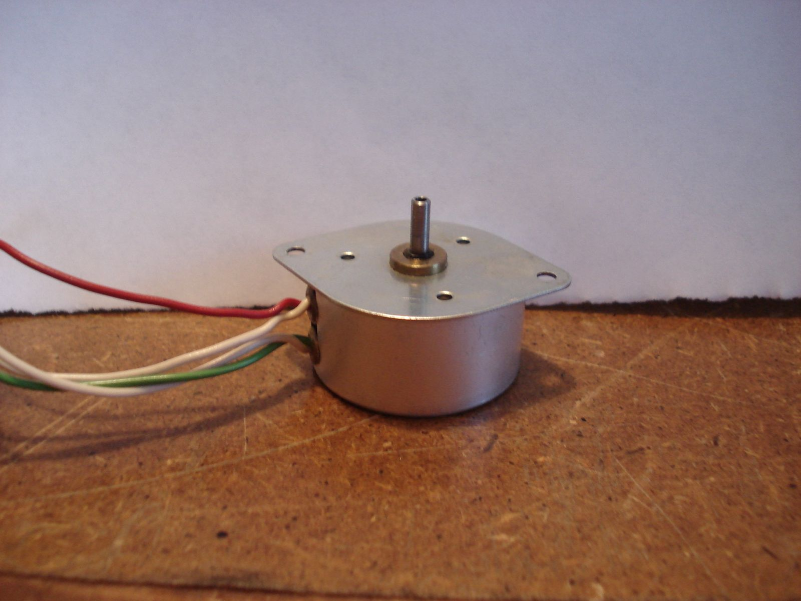](https://www.johnsweather.com/Turntable/old%20motor.JPG)

[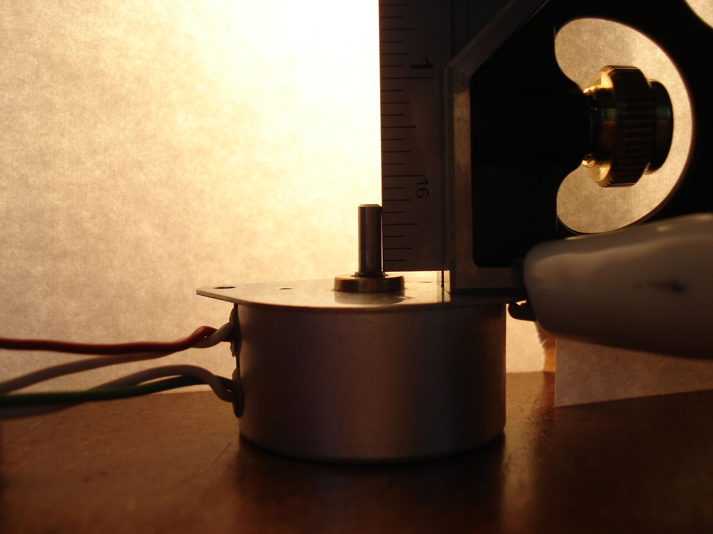](https://www.johnsweather.com/Turntable/wooble.JPG)

[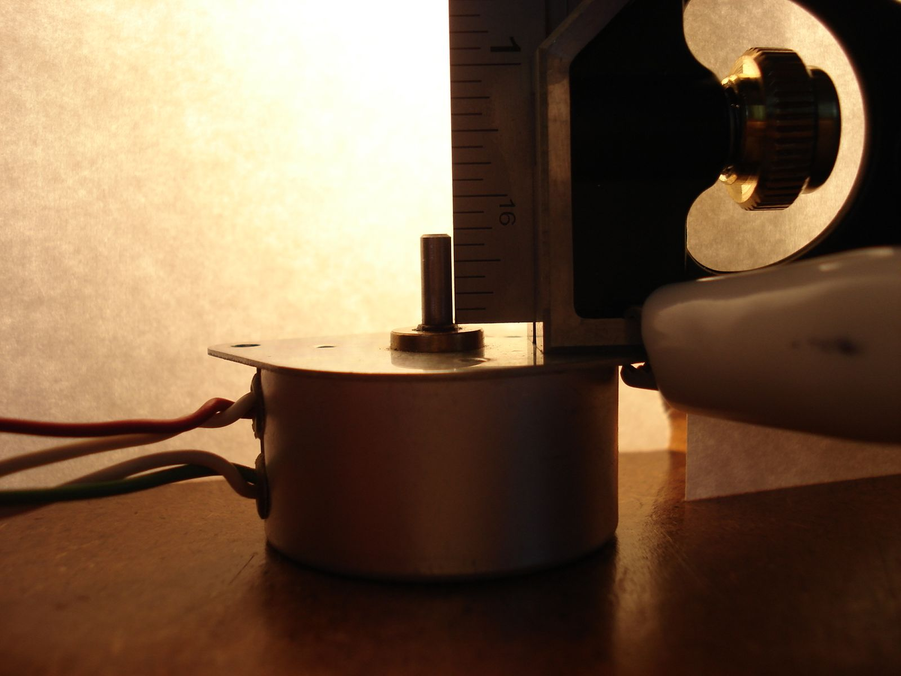](https://www.johnsweather.com/Turntable/wooble1.jpg)

**I guess I should explain
what I mean about wobble in the spindle.
Here's a picture of the original motor......looks ok, right?
Well look at the next two pictures...**

**Here's a picture with a
Machinist's Square attached to the
motor showing a little gap between the bottom of the spindle and the
Machinist's square....still not too bad.......**

**Without moving the
Machinist's Square I moved the spindle away from the square......notice
any difference in the gap now??????  You can't drive your car
through it but it's pretty ugly looking!

That's what I mean about spindle wobble.   And I didn't want a
turntable spinning my vinyl with a wobbly drive system....  I guess
it would be like drive your car with real bad front alignment and
everything shakes while your driving.

So out with the old and in with the new.......**

[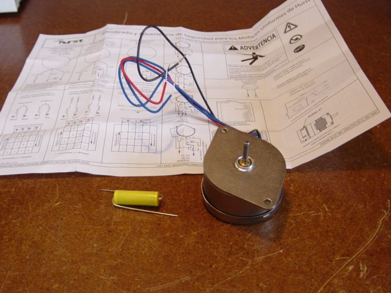](https://www.johnsweather.com/Turntable/DSC00174.JPG)

[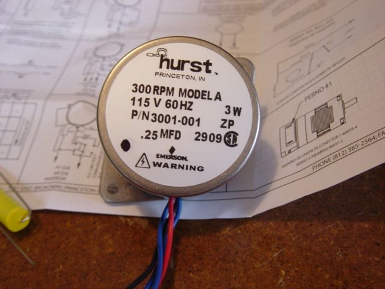](https://www.johnsweather.com/Turntable/DSC00176.JPG)

[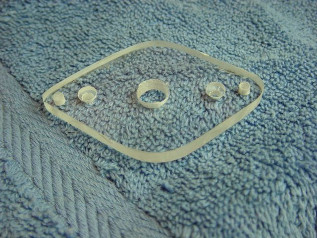](https://www.johnsweather.com/Turntable/DSC00177.JPG)

**This is the Hurst
3001-001 motor.  The mounting  flange is larger than the
original motor and the shaft is about .250" longer.
It come with the capacitor.**

**Picture of the back side
of the motor.**

**To mount the new motor without having to
drill and tap new holes in the plinth  an adapter had to be
fabricated. I took a piece of 1/4" thick Plexiglas, hand cut and sanded
the basic shape of the Hurst motor flange.
Next was to drill a 3/8" diameter  hole through the center of it.
Then placing the old motor on the adapter I drilled the holes that would
line up with the holes in the surface plate. The holes where countersunk
so the screws would seat below the adapter surface.
Finally the new motor was placed on the adapter and the motor mounting
holes were drilled and tapped. The screws used were 4 X 40.**

[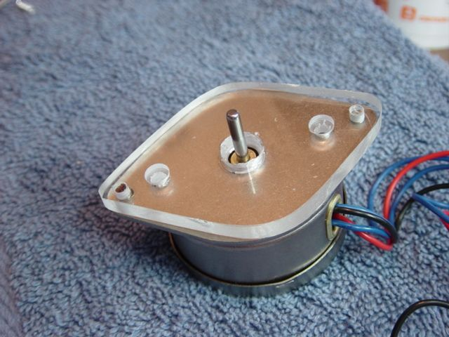](https://www.johnsweather.com/Turntable/DSC00180.JPG)

[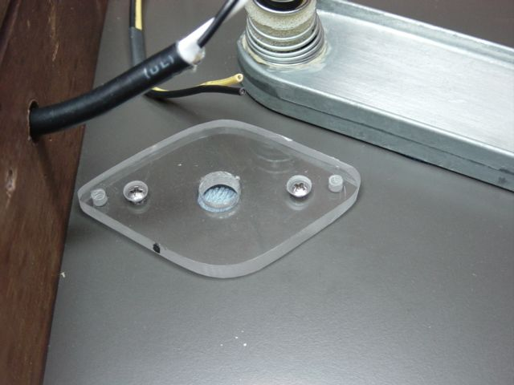](https://www.johnsweather.com/Turntable/DSC00181.JPG)

[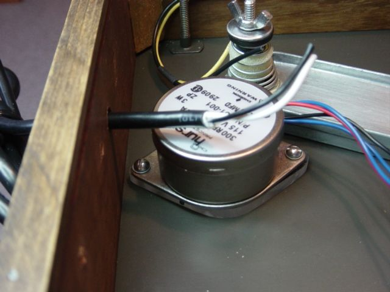](https://www.johnsweather.com/Turntable/DSC00183.JPG)

**This is
how the adapter looks on the new motor. The screws holding the motor to
the adapter had to be cut to 1/4" length.   Same as the
adapter thickness.**

**Next the
adapter is mounted to the plinth. These screws were cut to length
so they would not protrude above the plinth surface. Wanted it to
look as original as possible.**

**Finally
the motor is mounted to the adapter.**

[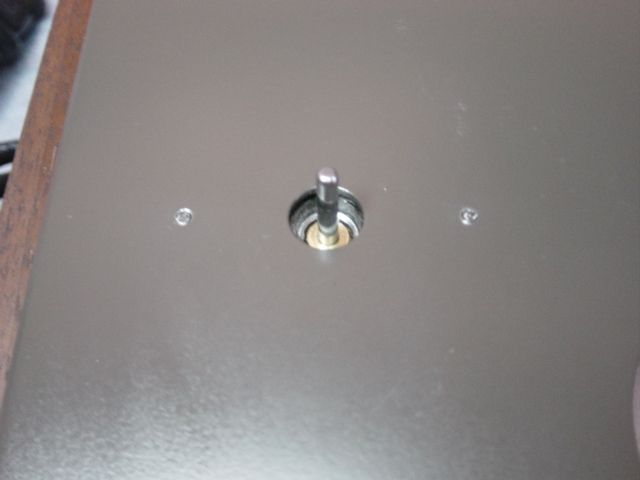](https://www.johnsweather.com/Turntable/DSC00187.JPG)

[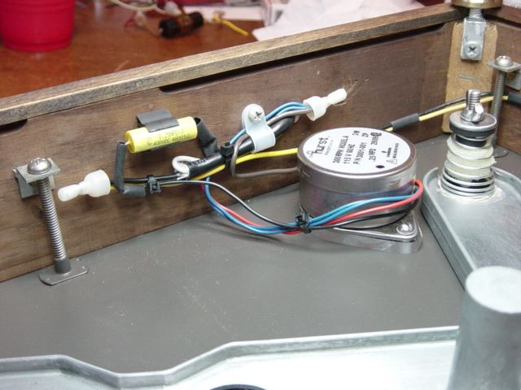](https://www.johnsweather.com/Turntable/DSC00190.JPG)

[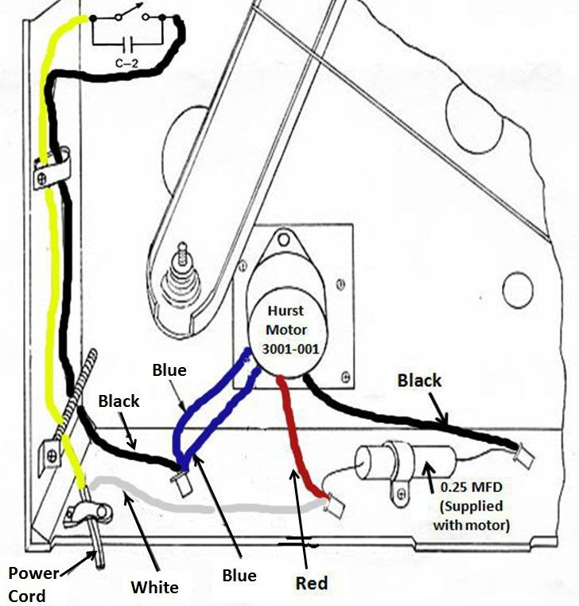](https://www.johnsweather.com/Turntable/motorwiring.jpg)

**This how the new motor
looks for the top.**

**All the wiring is hooked
up.  The wires coming out of the motor aren't as close to the T bar
as they look in the picture.**

**A few people have
emailed about the motor wiring. Here's a rough drawing of the wiring for
the new motor. It's pretty straight forward.**

[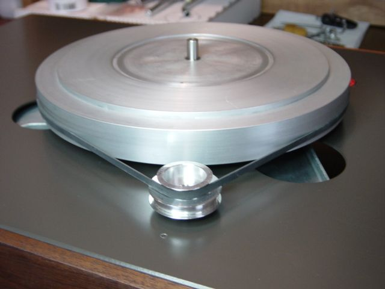](https://www.johnsweather.com/Turntable/DSC00188.JPG)

**This picture was taken
after the turntable was completed....the outer platter was removed after
running for a few minutes to check belt alignment.  A little minor
adjustment to the pulley and everything looks good!**

**New picture coming soon**

**New picture coming
soon.**

[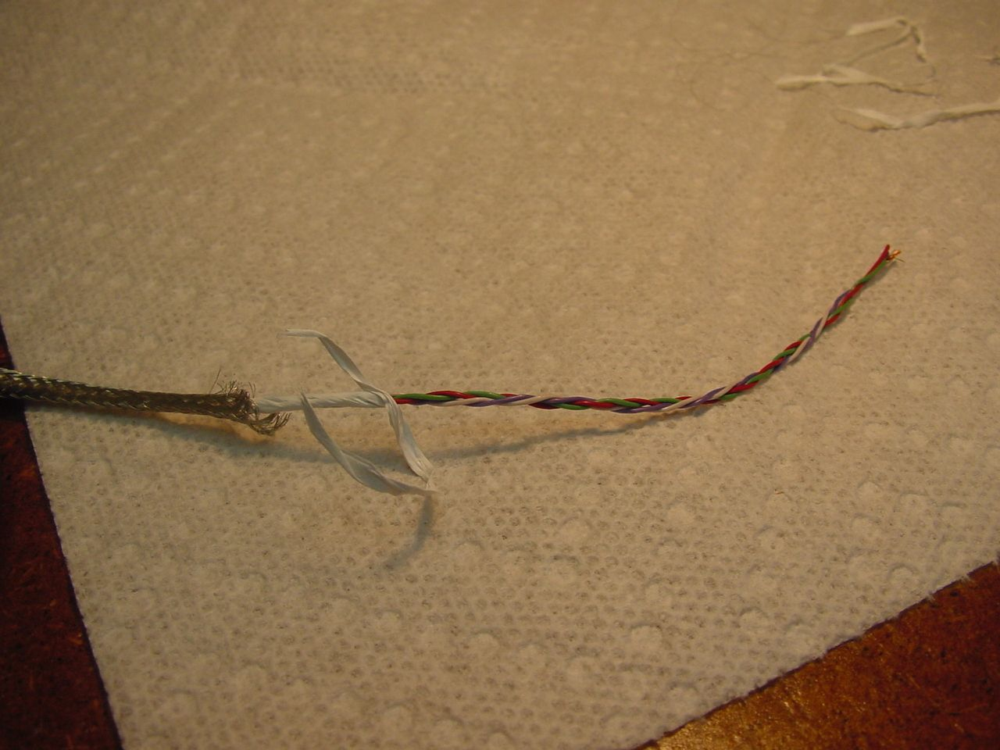](https://www.johnsweather.com/Turntable/DSC00040.JPG)

[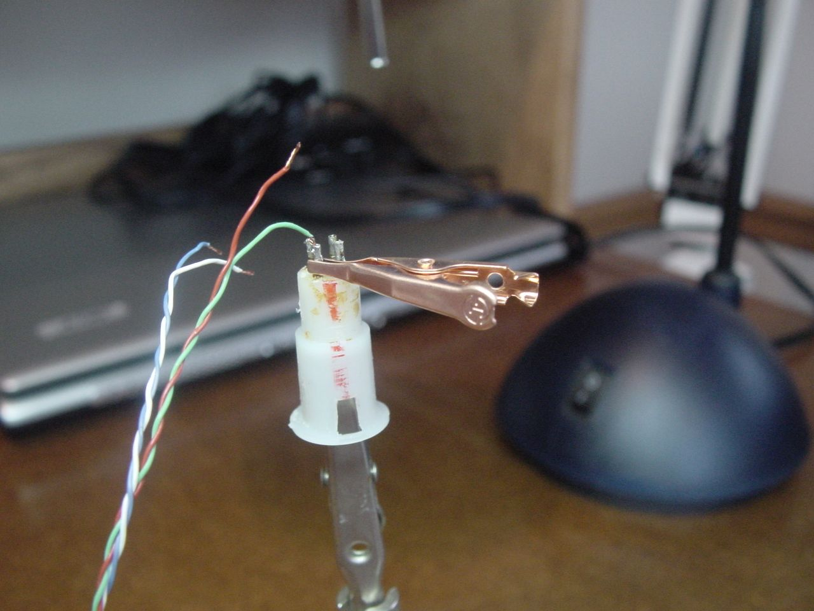](https://www.johnsweather.com/Turntable/DSC00041.JPG)

[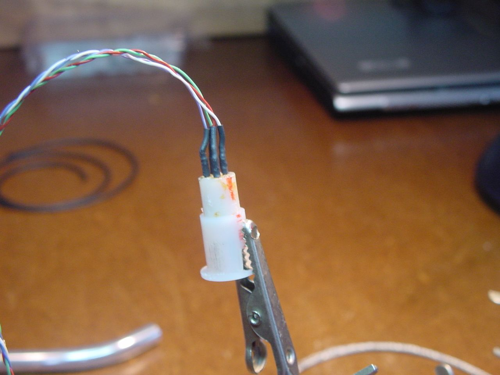](https://www.johnsweather.com/Turntable/DSC00044.JPG)

**Next is tonearm
rewiring.  I bought two feet of Cardas 4 X 33 shielded cable.
As soon as I received the cable I realized the outer jacket and braided
shielding had to come off. It was way to heavy for this tonearm.
Carefully I removed both.**

**Removing the plastic
insert from the tonearm was a real pain. There's excellent DIY
instructions on Vinyl Nirvana by Scott Hamrick on how to do this. No
sense rewriting how to do it....here's the link.****[tonearm rewiring](http://www.vinylnirvana.com/rewiring-an-ar-xa-tonearm/)**

**I used some little flat alligator clips to help prevent the heat
from soldering melting the plastic insert.   You may or may
not find this helpful....
What I found worked best to solder these tiny little wires was to have a
very hot soldering iron. My soldering station lets me control the
temperature of the soldering iron and about
350 ºC worked very well.**

**Here's the finished
result. The heat shrink tubing was to make sure none of the wires short
out with each other.

Reinserting the plastic insert is also described  how to do it in
the link I provided in the picture to the left of this one.

Make sure you place the knurled collar and washer on the tonearm before
pushing the wires through. Also write down what color wire goes to what
pin.on the plastic insert.**

[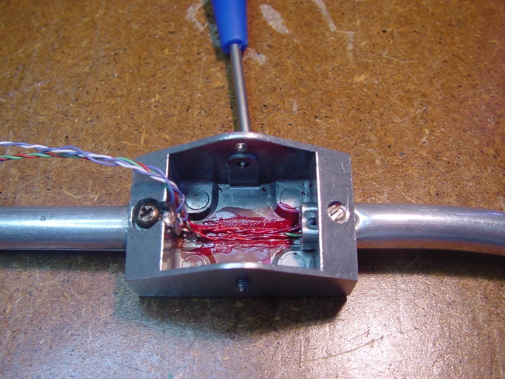](https://www.johnsweather.com/Turntable/DSC00048.JPG)

[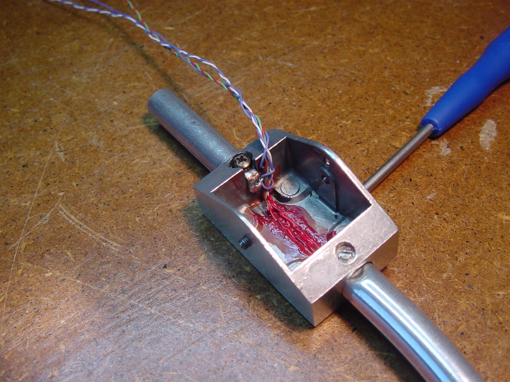](https://www.johnsweather.com/Turntable/DSC00050.JPG)

[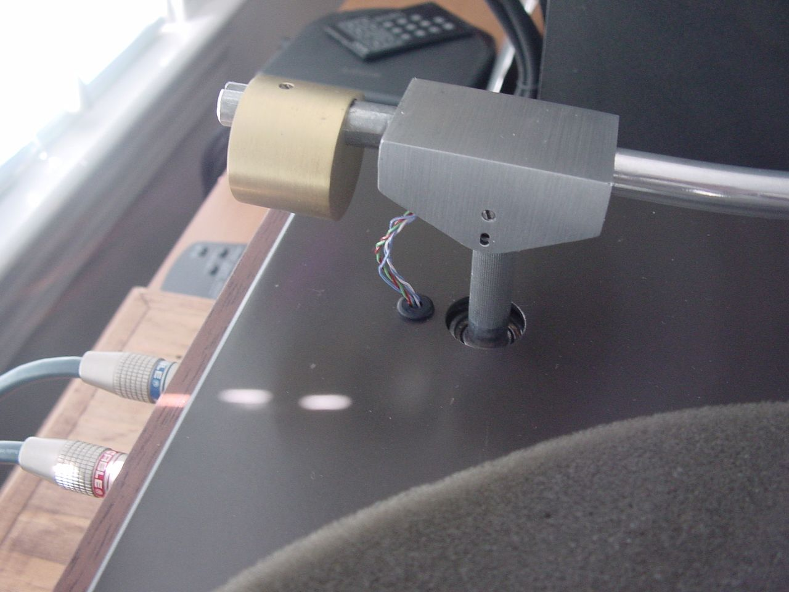](https://www.johnsweather.com/Turntable/wires4.JPG)

**The tonearm was then
reassembled and the wires were positioned in the little channel and nail
polish was used to hold them in place.  I used bright red nail
polish because that's all a lady friend let me borrow....I wasn't about
to go out and buy nail polish...I don't need those kind of looks**
**from the women at the cash resigter!**

**Also there's a little
eyelet that was screwed in place that was used for the grounding wire. I
took some of the extra Cardas wire and used that for the grounding. And
as you can see in the picture I wrapped it around the other wires to
help hold them in place.**

**I won't get into
reassembling the rest of the tonearm and putting it back in
place because I think its' pretty obvious.
Here's how it looks when finished.

Here's the fun part... install your cartridge without the stylus,(if you
can't remove the stylus be VERY careful with the next step)
Balance the tonearm so it's parallel with the platter. Then slowly move
it side by side. If the arm seems to move back to the same position each
time when you let go you'll have to play with the wires between the arm
and the plinth.  You might have to pull them out a little or push
them in little.  Or even move them side to side.
If you take your time you'll get it so the tonearm stays where you left
it.
patience.... patience....patience!**

[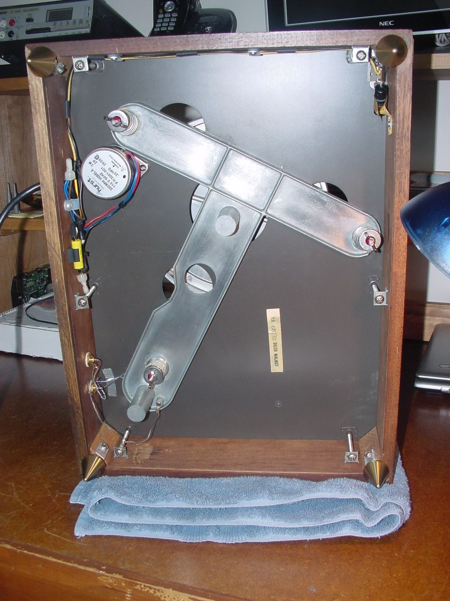](https://www.johnsweather.com/Turntable/under1.JPG)

[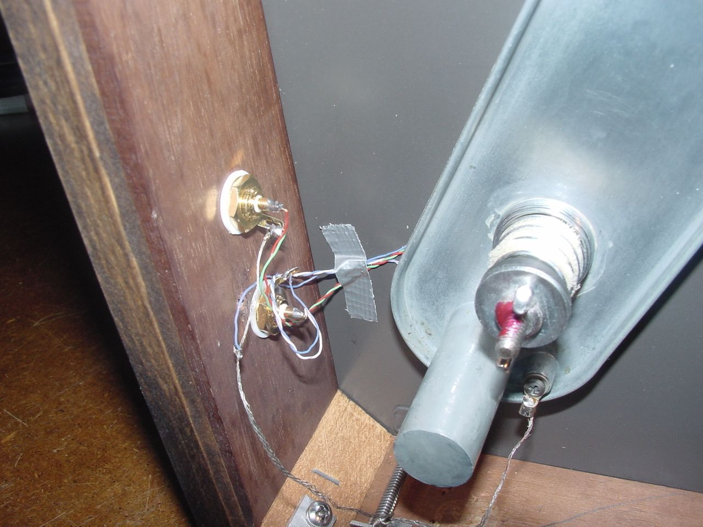](https://www.johnsweather.com/Turntable/wires3.JPG)

[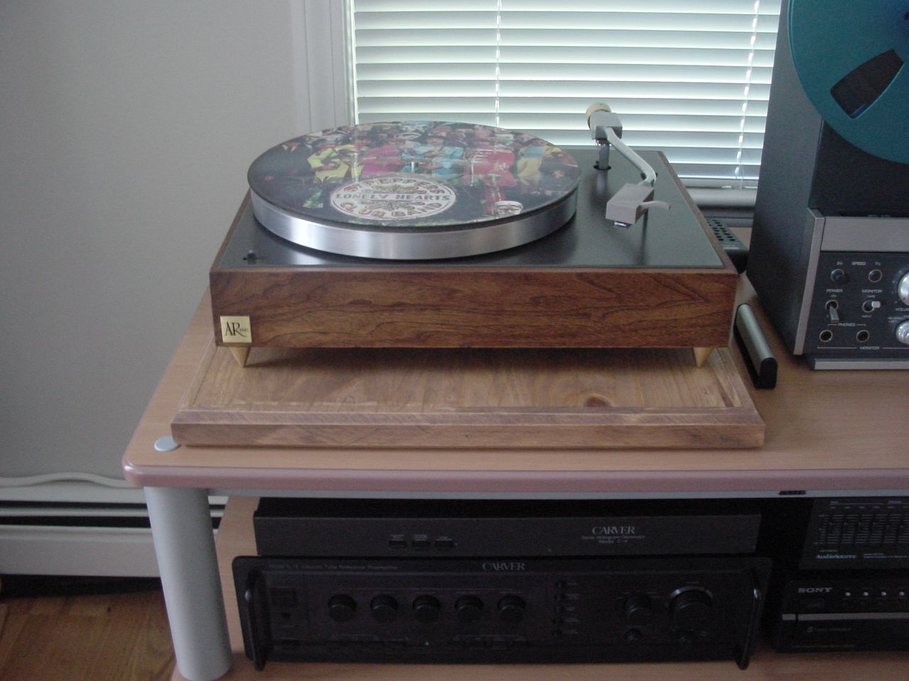](https://www.johnsweather.com/Turntable/DSC00055.JPG)

**Everything back in
place. Again, the T bar doesn't hit the motor or wires. With the
turntable on it's side the T bar is not in it's proper position.**

**This shows the tonearm
wires soldered to the RCA Jacks. And some duct tape holding them in
place.
I also replaced the aluminum thread studs that hold the T bar with 2" 10
X 32 Stainless Steel screws cut to length. Also bought some washers that
seat against the rubber bushing. And used Stainless Steel wing nuts.
Makes it much easier to make the suspension adjustments. Once I made the
final suspension adjustments I used the Red nail polish to lock them in
place.**

**Ok, almost
done!  I think it came out pretty good. Looks almost
original..... got a little ahead of myself here. There's much more to do
before we get to this part...read on.**

**I think this part is
important for real improvement on this turntable.
(The picture above is from the AR Turntable manual)
The spindle that screws into the tonearm originally had a little foam
washer and a plastic washer on the top. If you don't see the little foam
washer, don't worry about it. It  probably disintegrated about
the time Lewinsky was.....well you know!  This was
the tonearm damping system. These washers rested against the brass pivot
bearing in the tonearm assembly. As the tonearm was lifted up then
lowered on to the record these washers would rub against the brass pivot
bearing slowing down how quickly the tonearm would descend. And if by
accident you dropped the tonearm it wouldn't come crashing down and
possibly damag your stylus!
From what I've read it's best to remove these washers and don't worry
about having a damping system.
  Besides we're all very careful with our turntables and never drop the
tonearm anyway......right???**

**First I'd like to thank
"MuZak" over at
[vinylengine](http://www.vinylengine.com/phpBB2/viewforum.php?f=34&sid=be0e565d9ade363391b52b3426525025) web site for allowing me to use the above picture. I
totally forgot to take a picture of the brass pivot bearing and he was
kind enough to let me use a pic he had taken of his. Thanks!

Above is the brass pivot
bearing.  This is the bearing the washers rubbed against for the damping
system. If you click on the picture you see a small flat spot on the
bearing. This is where the washers would line up with when the tonearm
was playing a record. There wouldn't be any contact at this point
between the washers and the bearing......and the damping system was
disengaged.

There is also a pin press fitted into the bearing. This pin would stick
through the little slot in the tonearm housing when inserted. This is
what kept the bearing in it's proper alignment for the damping system to
function properly.

Since the washers for the damping have been removed this pin can also be
removed.  Take a pair of pliers and you should be able to work the pin
free. In the picture the pin has been removed and is sitting on the
bearing.**

**Here's what it
looks like with everything back together. You'll notice the washers have
been removed from the spindle and the pin has been removed from the
brass pivot bearing also.

The last thing to worry about is centering the pivot assembly in the
tonearm housing.
This is accomplished by playing with the pivot screws on either side of
the housing.   Take you time to line everything up....it's not a big
job.

The one thing you want to be VERY CAREFUL about is not to over tighten
the pivot screws.  You want them so there's very very little if any
wobble in the tonearm.   If there to tight your tonearm will bind in the
vertical motion.**

**(The cartridge I decided
to use is the AT440MLa. I had read a lot of
very positive reviews about this cartridge and for the price it seemed
like a good deal!)

After everything was assembled and ready to go I noticed the cartridge
wasn't sitting parallel to the record surface. This called VTA,
(Vertical Tracking Alignment).  In the picture if
you click on it you'll notice the tail end is sitting much closer to the
record that the head of the cartridge.  Some people say this
cartridge performs better with the tail end down but this is a little
excessive.**

**AR used to supply a
little hard cardboard shim that could be placed between the cartridge
and the head shell (in the front) to compensate for this problem. Of
course that little piece didn't come with the turntable.
No problem. Just cut a little piece wood to do the same thing.
Depending on the cartridge you use you'll have to play with the
thickness of the wood shim.**

**Here's what it looks
like with the shim in place.   You'll have to use a little
trial and error to get the shim in the proper location to suit your
cartridge.  As you can see mine is about a 1/8" from the front
surface.

The other thing you'll notice is you can't see much of the screw heads.
I don't know if our cartridges will mount the same way or not. Either
way you'll need a VERY SMALL slotted screw driver to install the screws.
And remember.....just snug them up. If you over tighten them those damn
little brass inserts will start spinning and the next thing you'll find
yourself running to eBay for another head shell....and if your lucky
you'll get one for under $50.00!!!**

**Here's a close-up of how
the cartridge sits now.  Almost parallel to the record surface.
The tail is maybe sitting a tiny bit lower but like I mentioned early a
lot of people say this is the preferred  position, (VTA)  for
this particular cartridge.

Tracking performance and sound quality is fantastic in this
position......I'm going to leave right where it is.**

**Another picture showing
the VTA**

**After installing the
shim it was time to reset the tracking force. I like 1.75 grams for this
cartridge....1.742 grams is close enough for me.
After all, the brass counter weight isn't the easiest thing to play with
on this TT!**

**I
should have mentioned this a little earlier.... I bough a new belt, you
can get them on eBay for about $10.00. I figured the one that came with
the TT was old and probably stretched.

AR recommended that the belt be bathed in Talc powder yearly.  This
provides a little belt slippage on start up and reduces the torque on
the motor.

I bought some Johnson's baby powder. It's talc with a little stuff added
for the perfume affect.   Besides, who doesn't want their new
TT smelling baby fresh!**

**Next
step is to pour a tiny bit of the baby powder in a baggie then throw the
belt in.
Now do the old "Shake n' Bake" trick.**

**After
removing the belt from the baggie shake off the excess powder.  The
belt should look like this.
Now install the belt on the TT.**

**Ok,
now everything is complete and here's the finished
TT.**

**Playing my favorite
album.....
SGT. Peppers Lonely Hearts Club Band!**

**Here's how the** **RCA cables and power
cord look in the rear.**

**First song played was
Jeff Beck.... I ain't Superstitious**

**Ok, now for the results.........        was
it all that worth it?????

You bet it was!

As soon as the song started playing, I said.....  now that's the
sound I'm use too!

Every time I play a record I can't believe how wonderful this little gem
sounds.

I didn't included every little detail of the restoration but I hope I
included enough to help anyone interested in restoring one of these
wonderful turntables!

Plus there's tons of other sites out that show some unbelievable
restorations and modifications to the AR XA turntable.

I hope you enjoy yours as much as I'm enjoying mine.

And thanks for looking......

John
 [email](https://www.johnsweather.com/cdn-cgi/l/email-protection#c7bfaaa6b4f6f6f687a6a8abe9a4a8aa)**
