# AR XA Turntable Rebuilding

> Archived copy, saved 2026-11-05. Original: <https://www.johnsweather.com/Turntable.html>. Site: John's Weather. Rights remain with the author and the original site.

**AR XA Turntable Restoration 2**

**July 5, 2012**

**This is the second AR XA turntable I decided to do a restoration on.

If you'd like to see the first restoration you can see it here**
[**AR XA Turntable Rebuilding**](https://www.johnsweather.com/Turntable1.html).
**Periodically I still check out eBay to see what's out there.
About a year ago I saw this Turntable on eBay and said to myself....this
looks like it could be a nice project. I won the auction and got the
turntable for $40.00.   After receiving it I took one look at
it and thought to myself, oh oh this might have been a mistake. The
turntable was in horrible shape. The platter had the typical goo crap on
it from the d****isintegration****of the original foam pad. The wiring from the tone arm had been torn
from the terminal connector under the base.  The plinth was a mess
and pully had dents in it. The power cord and phono cables were falling
apart from age and usage. The base was scratched dinged.  In other
words there was nothing good about it!
I basically flipped a coin to decide if I wanted to spend time on it or
throw back on eBay and try to get a few bucks for it.  As the coin
was flipping and spinning in the air I made the
decision...this baby was going to sing again!  I never looked to
see if the coin was heads or tails. I picked it up and put in my pocket
then said, Ok, let's get to work.....   You can click on any
image to enlarge it.
If your interested in more info on the AR XA Turntable here's a few
great sites with tons of info and memebers who are more than willing to
help if you need it.
[Audiokarma.org](http://www.audiokarma.org/forums/index.php)**

**[Vinyl Nirvana.com](http://www.vinylnirvana.com/)**

[**Vinylengine.com**](http://www.vinylengine.com/turntable_forum/viewforum.php?f=34)

[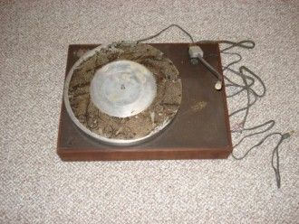](https://www.johnsweather.com/Turntable2/ar1.JPG)

[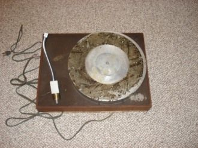](https://www.johnsweather.com/Turntable2/ar2.JPG)

[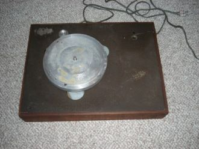](https://www.johnsweather.com/Turntable2/ar3.JPG)

**Here's how the turntable looked
when I received it. As you can see it's in terrible shape**
**as I mentioned above.**

**Another view of the it as I
received it..**

**And another
view.....what a mess!  But no sense just complaining about it, let's
fix her up!**

[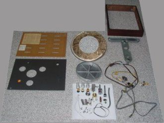](https://www.johnsweather.com/Turntable2/parts.jpg)

[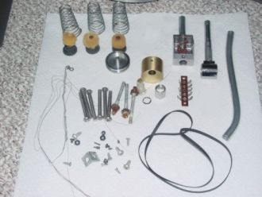](https://www.johnsweather.com/Turntable2/parts2.JPG)

[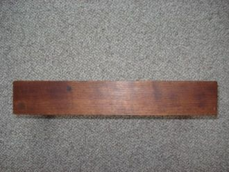](https://www.johnsweather.com/Turntable2/base.JPG)

**First thing to do
is disassemble everything. (This is a photoshopped picture from my first
restoration page but the parts are the same)**

**All the hardware.**
**(This is a photoshopped picture from my first restoration page
but the parts are the same)**

**Front of the base.
Few scratches and some black stuff on it.  But not in to bad of
shape.**

[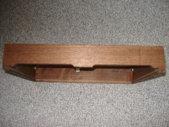](https://www.johnsweather.com/Turntable2/base1.JPG)

[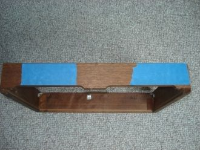](https://www.johnsweather.com/Turntable2/tape.JPG)

[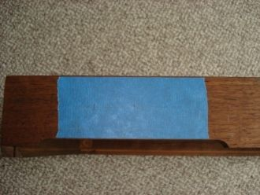](https://www.johnsweather.com/Turntable2/jacks.JPG)

**Back side of base.
Again a few scratches but not to bad.**

**First I like to do the work
required on the base then put it a side till the end. First step is to
mark where we want to install the RCA jacks and power socket. Painters
tape works well for this.**

**Measure half way
between top and bottom of the base and scribe a line.  Then draw a
line where you want the jacks.**

[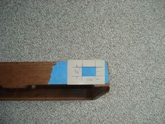](https://www.johnsweather.com/Turntable2/template.JPG)

[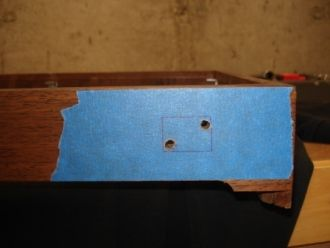](https://www.johnsweather.com/Turntable2/drill.JPG)

[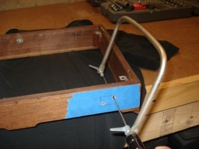](https://www.johnsweather.com/Turntable2/saw.JPG)

**The original power
cord was pretty frail so I decided to replace it with a socketed power
cord. For the power socket I make a little template for the  proper
size. Placed it in the center of the base and made a trace.**

**Drill two small holes in
opposite corners**

**Now use a coping
saw and carefully cut out the hole for the power socket.  You want
to make sure and stay within the trace when cutting. The power socket
doesn't have much of a lip so if you cut the hole to big you'll have a gap
and it will look like crap.**

[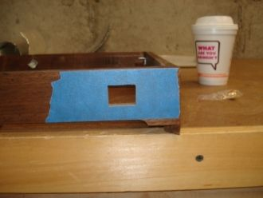](https://www.johnsweather.com/Turntable2/cut.JPG)

[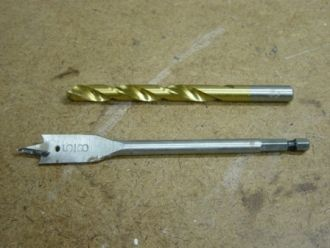](https://www.johnsweather.com/Turntable2/drills.JPG)

[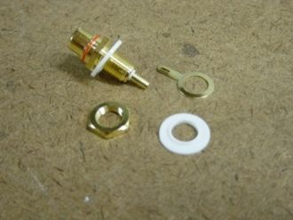](https://www.johnsweather.com/Turntable2/jack.JPG)

**Here's how it looks
after the rough cut. Try the socket to see if it fits.  It probably
won't, the hole will most likely be a little to small. You can take a
file and file the cut out till the power sockets fits nice and snug.**

**The original RCA cables were
a mess so I decided to added some RCA jacks in the base and wire the
tone arm to them.  Makes life a lot easier without having the RCA
cables hanging from the turntable when moving it around. These are the
drills used to drill the holes for the RCA jacks.
First I used the 5/8" spade drill and drilled
about 5/16" deep.  Be careful not to drill all the way through
the base.
Then used a 3/8" drill and drilled through the center of the first hole
all the way through the base.**

**Picture of the RCA
jacks I used.  If you notice the plastic washer has a small shoulder on
it. The diameter of the shoulder is 3/8". This helps to keep the jack
centered in the 3/8" dia. hole drilled through the base.
I bought the jacks here
[RCA JACKS](http://www.parts-express.com/pe/showdetl.cfm?Partnumber=091-1120)**

[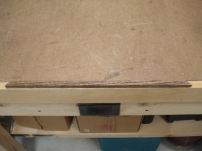](https://www.johnsweather.com/Turntable2/bottom.JPG)

[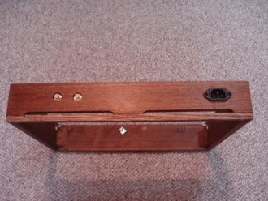](https://www.johnsweather.com/Turntable2/back%20finish.JPG)

**The bottom cover
slides into the slots as seen in the above picture.  I don't use
that cover so the back of the base has an opening where the cover slide
in.  Don't like that look at all!**

**I took a piece of
hardwood laying around and cut a piece to fill the opening in the back.**

**Here's how the back
of the base looks with the power socket and RCA jacks installed. The
power socket is a three prong socket but the ground isn't used. Also
the piece from the previous picture install on the bottom.**

[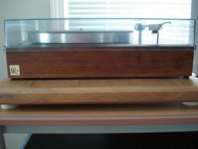](https://www.johnsweather.com/Turntable2/front.JPG)

[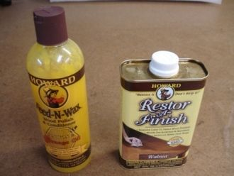](https://www.johnsweather.com/Turntable2/restore.JPG)

[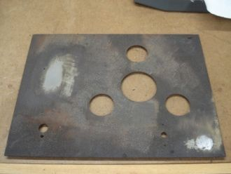](https://www.johnsweather.com/Turntable2/plinth.JPG)

**I messed up and
forgot to take a picture of the front of the base before assembling the
turntable.  Anyway here's how the front looks.  The "AR
inc"badge was missing when I bought the turntable but was able to get
one from the seller "vintage ar" on ebay.**

**I should have ementioned
this earlier but I used Howards "Restore and Finish" and "Feedn-Wax" on
the base bebore installing the power socket and RCA jacks.  This is
the best refinishing stuff out there...believe me!**

**Next step was to
restore the metal plinth. It was in bad shape.  First I tried
sanding and scraping but as you can see it wasn't getting me anywhere.**

[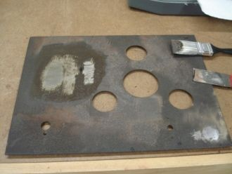](https://www.johnsweather.com/Turntable2/striper.JPG)

[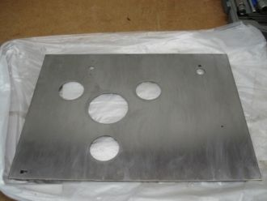](https://www.johnsweather.com/Turntable2/stripped.JPG)

[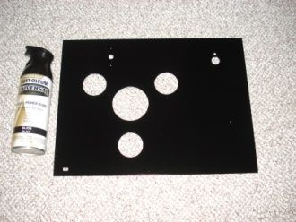](https://www.johnsweather.com/Turntable2/paint.JPG)

**Went to Home Depot
and bought some good old fashion paint stripper.  Brushed on a
little bit..waited a minute then tried scraping. I don't know what the
coating on the pinth is  but it started to come off faster than a
prom dress. Within ten minutes the entire plinth was clean. Wow, that
was a lot easier than I expected.**

**After stripping it I sanded
and sanded and sanded till the surface was as smooth as a baby's as\*.
Then cleaned with acetone.  Finally took a clean cloth and buffed
it to a shinny finish. I forgot to take a picture when it was
finished...sorry about that.**

**Final step for the
plinth was to paint it. I wasn't to sure if I should prime then paint or
try some of the new "Rust-Oleum Universal Paint and Primer in one".
I guess I'm a lazy guy and decided to try the "Paint and Primer in one".
All I can say is I was very impressed with the "Paint and Primer in one"
Three coats and it looked bright, shinny and beautiful! I highly
recommend this stuff.**

[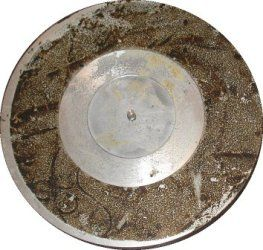](https://www.johnsweather.com/Turntable2/platter2.jpg)

[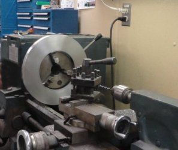](https://www.johnsweather.com/Turntable2/platter1.jpg)

[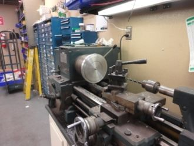](https://www.johnsweather.com/Turntable2/platter3.jpg)

**Now we'll work on
the platter. What you see is very typical of these turntables.
What happens is the foam pad originally supplied by AR degrades into a
sticky mess when stored for many years in a basement or some other moist
area. Removing it is a work of love. What I did first was use a scraper
to get most of the junk off. Then took some 240 grit sandpaper and
sanded the hell out of it. The biggest problem is the sandpaper fills so
quickly from the sticky goo and**
**aluminum from the platter itself.....what a mess!**

**The next two steps probably
won't be an option for most people.
Took the outer platter to work and placed it on a lathe. Then used lots
of scotch brite while the platter was spinning in the lathe. This worked
quite well. Removed almost all the remianing crap while giving the
platter the "Spun" aluminum look.**

**The inner platter
on the lathe for the same method of removing the messy crap.**

[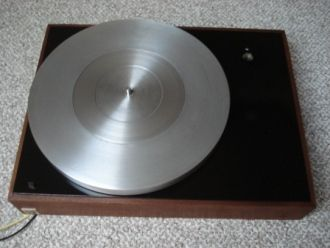](https://www.johnsweather.com/Turntable2/platter4.JPG)

[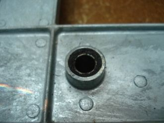](https://www.johnsweather.com/Turntable2/tbar.JPG)

[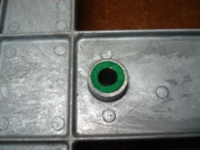](https://www.johnsweather.com/Turntable2/tbar%20felt.JPG)

**Here's how the
platter looked when done. Didn't get it new looking but good enough for
me.**

**The "T" bar was in good
shape and didn't need much work other than cleaning out the two wells
and replacing the foam washer on top of the platter spindle well. You
can see the old foam washer has pretty much**

**disintegrated.**

**I had some green
felt laying around so I made a washer to replace the**
**disintegrated old foam one. Before installing
the platter I put about 10 drops of sewing machine oil on it.**

[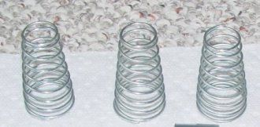](https://www.johnsweather.com/Turntable2/spring.jpg)

[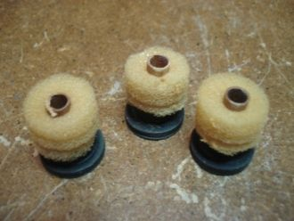](https://www.johnsweather.com/Turntable2/foams.JPG)

[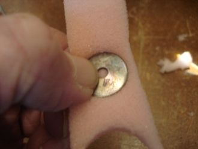](https://www.johnsweather.com/Turntable2/foamwasher.JPG)

**The three springs
that hold the "T" bar in position were in good shape. I know some people
recommend replacing them but I felt these were still ok to use.
Used a wire wheel on the grinder to remove the glue used to hold them in
place on the "T" bar. Probably the easiest part of the whole
restoration.**

**These are the three rubber
washer / bushing that  mount on the bottom of the springs. The original
foam has taken the shape of the spring coil.  I probably could have
still used the foam but figured while everything is apart might as well
replace them.
I've heard some say you don't need the foam, I'll leave that up to
you... your choice.**

**Had some half inch
foam laying around, (I know it's pink but that's all I had so don't give
me a hard time about it!)
Took two washers**
**approximately the
diameter I needed and placed one on each side of the foam. Squeezed them
together then took a pair of scissors and cut around the washer.**

[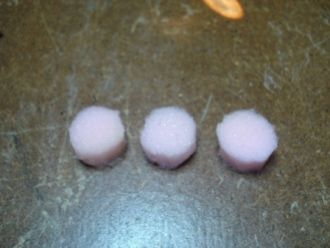](https://www.johnsweather.com/Turntable2/foams2.JPG)

[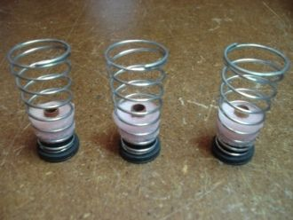](https://www.johnsweather.com/Turntable2/foams3.JPG)

[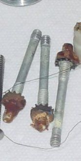](https://www.johnsweather.com/Turntable2/studs.jpg)

**Here's how they
came out. Not perfect but should work fine.
Folded the foam in half and made a small circular cut, that gives the
hole in the middle.**

**They look a little better
once installed in the springs.**

**The original studs
have to go. I didn't even bother trying to remove the nuts...wasn't
worth my time.
Time to make some new ones.**

[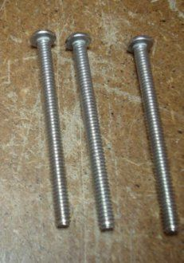](https://www.johnsweather.com/Turntable2/screws.JPG)

[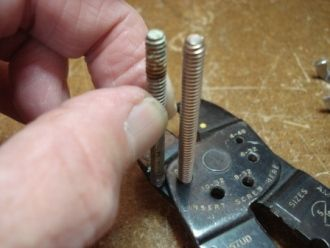](https://www.johnsweather.com/Turntable2/cut%20(2).JPG)

[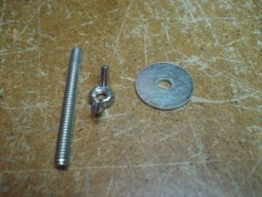](https://www.johnsweather.com/Turntable2/sstud.JPG)

**These are 10 X 24 x
2" Stainless Steel screws. You can get these from Home Depot or Lowes.**

**Now you have to cut the
screws to length. You can use a screw cutter or a hack saw to do it. I
tried using the screw cutter but I guess I'm getting to old and don't
have the strength to cut a number 10 screw... getting old really sucks!
I ended up using a hack saw.
Place the old stud next to the screw to get the right length.**

**Here the new stud,
fender washer and wing nut. You'll need three sets obviously.**

[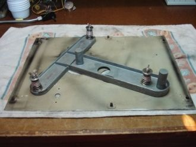](https://www.johnsweather.com/Turntable2/assembly.JPG)

[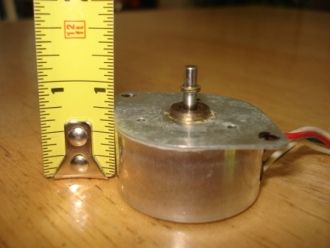](https://www.johnsweather.com/Turntable2/motor.JPG)

[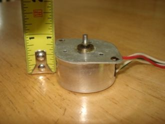](https://www.johnsweather.com/Turntable2/motor1.JPG)

**Here's the "T" bar
assembled to the plinth. Don't worry about any spring adjustment yet,
that will come near the end of the project.**

**Now to tackle the motor.
The original motor had about an 1/8" verical play in the shaft as can be
seen in this picture and the next one. Know idea how that came about but
this motor can't be used that's for sure.**

**Motor shaft all the
way down...about an 1/8" vertical play.**

[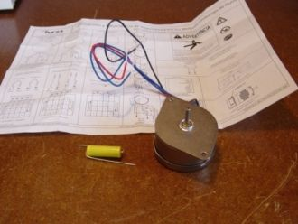](https://www.johnsweather.com/Turntable2/motor3.JPG)

[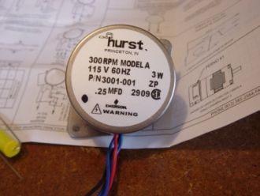](https://www.johnsweather.com/Turntable2/motor4.JPG)

[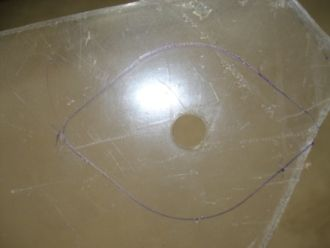](https://www.johnsweather.com/Turntable2/adapter.JPG)

**This is the Hurst
3001-001 motor.  The mounting  flange is larger than the original motor
and the shaft is about .250" longer.
It comes with the capacitor.**

**Picture of the back side of
the motor.**

T**he Hurst motor has
a larger flange and bolt hole layout. I didn't want to drill new holes
in the plinth for the Hurst motor so an adapter has to be made.  I
took some 1/4" plexiglass and drilled an 3/8" hole in it. Then placed
the motor on it and traced the motor flange.**

[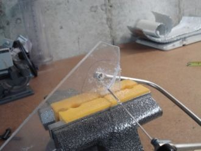](https://www.johnsweather.com/Turntable2/adapter1.JPG)

[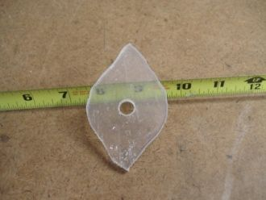](https://www.johnsweather.com/Turntable2/adapter2.JPG)

[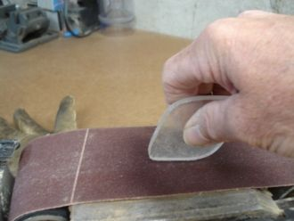](https://www.johnsweather.com/Turntable2/adapter3.JPG)

**Took my coping saw
and rough cut it out.**

**Boy, that came out great
uh....a cabinet maker I'm not!**

**Not to worry
though. Took out my belt sander and sanded the adapter to it's final
shape.**

[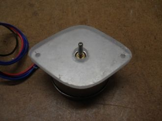](https://www.johnsweather.com/Turntable2/adapter4.JPG)

[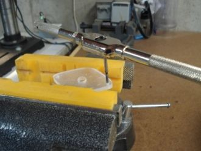](https://www.johnsweather.com/Turntable2/adapter5.JPG)

[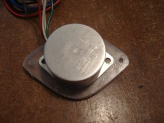](https://www.johnsweather.com/Turntable2/adapter6.JPG)

**Well, that looks a
little better!
I maked where the bolt holes had to be drilled.**

**After drilling the holes I
tapped 4 X 40 threads,**

**Now I took the
original motor and marked the holes. These will be the holes that will
line up with hte holes in the plinth.**

**After drilling the
plinth mounting holes I countersinked the holes so the screwheads would
be below the surface, if not the new motor won't set flush on the adapt**er.

**Here's the finished adapter.**

**You'll need two 4 x
40 Flat Head Machine screws to mount the adapter to the plinth.
You'll have to cut them to the proper lenght so they don't protude above
the plinth surface.  I forgot to measure the length of the cut
screws...sorry about that. You'll have to cut them by trial and error.**

I know you're probably
thinking I'm crazy but I painted the ends of the screws black so they'll
match the color of the plinth.....
Some people call me anal-retentive......

**The adapter mounted to the
plinth.**

**The Hurst motor
mounted to the adapter with  two 1/4" 4 x 40 screws.**

**Now that the motor
is installed it's time to wire everything up.
The switch didn't look to good so I figured I'd take it apart and see
what's inside....easier to do it now instead of after it's installed.**

**To take the switch apart
simply take some strong needle nose pliers and bend the four tabs just
enough to get it apart. Be careful not to bend them to much or they
could snap off. Good thing I decided to do so. The contacts are a mess.**

**I used the dremel
with the little wire wheel to clean it up. Worked very nice as you can
see. Before reassembling it put a drop of Deoxit on the contacts.**

**There, all back
together and ready for another forty or so years of use.  By the
way, it worked like a charm after installing.**

**Here's how it looks after
wiring everything.  Certainly not rocket**

**science** **here.**

**Here's a diagram of
the wiring.**

**Now the real fun
begins.....the infamous AR tone arm damping system! The first thing we
want to do is GET RID OF IT!

I'll discuss a little later why.

See that little pin sticking out below the screw, that's what I'm
talking about.**

**To get at the pin you have
to remove the two little screws on either side of the housing (see
previous picture). BE CAREFUL NOT TO LOSE THE TWO LITTLE SCREWS OR
YOU'LL BE SCREWED!
The collar holding the brass pivot bearing with the pin will slide out of the
housing.

Be careful when handling this piece, there's a pivot bearing on each
side that you MUST NOT DAMAGE.**

**Here's another view
of the brass pivot bearing with the pin. You'll notice a "Flat Spot" on either
side of the groove. Remember those flat spots, I'll mention them a
little late on.**

**We want to remove
that pin. We won't need it any longer.
The easiest way I found to remove it is with a strudy pair of needle
nose pliers and give it a good yank.
Well once again my age is catching up me, I couldn't get that sucker out
of there for the life of me.....so on to plan two.....**

**Plan two......I placed the
pin in a vise at a slight angle with a penny under the brass pivot
bearing. The
penny was there so I wouldn't cause any damage to the pivot bearing or
the outer edge.**

**A closer view so
you can see the pin in the vise.**

**With a screw driver
I slowly pried the brass pivot bearing upward.**

**Bingo...plan two worked with no
damage to the** **brass pivot bearing**.

**There you go. Pin
safely removed and again no damage to the brass pivot bearing.**

**Now that the pin is
removed we want to inspect it for any damage. You can see a bunch of
little holes and nicks. Those are from the pivot screw being tightened
up and not lined up correctly with hte pivot bearing. The pivot screws
are steel so fortunately there shouldn't be any damage to them.
The pivot bearing itself looks to be in good shape still. The one on the
opposite looked good too.**

**These are the two pivot
screws that hold the Brass Pivot Bearing in place.
They look pretty good. The point is still pointed and the bearing
surfaces ( the angled sides) are smooth with no grooves in them.
As far as I can tell they're a # 2 cone point screw, but again make sure
not to lose them. I don't think it a standard size you can buy anywhere.**

**Just cleaning them
up a little with some scotch brite.**

**The Brass Pivot
Bearing was pretty dirty so I wanted to clean it up.  I decided to
use the dremel with a buffing wheel attachment. I wanted to make sure I
didn't buff to much and reduce the outside diameter of it. I didn't
think buffing would remove much material so I took an measurement of the
OD before buffing. It measured .618"**

**Here it is after the
buffing. Looks pretty good.**

**Now to verify I
didn't remove to much material I remeasured it.....618".
Perfect!
Now we can put it aside till we need to reassemble the tone arm.**

**I think this part
is important for real improvement on this turntable.
The spindle that screws into the tonearm originally had a little foam
washer and a plastic washer on the top. If you don't see the little foam
washer, don't worry about it. It  probably disintegrated about the time
Lewinsky was.....well you know!  This was the tonearm damping system.
These washers rested against the brass pivot bearing in the tonearm
assembly. As the tonearm was lifted up then lowered on to the record
these washers would rub against the brass pivot bearing slowing down how
quickly the tonearm would descend. And if by accident you dropped the
tonearm it wouldn't come crashing down and possibly damag your stylus!
From what I've read it's best to remove these washers and don't worry
about having a damping system.**

**In case you forgot here's
the flat spots again...**
**Above is the brass pivot bearing.  The two inner shoulders is
where the plastic washer on the spindle rubbed against for the damping
system. If you click on the picture you see a small flat spot on the
bearing. This is where the washer would line up when the tonearm was
playing a record. There wouldn't be any contact at this point between
the washer and the bearing......and the damping system was disengaged.
It worked great in theory but we don't need or want it.**

**Here's the foam and
plastic washer removed from the spindle.**

**As you can see the
knurled part of the spindle is pretty dirty so we want to clean it up.
I tried a old tooth brush first but it didn't relly do much. Got to find
a better way to clean it.**

Took out the dremel and the wire
wheel and gave that a shot.
Worked great.

**Next I wanted to
clean up the bearing surfaces of the spindle.
Again the dremel with the bushing wheel worked nicely.
I was afraid this time of removing any material with this method. I
proved earlier when buffing the brass pivot bearing it doesn't remove
enough if any to worry about.**

**Here's how it looks
after cleaning.
If you notice right in the threads is a small gray plastic piece (red
arrow pointing at it). It's a locking system. Original with the damping
system you wouldn't tighten the spindle all the way. If you did the tone
arm would bind and not move at all. You'd have to play with tightening
spindle till the damping system was working. That little gray piece
would hold the spindle in place and not allow it to loosen.
Again, another reason to get rid of the damping system.**

**The threaded collar that
holds the headshell intact also need to be cleaned. Used the dremel and
wire wheel again. Works great. You can see in the picture where the top
half of the collar has been wired wheeled.**

**The housing for the
bearing assembly needed cleaning to.
The little wire wheel didn't have the power to do much so I decided to
use my bench grinder wire wheel....plenty of power now!**

**You can see it
cleaned it up nicely...except the brushed aluminum look is gone!
This isn't acceptable, I wanted the original brushed aluminum look.**

**Ok the brushed aluminum look
is back.
I took some 180 grit sandpapper and put a piece of wood across it.
Holding the housing against the piece of wood I carefully slid it back
and forth till I got the brushed aluminum look I wanted.
Don't try to sand it free hand, you'll never get it right....believe me
it tried it!
Unfortunately the picture doesn't do it justice.**

**Now we get into the
fun part.....rewiring the tone arm. This is the part that will make or
break this project!

First thing you'll notice when the collar is slid back is a "RED"
marking. Remember this is the top when reassembling.**

**How to remove the
plastic piece from the tone arm tube. This is a little trick I learned
from Scott Hamrick who has a page on Vinyl Nirvana.com  ["How to rewire a AR XA tone arm"](http://www.vinylnirvana.com/ar-diy-do-it-yourself/rewiring-an-ar-xa-tonearm/)  Thanks Scott, nicely done.

I placed a 19/64" drill bit into the plastic piece then with a strudy
pair of needle nose pliers I gently twisted and pulled at the same time.
There's two little dimples inside the tube that hold the plastic piece
in.
With a little patience the plastic piece will pop out.
AAgain, be very careful in this step, if you ruin the plastic piece you
have to jump on eBay and buy another TT just for that part.**

**Here's the plastic piece
when removed. You can see the scoring on the side from rubbing against
one of the dimples while removing it from the tube**.

**You'll notice after
removing the plastic a little washer with two indents. That's what holds
the threaded collar  from sliding to far back on to the tone arm
tube. Make sure when reassembling those two indents sit on the two steps
on the plastic piece,(two black marks on the plastic piece in the
picture).If the two little steps aren't marked take a black magic marker
and mark them, This will help to see them when reassembling.**

**This is how it
should look when put back together. It's hard to tell from the picture
but the two indents are sitting on the the steps.**

**When removong the old wires
the solder will probaly stay in the little connector pins. I found using
a small pin and pushing it in the pin while heating it up will give you
an opening for the new wire.**

**Ok, you're probably
wondering why a picture of a computer fan.....

I racked my brain as to what I wanted to use for the tone arm wire. On
the last rebuild I used the** **Cardas 4 X 33 shielded
cable. That wire had to have the shielding removed and the four internal
wire were used. I didn't want to go that way again, besides it's a
little pricey.

I had to find some very thin wire....33 gauge or less. Then it dawn on
me, if I could fine a small motor the armature wire would probably be
small enough. That's where the computer fan came in.**

**Here's the original
tone arm wire. It measures .007"(33 ga.).**

**Here's the armature from the
computer fan.  The wire measures .005" (36 ga).
This will work fine.
Gonna have to be real careful with this stuff though, it's pretty damn
fragile to say the least.**

**To give a
comparison the above picture is a human hair...it's measures just over
.004" !
Pretty small stuff we're working with.**

**Next I unwound
about ten feet of the wire from the armature and cut in four pieces.
The picture above compares the four strands of armature wire to one
strand of the Cardas wire.**

**Next step was to take two
strands and wind them together. This will give a little more strength.
I put the two wires in a small vise then the other ends  of the
wires in a hand drill. Slowly ran the drill till the two wires were
twisted around each other.
Again, have to be very careful not twist to tight or you'll snap the
wires.

It's hard to see the wires in the picture but believe me they're there.

Did this operating twice. One set for each channel.**

**Now you have to tin
one end of each wire.  The wire has an enamel coating on it which
can be burned off while tinning if your soldering iron is hot enough.
You'll need to use a good size soldering iron.**

**All four wires
soldered.
You'll want to use a small soldering iron here and be quick, you don't
want to melt the plastic piece.**

**Now we're ready to
reassemble the tone arm. Here's a picture from the AR XA service manual
that show the assembly**

**We're getting
there. You can see the two sets of wires coming out of the tube.**

**Now the tube is
installed into the housing. It's hard to see but the wire are there.**

**A little nail polish to hold
the wires in the  channel at the bottom of the housing.**

**Now for the tricky
part.
I wanted to make sure the wires wouldn't rub against the housing in fear
it would rub the enamel off the wires eventually and cause a short.
So, I stripped a small piece of the insulation off some 18 ga wire and
slid the 4 wires though it. Then took another piece of the armature wire
and attached it to the grounding lug then wrapped it around the little
piece of insulation to hold it in place.
The piece of insultaion is just above the housing so the wires won't hit
it.
You'll have to look at the picture to see what I mean....hope you can
figure it out.**

**Finally I took the
piece of wire from the grounding lug and wrapped around the other 4
wires. This should hold the 4 wires together and hoprfully act as a
ground.**

**Now we can go ahead and
assemble the rest of the tone arm.
I should mention I used a Q-tip with some sewing machine oil to oil the
brass pivot bearing before installing it.
Also be careful when lining up the two pivot screws with the pivot
bearings. Make sure they're in place before snugging them. And make sure
everything is centered in the housing.
The spindle can be tighten snug now that the damping system has been
removed.
Just snug the pivot screws till there is minimal wobble in the housing.**

**Now we can install
the tone arm into the well. There's a small ball bearing (.219"
diameter) that goes into the well first.
Guide the wires through the rubber grommet in the plinth while lowering
the spindle into the well.
You'll have to tilt up the turntable to grab the wires underneath.

Ok that's done....whew!**

**Flip up the
turntable and wire the RCA jacks.
I used a meter to find out what wires had to go to each jack.
And added the ground from the "T" bar.
That completes all the wiring....let's hope it works!**

**This is how the wires look
going through the plinth.
I'm sure some people will say the wires are much to small and fragile
and they will eventually fail. I guess only time will tell that.

After finishing the tone arm installation what you want to do is to make
sure the wires aren't creating any drag on the tone arm. The easiest way
to check for this is to balance the tone arm at 0 grams with the
headshell/cartridge and counterweight install. You should be able to
take the tone arm and place it anywhere and when you let go it should
stay right where it is.  If not, you've got to find out whats
causing the problem. Unfortuntely you'll have to do that on your own....

This tone arm did not move a bit when I let go...so we're in good shape
and ready to move to the next step.**

**Forgot to mention
the brass counterweight.  It only needed a quick cleaning with
some scotch brite.**

**Nice bright and
shinny now.**

**We now want to put the
pulley back on the motor shaft but we have a problem here. The pully is
very dirty and has some dents on it. The owner before me sure didn't
take care of this thing.
It shouldn't be a big deal to straighten it out and clean it up.**

**That's a little
better.  Still has some stuff in the crowns of the pulley but I
don't want to do much more to it in fear of removing to much material
and change it's diameters.  This will do!
You can now put the pulley on the motor, we'll adjust the height later**

**Now you can put the
platter on. You'll want to adjust the three springs underneath till the
distance between the bottom of the platter and the plinth is equal all
around.

Mine looks a little off in the picture but it's fine.**

**After you get the springs
adjusted gently lift up the turntable and put some nail polish on the
wingnuts and threads to hold them in place.**

**Next we want to
prepare the belt for installation. You should probably get a new one
from eBay, they're about $10.00.**

**AR recommended that the belt be bathed in
Talc powder yearly.  This provides a little belt slippage on start up
and reduces the torque on the motor.

I bought some Johnson's baby powder. It's talc with a little stuff added
for the perfume affect.   Besides, who doesn't want their new TT
smelling baby fresh!**

**Next step is to pour a tiny bit of the baby powder in a baggie then
throw the belt in.
Now do the old "Shake n' Bake" trick.**

**After
removing the belt from the baggie shake off the excess powder.  The belt
should look like this.After removing the belt from the baggie shake off
the excess powder.  The belt should look like this.
Now install the belt on the TT.**

**Place the belt on
the upper section of the pulley (this is for 33 1/3) and the over the
inner platter.
Next place the outer platter on top of the inner platter upside down.
Now you can see if the belt is aligned properly while running. As you
can see it's running right in the center of the pulley exactly where you
want it.**

**Ok, we're almost
done!**

**(The cartridge I decided  to use is the
AT440MLa. I had read a lot of very positive reviews about this
cartridge and for the price it seemed like a good deal!)

After everything was assembled and ready to go I noticed the cartridge
wasn't sitting parallel to the record surface. This called VTA,
(Vertical Tracking Alignment).  In the picture if you click on it you'll
notice the tail end is sitting much closer to the record that the head
of the cartridge.  Some people say this cartridge performs better with
the tail end down but this is a little excessive.**

**AR used to supply a little
hard cardboard shim that could be placed between the cartridge and the
head shell (in the front) to compensate for this problem. Of course that
little piece didn't come with the turntable.
No problem. Just cut a little piece wood to do the same thing.
Depending on the cartridge you use you'll have to play with the
thickness of the wood shim.**

**Here's what it
looks like with the shim in place.   You'll have to use a little trial
and error to get the shim in the proper location to suit your
cartridge.  As you can see mine is about a 1/8" from the front surface.

The other thing you'll notice is you can't see much of the screw heads.
I don't know if your cartridges will mount the same way or not. Either
way you'll need a VERY SMALL slotted screw driver to install the screws.
And remember.....just snug them up. If you over tighten them those damn
little brass inserts will start spinning and the next thing you'll find
yourself running to eBay for another head shell....and if your lucky
you'll get one for under $50.00!!!**

**Here's a close-up
of how the cartridge sits now.  Almost parallel to the record surface.
The tail is maybe sitting a tiny bit lower but like I mentioned early a
lot of people say this is the preferred  position, (VTA)  for this
particular cartridge.

Tracking performance and sound quality is fantastic in this
position......I'm going to leave right where it is.**

**After installing the shim it
was time to reset the tracking force. I like 1.75 grams for this
cartridge....1.742 grams is close enough for me.
After all, the brass counter weight isn't the easiest thing to play with
on this TT!**

**Coming Later**

**This headshell is a
spare one I've had laying around. When I bought it it had two missing
wires so I put on the shelf and figured one day I'll get around to
fixing it, if I can
I'm not using it currently but figured I'd add the .
following pictures because I've had people ask me if the headshells can
be rewired.
Not an easy job.....**

**I put the headshell in my
small bench vise pushing in the pin I want to work on. You can see the
bottom pin is inside the jaw.**

**If you click on the
picture you'll ba able to see the bottom pin is sticking out making it a
little easier to work on.
The red wire was the first wire I did, looks like I did a lousy job on
it so I'll fix it later.**

**Before you attemp
to solder this pins you need to put a heat sink on them or there's a
good chance the melt housing that holds the pin. If you do that your
screwed.

I took a small alligator clip and bent the tip so it would fit in
between the bottom and top pins. (If your working on a top pin you won't
have to bend it.)**

**Fits nicely between the
pins.**

**Use a very small
soldering iron tip and tin the pin...you'll see that in the next
picture.

You'll want to get in and out quick, don't let the pin get to hot.**

**The pin has been
tinned and ready to have the new wire soldered in.

The reason for doing this step is it will make easier when soldering the
wire.
You'll also want to tin the wire before installing**.

**Now all you have to do is
hold the wire in the pin and hit it with the soldering iron.....presto
done! That was easy!

I also fixed the red wire while doing htis.**

**Finally I put a
small piece of shrink tubing over the connection. This will help to
prevent the wire from breaking at the solder joint in the future from
any bending when installing the cartridge.
The picture doesn't show it but I put shrink tubing on all four
connection before finishing.
I haven't soldered on the  phono clips yet so I can't show that part
of it. But that part should be easy.**

Finally got around to
getting the phono clips, These are pretty nice clips.
"J.A. MICHELL PREMIUM PHONO CARTRIDGE CLIPS"
I got them of ebay for $20.00.

**Clips installed.**

Cartridge installed with
clips attached.

I had to put the little piece of wood under the cartridge again to get
the cartridge properly aligned.

**Here's a needle drop so you can hear how it sounds.

[I Ain't Superstitious](https://www.johnsweather.com/Turntable2/I%20ain't%20superstitous.mp3)

By Jeff Beck**

**Ok, it's all
together and ready for a test drive....can't wait to hear baby sing!

I'm quite happy with the outcome so far.**

**Picture showing the
connections in the back**

**The End.**

Thought I'd show a picture
of each of the three AR XA's I've done so far.
This is the first one I did back in 2009.

This is the second one. This page
is about restoring this one.

This is the third one I
finished recently, (10/2012).  I decided to try a light color for
the plinth this time.
I didn't bother putting another web page together for this one.  I
don't think I could of added anything new to the restoring process for
the XA that isn't on this page or my first one.

**Ok, now for the results.........        was
it worth all that screwing around????

For the second time doing this it was worth it!!!!

This AR XA sounds just as wonderful as the first one I did.

Without a doubt these turntables are one of the finest out there.

I didn't included every little detail of the restoration but I hope I
included enough to help anyone interested in restoring one of these
wonderful turntables!

Plus there's tons of other sites out that show some unbelievable
restorations and modifications to the AR XA turntable.

I hope you enjoy yours as much as I'm enjoying mine.

And thanks for looking......

John
[email](https://www.johnsweather.com/cdn-cgi/l/email-protection#fd85909c8eccccccbd9c9291d39e9290)**
