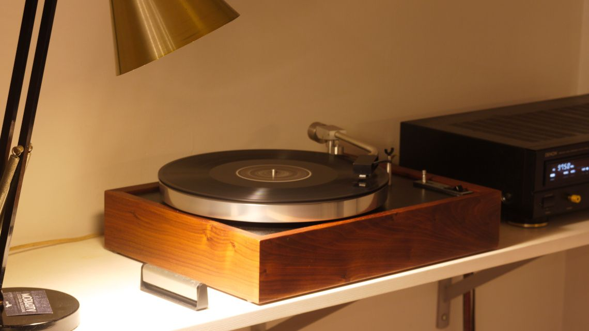
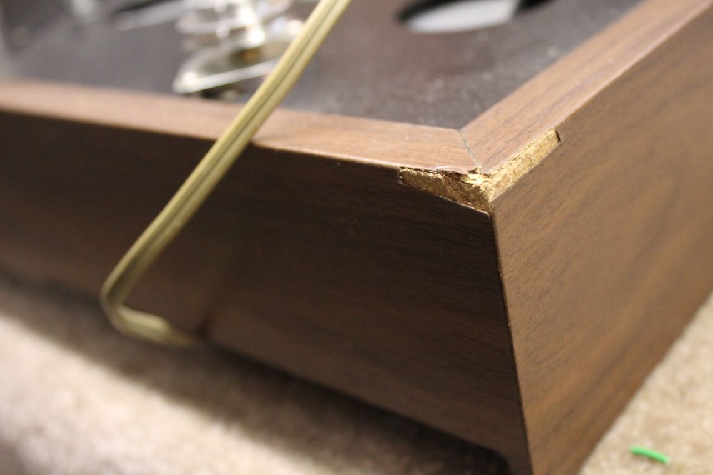
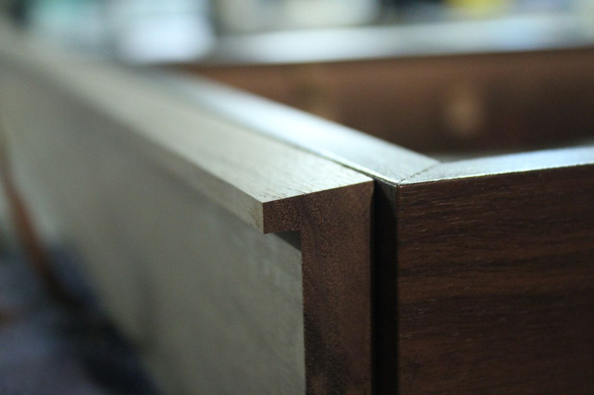
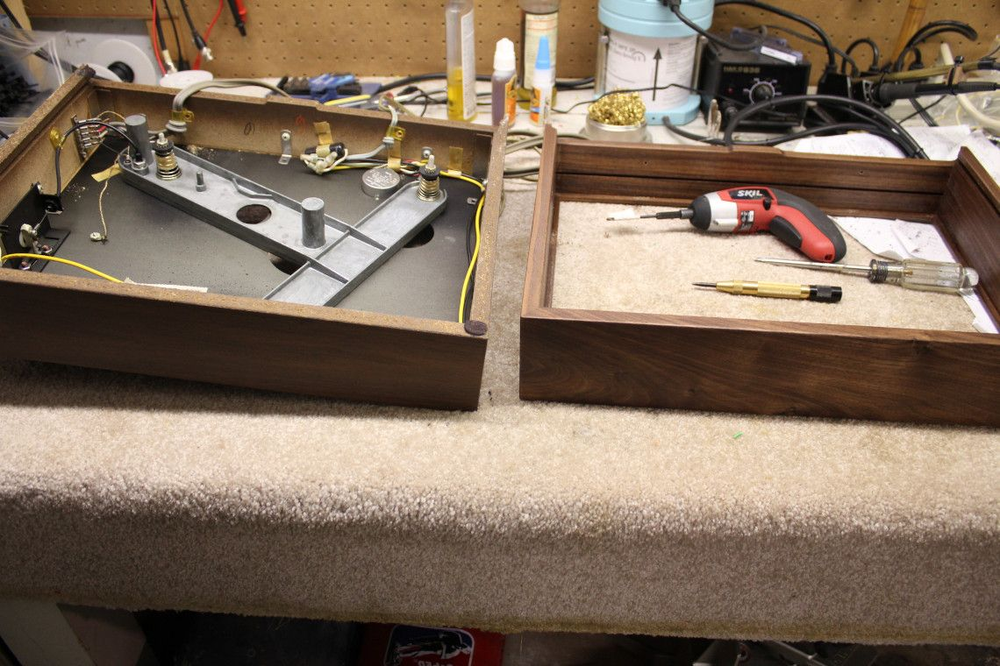
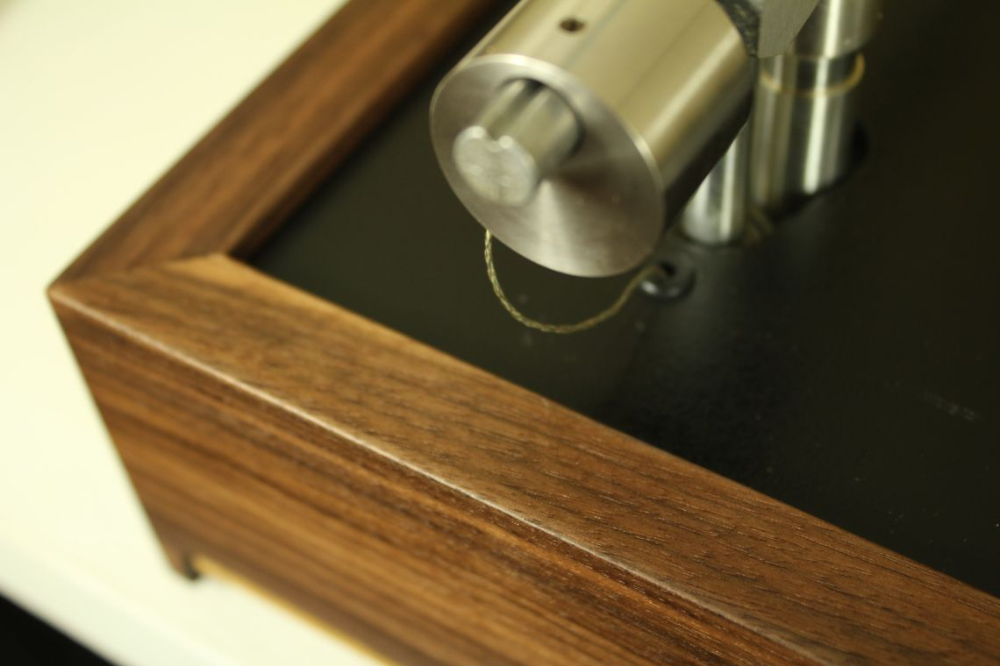

# Walnut AR-XB Turntable Base - Mike Beauchamp

> Archived copy, saved 2026-11-05. Original: <https://mikebeauchamp.com/turntable/>. Site: Mike Beauchamp. Rights remain with the author and the original site.

# Walnut AR-XB Turntable Base (2013)

When I saw a local ad for a cheap Acoustic Research AR-XB, I immediately called my buddy John to come check it out with me. The price was great, but as soon as we entered the sellers house we noticed everything smelled like cigarette smoke. The turntable was in great condition though and even came with the original box and manual, so I figured all it needed was a cleaning.

The model before the AR-XB, the AR-XA, was built with a solid wood base. This model however was built with a chipboard base covered with wood-looking vinyl. There's no way to refinish this and the chipboard would not let go of the smell. On my next visit to the wood mill, I set aside a large board of 4/4 black walnut for the eventual task of building a new base for the turntable.

I copied the profile of the existing base exactly, including the slight angle that the top piece is at and the exact dimensions and thickness. I first made long extrusion pieces in that shape and then cut and mitred them before assembly. When I was inside of the turntable I also decided to replace all of the capacitors and give everything a cleaning.

[Back](https://mikebeauchamp.com/)
