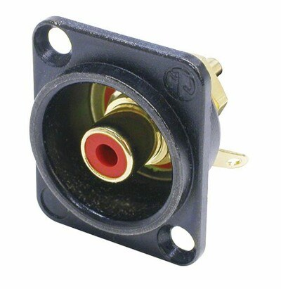

# NF2D-B-2

> Archived copy, saved 2026-11-18. Original: <https://www.neutrik.com/en/product/nf2d-b-2>. Site: Neutrik. Rights remain with the author and the original site.

neutrik / Products / NF2D-B-2

Download Data Sheet

Phono socket in black chrome D-shape housing, red isolation washers, solder version.

Features & Benefits

- Precisely machined to our demanding quality standards
- Gold plated contacts

Downloads

3-D NF2D stp - 76.09 KB nf2d-5 pdf - 56.08 KB nf2d-6 dxf - 421.76 KB 02 Neutrik PG EN - Section Plugs & Jacks - 202110-V24 pdf - 6.12 MB

## Technical Information

| Product |  |
| --- | --- |
| Title | NF2D-B-2 |
| Connection Type | RCA |
| Gender | female |

| Electrical |  |
| --- | --- |
| Capacitance between contacts | ≤ 9 pF |
| Contact resistance | <5G mΩ |
| Dielectric strength | 0,5 kVdc |
| Insulation resistance | < 5 GΩ |
| Rated current per contact | 16 A |
| Rated voltage | < 50 V |

| Mechanical |  |
| --- | --- |
| Lifetime | > 2000 mating cycles |
| Wiresize |  |
| Wiring | Solder contacts |
| Mounting direction | Front mounting |
| Chassis shape | D |

| Material |  |
| --- | --- |
| Contacts | Brass (CuZn39Pb3) |
| Shell | Zinc diecast (ZnAl4Cu1) |
| Contact plating | 0.05 µm Au over 2 µm Ni |

| Environmental |  |
| --- | --- |
| Flammability | UL 94 HB |
| Standard compliance | IEC 601-14 |
| Protection class | IP 40 |
| Solderability | Complies with IEC 68-2-20 |
| Temperature range | -30 °C to +80 °C |
