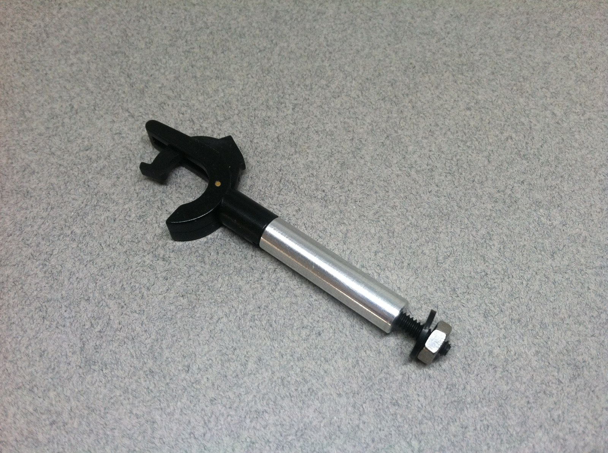

# AR XA Turntable Arm Rest

> Archived copy, saved 2026-11-18. Original: <https://www.patsaudioparts.com/single-post/2017/11/09/ar-xa-turntable-claps-arm-rest>. Site: Pat's Audio. Rights remain with the author and the original site. Sold on eBay as "Pats Audio XA Arm Rest with Clasp for Acoustic Research AR XA Turntable", item 302476992907, by patsaudioparts; the eBay page is not held, see the [archive index](../README.md#not-archived).

Nov 9, 2017. Updated: Mar 20, 2022.

Our latest offering is in keeping with the original AR style but secures the tonearm when in the cradle. The exclusive design employs a sturdy clasp to keep your tonearm safe when not in use. And the machined aluminum post provides strong support while preserving the Acoustic Research look. The arm rest sits flush on the top plate and is affixed from below with a washer and nut.

Tags: AR XA, Armrests.

