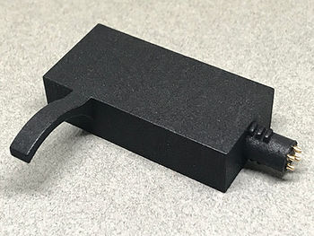

# AR XA Turntable Headshell

> Archived copy, saved 2026-11-05. Original: <https://www.patsaudioparts.com/single-post/AR-XA-XB-Headshell>. Site: Pat's Audio. Rights remain with the author and the original site.

Pat's Audio XA Headshell in classic black for the Acoustic Research AR XA and AR XB turntable models.

Seven years ago we introduced our XA Headshell and it has proven to be the most popular and reliable headshell with more than 500 sold to our loyal customers worldwide.

Features of our superior XA Headshell include:

- perfect size and fit
- reinforced neck with durable threads that won't crack off
- full length spring-loaded gold plated contact pins
- threaded brass screw inserts
- proper AR color coded wires (red, black/blue, white, green)
- silver coated multi-strand wires with high quality silver based solder joints
- premium alloy round barrel cartridge connectors individually soldered
- multiple pairs of progressive length M2.5 screws
- detailed cartridge mounting and headshell installation instructions

If you need assistance with any aspect of your Acoustic Research turntable feel free to inquire. As long time trusted, knowledgeable, and respected turntable service and repair experts we'll be glad to help. That's something we guarantee other sellers can't do for you.

