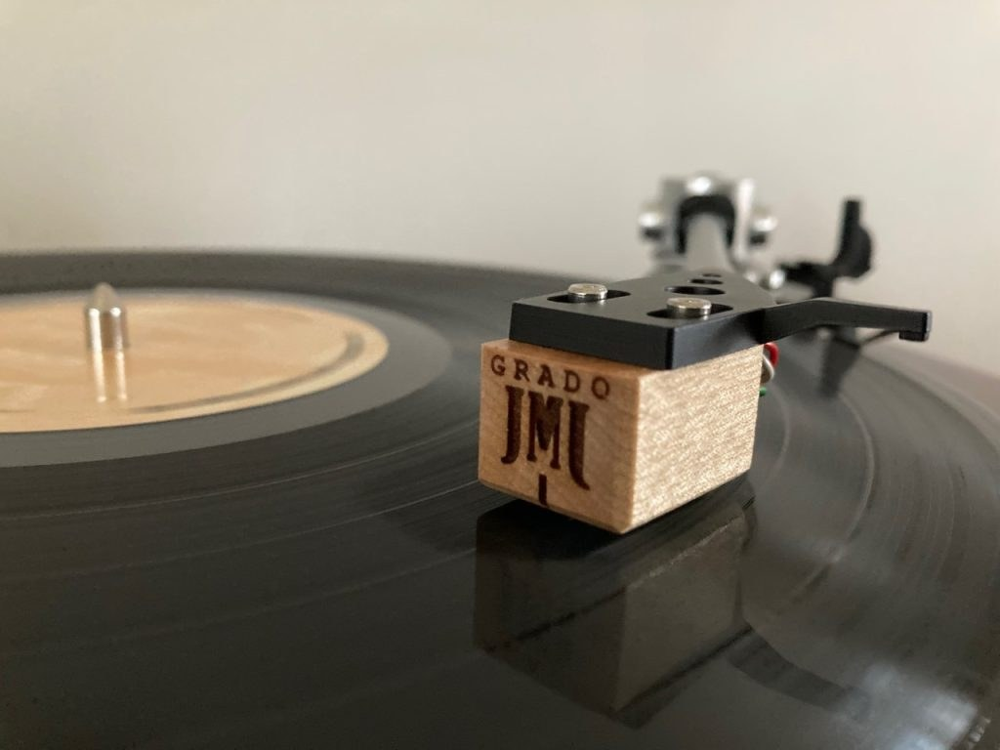
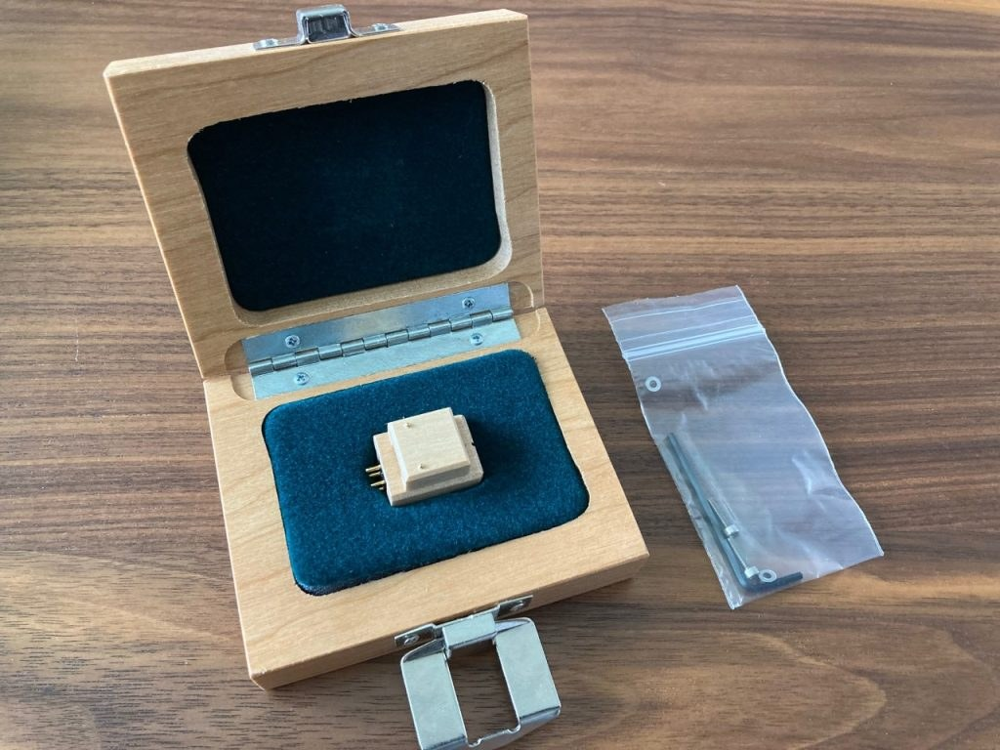

# Grado Timbre Series Opus3 Phono Cartridge

> Archived copy, saved 2026-11-18. Original: <https://positive-feedback.com/reviews/hardware-reviews/grado-timbre-series-opus3-phono-cartridge/>. Site: Positive Feedback. Rights remain with the author and the original site.

If you've never heard one of the new, wood-bodied Grado cartridges, you may be under the same misconceptions I was. Maybe because they look so pipe-and-slippers, I'd assumed they'd sound commensurately warm, cozy, syrupy-sweet, homemade, and comforting. Or maybe it's because my first experience with a Grado cartridge—a whopping two decades ago—left me with the impression that Grado's "house sound" prioritizes listenability above all else, including excitement. Whatever the reason, I could not have been more wrong. Clearly a lot has changed since I mounted a Prestige Green—on my factory-new Denon DP-47F—during the Clinton administration.

Brooklyn-based Grado recently revamped and, it appears, somewhat consolidated their cartridge lineup. The upshot is, you can now buy this honest-to-Grado, wood-bodied moving iron cartridge for a very reasonable $275. It's called the Opus3, a new model that serves as the transition point between their entry-level, plastic-bodied Prestige series and more luxurious Timbre series wood models.

The cartridge's stout-looking body isn't unreasonably heavy, but it's still big and defied my attempts to successfully mount it on two different headshells; for example, it wouldn't clear the downward-facing fins particular to one lightweight model. This won't generally be a problem on most tonearms or headshells. Other than that, the body has threaded screw inserts which make mounting easy, although the wood body might not take kindly to excessive cycles of screw insertions and removals. Its cantilever is obscured by the big body from most viewing angles, so aligning to it takes a sharp set of eyes and a good flashlight; it's a little like getting down on your knees to peer under a car. I opted to track right at 1.75 grams, smack-dab between the 1.6 and 1.9 gram values specified by Grado.

While this is available in a low output (1mv) version, I selected the more preamp-friendly 4mv version. The stylus is not user replaceable, but Grado offers an exchange service, so you won't be on the hook for full replacement price when its useful life ends. It's also worth noting that this is a pretty compliant cartridge, a rarity these days. If you still own a lower-mass tonearm, Grado cartridges like this are among the few remaining premium options for you. It was, however, perfectly at home on one tonearm on the lower end of medium mass, as well as another more firmly in the medium category.

Dim the lights, drop the stylus, and the Opus3 transports you to a zone where records sound smooth and decidedly non-mechanical, but with commendable clarity and, in particular, midrange transparency. The entire (audible) frequency range is well integrated, without much to criticize aside from high frequencies that sound a tad sandy compared with a Shibata-tipped Audio-Technica. The Opus3 also manages to sound downright agile, though more like a luxury SUV equipped with a sport suspension than a low-slung, two seat sports car. As such, it's a very satisfying daily driver, so to speak. What you sacrifice in lean, corner-carving sharpness is more than made up for with tonal richness.

Speaking of richness, here's the Opus3's party trick: it manages to be oddly multi-talented, conjuring up acoustic guitars, vocals, and piano notes with a lifelike presence. Yet it's not the byproduct of a top-to-bottom coloration. If it were, as I've experienced on various components of all kinds over the years, the treble would be recessed (it isn't) and deep bass notes would be fat and syrupy (they're not). This is a new kind of Grado for me, with a modern vibrancy and energy.

In fact, the Opus3 manages to combine some of the best attributes of moving coils and moving magnets. The overall cohesiveness and integration reminded me of the better affordable moving coils, but while trading any glassy, detached transparency for a more upfront, human presence. Meanwhile, it has the listenability of moving magnets (along with detail levels approaching that of cartridges featuring more exotic styli, despite what looks to me like a very finely polished, but otherwise ordinary, bonded elliptical). In that sense, the Opus3 is in a class of its own.

Cueing up a Japan pressing of *Toto* *IV* (CBS Sony 2OAP 2280) finds the Grado game for all the fun, splash, and sparkle of one of my youth's most derided records. If ever I was cool, those days are long behind me, and now I can freely admit that I missed out on hours enjoyment like this: expertly crafted showpieces of peak 80s pop-rock musicianship. So *this* is what I was missing out on while subsisting on an angsty teenage diet of Camper Van Beethoven and Morrissey.

I also plowed my way through all ten sides of pianist Igor Levit's captivating, two-part *On DSCH* (Sony Classical 19439889261 and 19439903681) Typical of newer pressings, they're far from perfect, but Levit's intensity smashed through the (sort-of) silence to reveal his technical mastery and idiosyncratically edgy, skittish brilliance. Rather than come across as captivating but icy, the Grado put forth a completeness that captured the performer even if it maybe sheared off a bit of the performance details a much more expensive cartridge would fully render.

It went on like this, record after record. The Grado was equal parts revealing and forgiving, never tipping too much toward one end of the spectrum or the other. It didn't require a mega-buck turntable either; it was equally happy going about its business on a new Technics as it was on some underrated mass-market tables from the early 1980s.

Digging deep for areas to criticize, it doesn't handle sibilants as effortlessly an Audio-Technica MicroLine-equipped model, though you'll have to listen closely to hear it. Soundstaging is big and quite good, though perhaps more on the gregarious side. It's somewhat lacking in definition and presence of the very lowest notes, at least in my experience, and high frequencies can be gently etched in contrast with the otherwise organic overall reproduction. It may look homegrown, but the Opus3's tracking and technical attributes are largely unassailable when evaluated with realistic expectations.

Until just prior to filing this piece, I'd forgotten all about the so-called "Grado hum," a tendency for their cartridges to allow some slight motor interference to seep through on certain turntables. And yes, minor hum was present on two of my tables as the arm approached the motor's location, though I might never have noticed had I not gone looking for it. It detracted not at all from my enjoyment, but I mention it only for those who might be sensitive.

To be sure, $275 doesn't buy nearly as much cartridge as it did during Bill Clinton's second term. That makes the Opus3 an even more unique value proposition in today's market. There really isn't anything quite like it. While it's most talented at making human voices and acoustic instruments sound especially realistic and present, it doesn't shortchange rock at all, or even electronic music. It's middle-aged agile, engaging and warm, all at the same time. The Opus3 consistently caught me by surprise, until I finally started taking its bravura performance for granted. For my money, it's the most expressive cartridge I've heard around this price point.

Unexpectedly chunky and punchy sounding, yet also quick, clear, and warmly engaging, the Grado Opus3 is a compelling alternative to similarly-priced cartridges from both musical and technical standpoints. It's the phono cartridge equivalent of Daniel Craig playing James Bond while dressed in Mister Rogers' cardigan sweater. If that rings some kind of bell, you may have found your next phono cartridge.

**Specifications**

- Body: Maple Wood
- Cantilever: Aluminum / Elliptical Diamond
- Output: High: 4.0mV @5 CMV (45). Low: 1.0mV @5 CMV (45)
- Inductance: High Output: 55mH. Low Output: 6mH
- Resistance: High Output: 660 ohms. Low Output: 70 ohms
- Input Load: 10k-47k ohms
- Cartridge Weight: 8 grams
- Tracking Force: 1.6-1.9 grams
- Compliance: 20μm/mN
- Channel Separation: Average 30db - 10-30k Hz
- Controlled Frequency Response: 10-60 kHz
- Non-Sensitive to Capacitive Load

**Timbre Series Opus 3 Cartridge**

Retail: $275

**Grado Labs**

4614 7th Avenue

Brooklyn, New York 11220 USA

[gradolabs.com](http://gradolabs.com)
