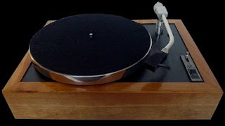
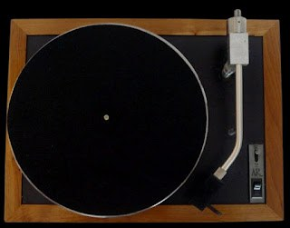
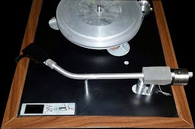

# Acoustic Research AR-XB

> Archived copy, saved 2026-11-18. Original: <https://stereonomono.blogspot.com/2021/02/acoustic-research-ar-xb.html>. Site: stereonomono. Rights remain with the author and the original site.

The new AR-XB is the latest version of the world's best-selling manual turntable. Since its introduction, the AR turntable has had a profound effect upon both design and performance standards of home record-playing equipmen, yet it remains alone in the field in the degree to which it combines broadcast equipment performance, completeness and convenience, simplicity of operation and low cost.

The stability of the AR turntable is unusual; the top-plate may even be struck by vertical hammer blows without interrupting the music being played. The AR turntable is insensitive to floor vibrations or acoustic feedback. This gives its owners maximum freedom in placing the turntable where it will be most convenient, even close to the loudspeakers, if necessary.

The AR turntable is guaranteed, as a condition of sale, to meet NAB (national Association of Broadcasters) specifications for broadcast equipment on wow and flutter, rumble, and speed accuracy. In addition, the AR turntable meets the stringent requirements of the CBS standards on rumble and the IEEE standards of flutter.

The NAB stereo Standard for professional broadcast equipment calls for a number levell in each channel at least 35 dB below 1 cm/sec. In the plane of modulation at 100 Hz, with the ballistic characteristics of the meter specified and will the playback equalization specified.

The NAB Standard on flutter and wow prescribes the exact methods of measurement. The NAB Standards for broadcast playback equipment is 0,1% maximum wow and flutter combined when measured as specified.

The NAB Standard for speed accuracy of broadcast playback equipment is ±0,3%, or 21 lines per minute drift on a standard 216-line stroboscope card. All AR turntables are tested to meet this standard, and to keep within the NAB limit with an extra 5 grams of stylus force (equivalent to the drag of a dust bug). Line voltage variations have no effect on the speed of the AR turntable, since the drive motor is synchronous

Each AR turntable feature:

Viscous-damped cue/pause control

Ready-mounted walnut-grained base

Transparent plastic dustcover

Hysteresis - synchronous motor

Plug-in cartridge shell with mounting hardware

Precision stylus pressure gauge

Overhang adjustment guide

Lubricating oil

Screwdriver for installing cartridge and setting arm counterbalance

Color-coded connecting cable

45 rpm center hole adapter

Specifications

Type: Belt drive system

Speeds: 33-13 and 45 rpm

Motor: Hysteresis - synchronous motor

Wow and Flutter: NAB Standards

Rumble: NAB Standards

Power: 110 - 120 V, 50 or 60 Hz

Size (W x D x H) : 12-3/4" x 16-1/4" x 5-3/4"

Weight: 6,35 kg (14 lbs)
