# Linn Sondek LP12

> Archived copy, saved 2026-11-18. Original: <https://stereonomono.blogspot.com/2014/07/linn-sondek-lp12.html>. Site: stereonomono. Rights remain with the author and the original site.

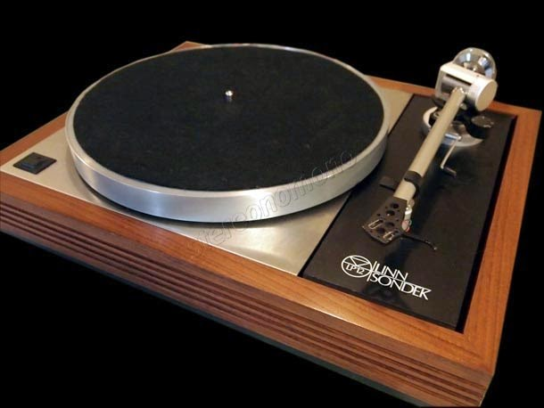

The Linn Sondek LP12 transcription turntable is designed and manufactured to extract as much information as possible from the modern long playing record. It is, quite simply, the link missing in so many play-back systems between your ear and the reocrded performance.

**The design**

is elegant yet functional, relying on precision machining rather than complex electronics and gadgetry to provide the highest level of performance while maintaining the ultimate in reliability. If you can appreciate the differences between listening to a record on a good system and hearing something that approaches live music, then the logical place to start is with the Linn Sondek LP12. A product of integrity which offers proven value and performance. The Linn Sondek LP12 is specifically designed and manufactured to obtein the best reproduction from the modern high fidelity long-playing record.

**General Description**

The Linn Sondek LP12 transcription turntable is designed for free-standing use with the finest specialist component high fidelity sound reproduction systems. The unit is designed for a long operating life and should, if treated properly, last longer than any other part of your hi-fi system. We cannot emphasise strongly enough the importance of prospective customers receiving a fair demonstration before purchase. We suggest placing any transcription turntable beside the LP12. fit same with arms and cartridges, listen to both at the same volume setting through the same system and decide for yourself which sounds more like real music. The unit is guaranteed under the conditions which apply in the country of purchase. In addition to any statutory rights the customer may have, we undertake to replace any parts which have failed due to fault manufacture.

**Type**

Precision built single speed transcription turntable mounted in a solid kiln-dried hardwood low resonance plinth system with counter-balanced hinges and moulded perspex lid.

**Bearing**

The LP12 employs an exclusive single point bearing running in an oil bath (world patents pending). [The hardened and ground steel spindle runs on a mirror finished hardened, ground and lapped thrust pad.] The spindle is hardened tool steel. The thrust plate, which must withstand a pressure of 2,5 tons per square inch, is top grade steel, machined, hardened, groun, and lapped to a mirror finish. The sides of a bearing housing are lined with a hard, very low friction plastic. Between this liner and spindle is a thin film of oil. The only surface to surface contact is at the single point where the spindle rest on the thrust plate. Since this is also the center of rotation, the velocity at the point of contact is very low. A direct result of this low velocity is low friction, negligible wear, and extremely low rumble.

**Motor**

24-pole precision synchronous low noise motor. Speed is 250/300 rpm, depending on mains frequency. The motor is fully electrically and mechanically screened and isolated from the main turntable assembly.

**Speed Accuracy**

The synchronous motor of the LP12 locks-on to the 60 Hz AC line frequency. Over a day's time, this line frequency, and the speed of the turntable, will typically change by less than ±0,04%. While it might be possible to obtain greater "accuracy" by using a quartz-locked servo-controlled motor, it should be pointed out that our goal is to obtain the best possible audible performance, not to build a laboratory standard rotating platform. Speed consistancy is far more important than speed accuracy. Errors in accuracy of up to three percent often go unnoticed, while rapid changes in speed of only a few hundredths of a percent are audible. By definition, a servo-controlled motor maintains its speed accuracy by constantly changing and correcting its speed.

**Drive**

The platter is driven via a flat precision ground chloroprene rubber belt by a 24-pole, low noise, synchronous motor. The 24-pole design of the motor allows it to run at a relatively slow speed (300 rpm vs. 1800 rpm for a four-pole motor). The combination of the slow speed and the individually tuned motor assembly reduces rumble to a minimum. The beltdrive acts as a filter to prevent any residual motor noise from reaching the platter. Flutter is minimized by the use of a machined metal drive pulley (concentricity 0,0004") in place of the usual cast metal or molded plastic variety. The pulley is machined from the same material as the platter. Thus, all parts within the loop of the drive belt have the same coefficient of expansion insuring that the speed will be constant over a wide range of operating temperatures. A flat precision-ground chloroprene rubber belt driven by a drive pulley mounted on the motor. Due to the materials selected, the rotating elements within the drive belt loop are such that the ratio is temperature stable. This means that a constant speed will be maintained over a wide range of operating temperatures.

**Suspension**

The platter and arm board are fixed to a floating sub-chassis suspended by resilient mountings in the double-damped triple point suspension.

**Chassis**

The main chassis is heavy gauge non-magnetic brushed satin finished stainless steel. The sub-chassis is formed from mild steel pressing welded for maximum rigidity and stove enamelled to give corrosion protection.

**Base Plate**

The base plate is constructed of heavy gauge, satin finish stainless steel. The motor of the LP12 is attached directly to this non-magnetic plate. Besides providing additional hum shielding, this plate acts as a mechanical energy sink. Motor vibrations, that would have been transmitted along the belt into the system, are instead converted into harmless mechanical noise that ia dissipated over the entire surface of the stainless steel plate.

**Subchassis**

The platter/bearing assembly and the arm board are mounted on a rigid steel subchassis. It is isolated from the base plate, motor, and external vibrations by a fully adjustable three-point spring suspension.

**Arm Board**

The arm mounting board is constructed of a center ply layer sandwiched between two layers of hard board.

**Base**

In contrast to the typical flake board base construction, the LP12 base is crafted from solid kiln-dried hardwood. Hardwoods are chosen for their ideal resonance characteristics and stability. Provision has been made for proper arm cable dressing to control vibrations that may travel up the arm cable, by-passing the suspension.

**Plater**

305 mm (12") diameter non-magnetic zinc aluminium alloy die casting machined throughout with optimum peripheral mass distribution. Total weight is approximately 4,5 kg (10 lb). A choice of mat is available: a felt type suitable for tag cueing, or a radial-ribbed thermo-plastic moulded mat for standard use.

**Rumble**

Rumble is -60 dB unweighted, with reference to a 10cm/sec 1000 Hz signal. The weighted rumble measurements used by most manufactures are virtually useless in evaluating the performance of a turntable. Weighting systems effectively ignore rumble at very low frequencies. This subsonic rumble may not be as audible as rumble occuring at 200 Hz, but its side effects can be quite audible and even more serious than a little low frequency noise. Sunsonic rumble may excite arm/cartridge resonance and cause mistracking. The amplifier, trying to reproduce this rumble, wastes a great deal of power. The speaker cone is forced to move beyond its linear operating limits. The end result is increased IM Distortion. We contend that, if you must use a rumble measurement, it should be unweighted and the velocity and frequency of the reference signal should be specified. Anything less can, and often does, cover up poor performance.

**Wow and Flutter**

The LP12's wow and flutter is less than 0,04% (typically, wow is less than 0,03% and flutter is less than 0,015%)

**Dimensions**

445 x 355 x 140mm (17 ½ x 14 x 5 ½ in) Approximately 7 cm (2 ½ ") clearance is required at the rear of the unit and approx. 25 cm (10") above the unit to permit convenient opening of the lid.

**Specifications**

- Type: single speed transcription turntable

- Speed: 33 ⅓ rpm

- Motor: 24-pole precision synchronous low noise motor

- Drive: belt-drive

- Plater

- Type: Non-magnetic zinc-aluminium alloy die-cast

- Platter

- Diameter/Mass: 305 mm (12")/4,5 kg (10 lb)

- Rumble: -60 dB (unweighted)

- Wow and

- Flutter: less than 0,04%

- Power

- Requirement: 220-250 V or 110-125 V, 50-60 Hz

- Power

- Consumption: 3,3 VA

- Dimensions (W x H x D): 445 x 140 x 355 mm (17 ½ " x 5 ½ " x 14")

- Weight: 10 kg (22 lbs)

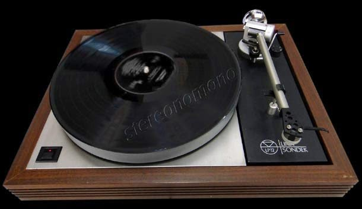

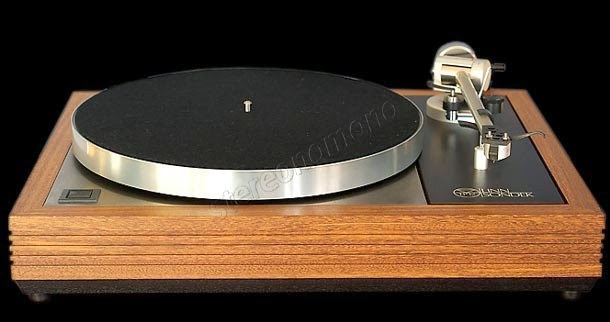

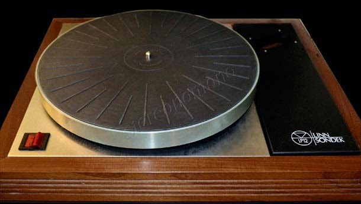

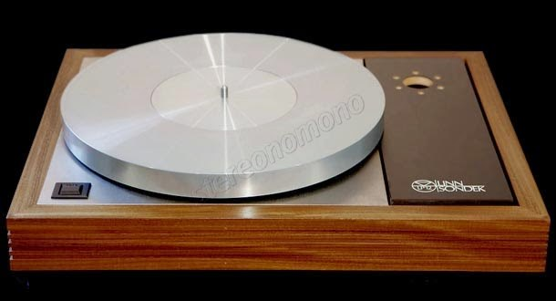

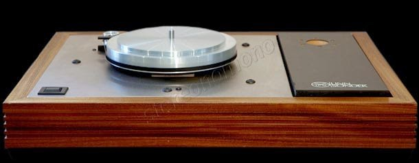

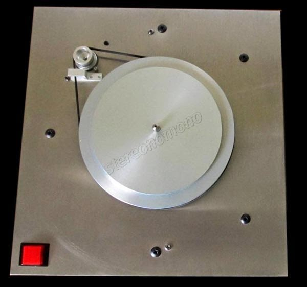

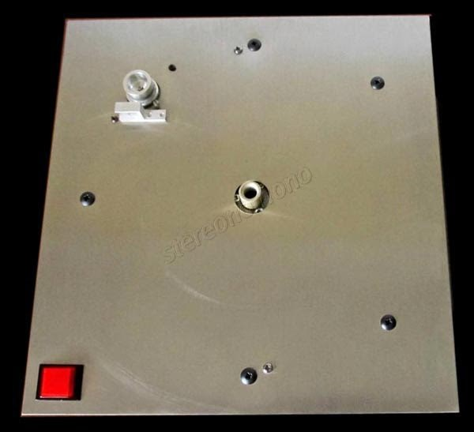

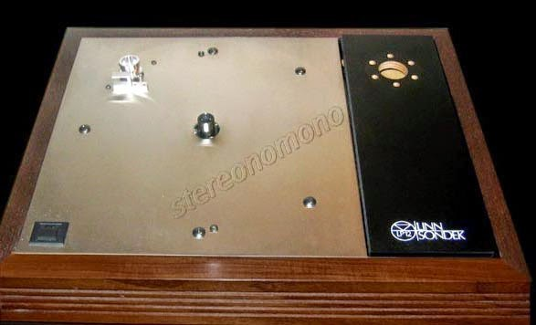

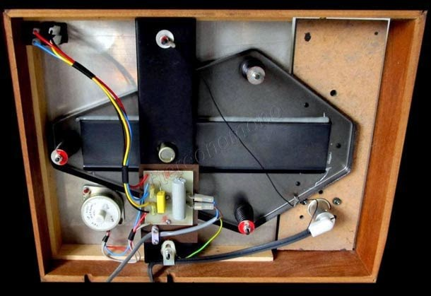

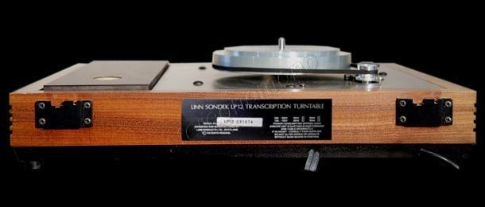
