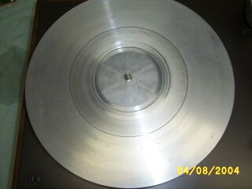
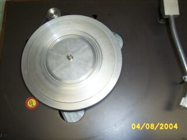
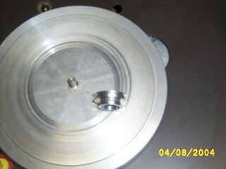
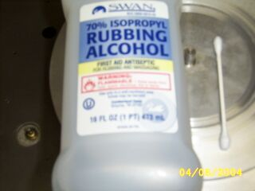
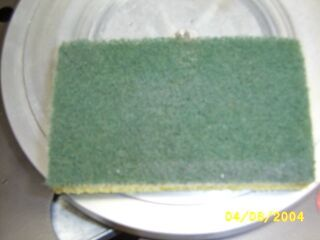
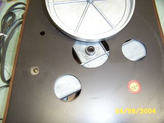
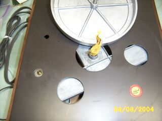
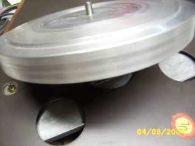
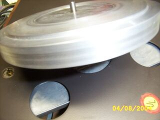
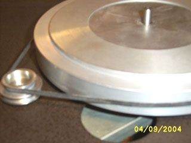

# AR XA and XB Belt Replacement

> Archived copy, saved 2026-11-05. Original: <https://vinylnirvana.com/ar-turntable-resources/ar-diy-do-it-yourself/ar-xa-xb-belt-replacement>. Site: Vinyl Nirvana. Rights remain with the author and the original site.

```
## AR XA and XB Belt Replacement

### Supplies needed:

New Belt
Talcum Powder
 99.5% pure anhydrous isopropyl alcohol
Q-tips
Green scrub pad
```

```

1. Once you remove the mat, you will see the two aluminum platters.

2. Once you remove the outer platter, the motor pulley will be revealed. In some cases, the old belt will be lying loose on the plinth. In other cases, the belt may have "chemically bonded" to the platter. In that case, remove the inner platter and use a putty knife to remove as much residue as possible.

3. Next, remove the pulley with a quick straight upward pull.

4. Here is a generic bottle of isopropyl. Even better to use 99.95% pure anhydrous isopropyl alcohol. See links page for source.

5. And here is a generic green scrub pad. This one has a sponge on the back side. I learned multi-tasking from my wife.

6. Next, remove the inner platter from the platter bearing well.

7. It is important to prevent contamination of the platter bearing, so stuff a small piece of cloth into the opening.
```

```

8. Before replacing the belt, it's a good idea to remove residue from the pulley and the inner platter surface which comes into contact with the belt. Use your green scrub pad to remove the residue. The end result should be a smooth metal surface.


```

```
10. Remove the cloth from the bearing well, and replace the cleaned inner platter. Take the talcum powder and place about a teaspoon in a baggie. Place the belt in the baggie and "shakenbake" for a few seconds. Remove the belt and shake it away from the turntable (and other contaminable objects.) It's now time to put the belt back on the table. Remember the upper part of the pulley is for 33&1/3.
```
