# Replacing an AR XA Tonearm with a Mayware Formula 4, MKIII

> Archived copy, saved 2026-11-05. Original: <https://vinylnirvana.com/ar-turntable-resources/ar-diy-do-it-yourself/replacing-an-ar-xa-tonearm-with-a-mayware-formula-4-mkiii>. Site: Vinyl Nirvana. Rights remain with the author and the original site.

## Replacing an AR XA Tonearm with a Mayware Formula 4, MKIII

by “Dadbar”

Starting out….the top deck has that disgusting brown flock which has become very sticky and grimy

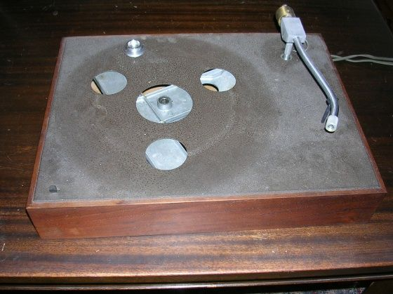

Dismantling all of the parts..I put them in baggies so I wouldn’t lose them

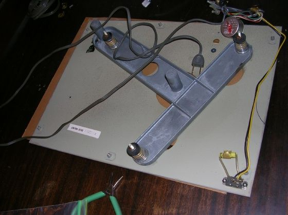

With the T-bracket off I was able to compare the mounting template that came with my used Mayware Formula 4 MkIII. The actual mounting distance seems to be a hair shorter than the original AR arm. My mounting template has the spindle hole mispunched to I backed up the measurement with a metal ruler. It’s easy to use a Sharpie and make some layout lines on the T-bar for reference. I also used a piece of duct tape to cover over the platter spindle bearing to keep filings out of it.

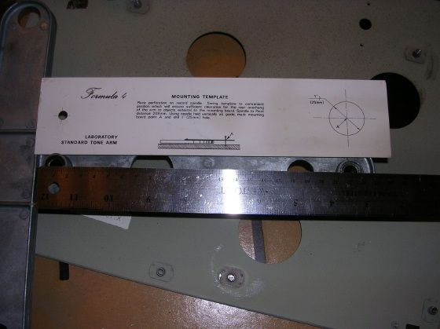

I happen to own a 1 1/8 chassis punch so I used it to cut a hole in the top deck for the tonearm. I pretty much centered this around the current hole.

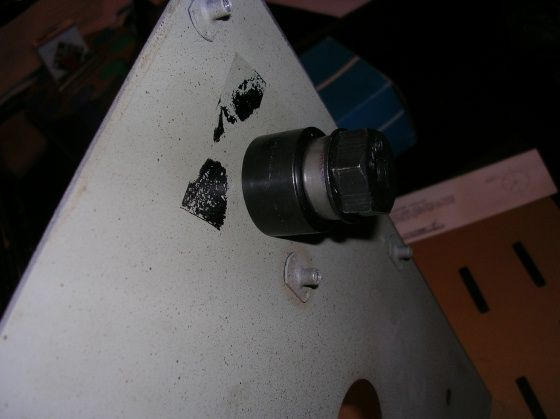

I used a simple hacksaw to cut off the tonearm bearing. I’ve seen some modification procedures that also suggest grinding down the outer flanges on the bracket….I found this to be unneccessary so I left them in place.

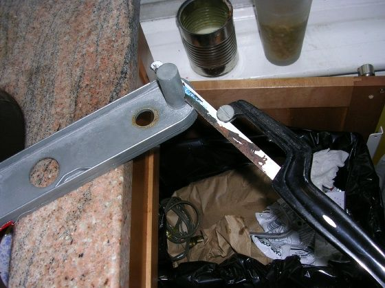

The remaining part of the bearing I drilled out using my 7/8 step drill.

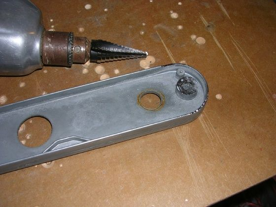

There is a small flange for the original grounding nut that needs to be removed…I prilled out most of it with a regular power drill and used my Dremel tool to flatten the area a bit. While I was at it, I used the dremel to enlarge the hole a bit to give me some wiggle room for mounting.

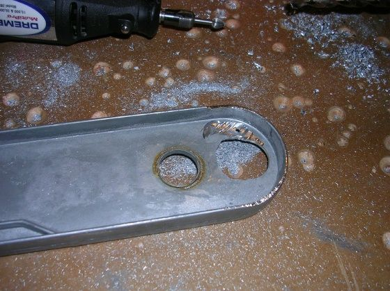

I scoured down the deck with steel wool to get off all of the disgusting flock and the ugly brown paint

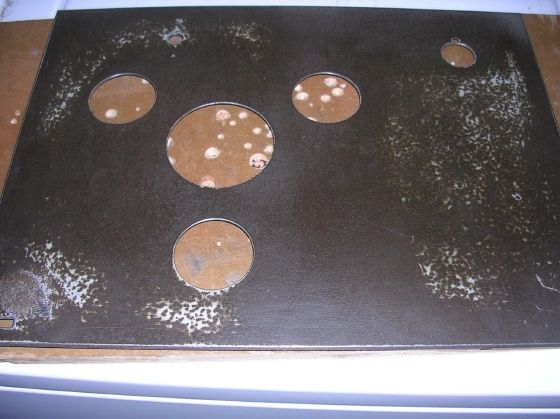

I gave the deck a nice fresh coat of paint….a copper hammertone look courtesy of Rustoleum.

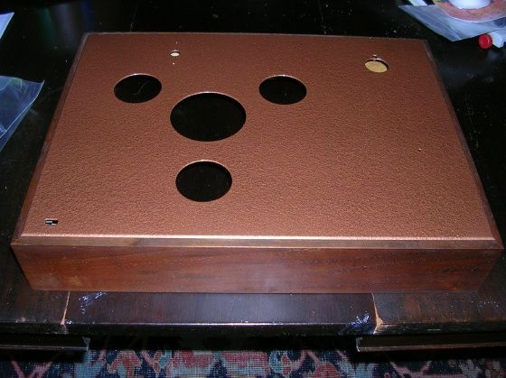

The T-bracket rings quite nicely when it’s tapped….so I added a bit of rope caulk to it. I also added some scraps of Dynamat that I had to the underside of the top plate.

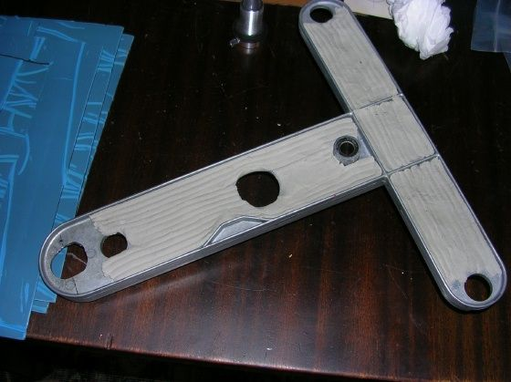

Reassembly of all the parts. The arm mounting stud is solidly mounted to the T-bar with nuts on either side (thank you, Dave). I drilled a second hole for the ground connection for the T-bar and replaced the ground strap to the deck. I also ran another ground connection from the same T-bar lug right to my amplifier to eliminate hum (not shown). The tonearm cable was also secured with a clip to the wood plinth to keep it from binding up the suspension. I originally bought heavier duty springs and studs from Anthony Scillia for this project but since I decided not to replace the plinth, I chose not to use them as they were too long for the stock plinth. Some day I will build a new plinth and use them. The original springs seem to work fine with the Mayware arm for now.

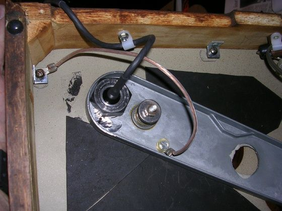

The used Mayware that I got off Ebay had a fractured integral arm rest. At first I thought I would remove it and get a stand alone arm rest for it (The original AR Arm rest doesn’t work particularly well in this application…and let’s face it…it’s kind of cheezy. I may eventually see something nice in my travels, but for now I took the old one off and bought an arm clip meant for a Technics 1200. I Crazy glued it to the end of a nail and cut the excess off with a Lineman’s pliers….it fit in the same hole as the original rest. I also added a bit of silicone caulking to the rest (shaped a bit with a toothpick) to build up the contour so the lock would actually work (the Technics arm diameter must be quite a bit bigger than the Mayware). Not exactly the most elegant solution but it works. One last issue- the fine wire for the antiskate had broken so I replaced this with clear nylon sewing thread (courtesy of my wife). It works quite well once you get all of the little knots tied (a tweezer is a must for this)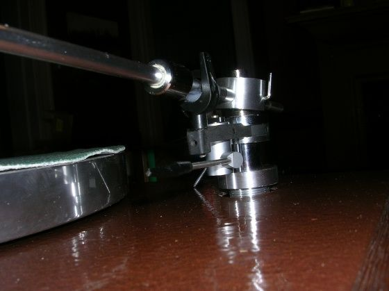

Finished product- complete with Shure V15VxMr and Michell record clamp. The resulting product works great!

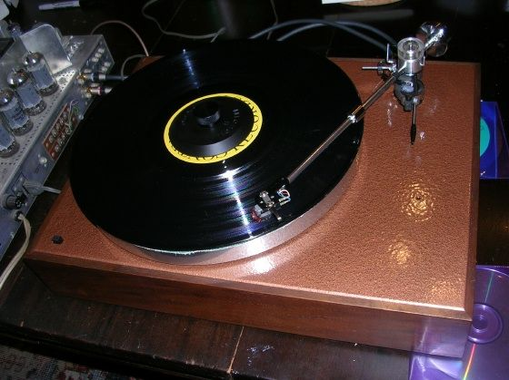
