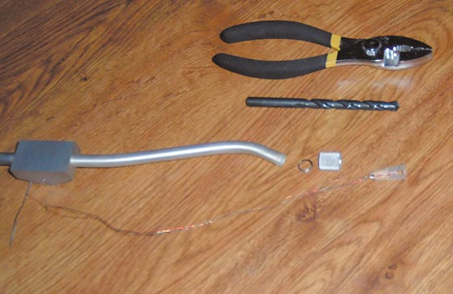
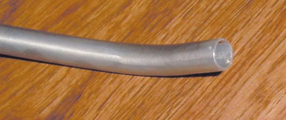
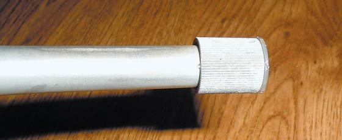
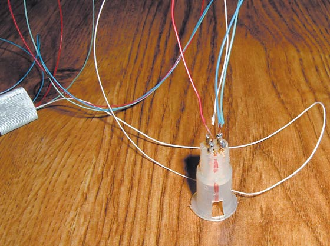
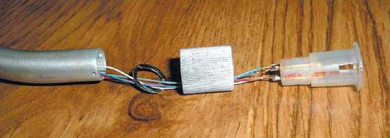
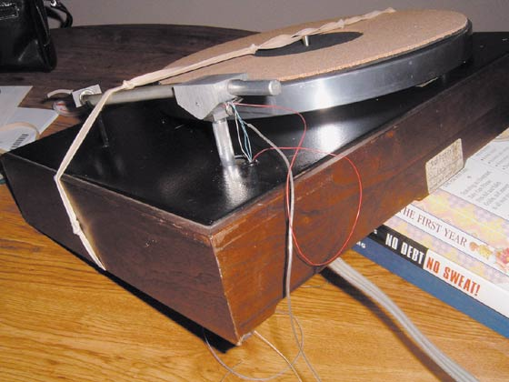
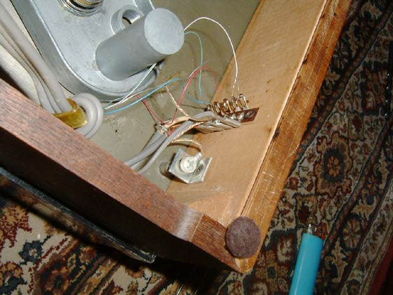
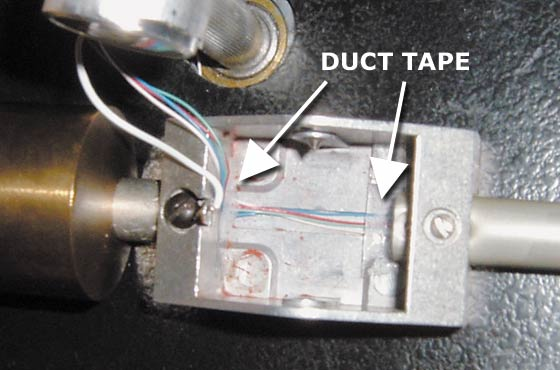
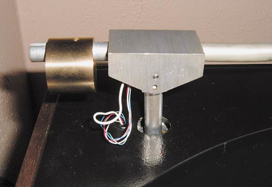
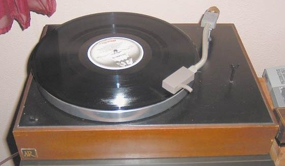

# Rewiring an AR XA Tonearm

> Archived copy, saved 2026-11-05. Original: <https://vinylnirvana.com/ar-turntable-resources/ar-diy-do-it-yourself/rewiring-an-ar-xa-tonearm>. Site: Vinyl Nirvana. Rights remain with the author and the original site.

## Rewiring an AR XA Tonearm

by Scott Hamrick

One common problem for aging AR XA turntables is frayed or broken tonearm wire. The tonearm wires run the length of the entire arm’s interior, pass through the metal plinth and connect to a wiring post that is screwed onto the inside of the wooden base. The point where the wires pass through the plinth is where damage is most likely, and it comes from decades of rubbing against the edge of the hole in the plinth.

I will give instructions on how to replace these wires based on my experience in rewiring my own tonearm. I am not an electronics or turntable repair expert, so you may know better ways of doing certain things. Use your own judgment if you are in doubt about my techniques. If you are similarly inexperienced, then let my success inspire you. If I can do it, almost anyone can! There is virtually no information available on the Web about rewiring an AR XA, so hopefully this article will change that. I was almost under the impression it couldn’t be done, but it definitely can be, and for very little money.

All that is required for this project are a few basic tools and some new wire. I bought new Cardas 33 gauge tonearm wire from Welbourne Labs (http://www.welbornelabs.com/). It is very tiny and flexible, which makes it just right for the job. I would not recommend using wire any thicker than 33 gauge, as even this is just a bit thicker than the original wiring. Welbourne sells it by the foot in five different colors. Be sure to buy different colors. I bought two feet of four of the colors. In retrospect, I might have done well to buy one foot of the fifth color for a ground wire. I also opted to buy Welbourne Labs’ own brand of solder for this project since it is made for audio applications and is much thinner than what I had on hand.

Obviously, a soldering iron will be necessary, as will solder braid, a cigarette lighter, a couple of small screwdrivers, wire cutters or scissors, pliers and a 5/16” drill bit.

The very first thing to do is to cut the tonearm wires. Cut them where they pass through the plinth and leave the remaining halves of the wires in place for now. This will allow you to remove the entire tonearm assembly from the turntable. At this time it’s probably best to also loosen the tiny screws on either side of the tonearm pivot so that you can remove the arm itself from the spindle. Be sure to screw these screws back into the arm pivot so that they can’t be lost. You will also need to get the ball bearing out from the inside of the tonearm bearing well and put it in a safe place for now.

Once the arm is separated from the turntable, you are ready for what is probably the riskiest part of the whole procedure – getting inside the tonearm. After removing the headshell from the front end of the tonearm, you will see a white plastic receptacle containing the four contacts that touch the pins at the back of the headshell. This has to be pulled out of the tonearm tube. Unfortunately, this receptacle is made of a somewhat soft, flimsy plastic, and it is very tightly fitted to the arm tube. There are two round dimples stamped into the sides of the arm tube. You may be able to see them if you pull on the collar used to tighten the headhsell into place forward a bit. These dimples and a little glue are what hold the receptacle in place. To remove the receptacle without damaging it, place the tail end of a 5/16” drill bit inside the receptacle. Pull the collar forward into its normal position and grasp it with your pliers. The drill bit and the collar will keep the receptacle from getting crushed as you pull it out of the arm tube. A little wiggling side to side will help but do not twist. Pull the receptacle straight out of the tube with the pliers. You should be able to do this with just a few tugs. Once the receptacle pops out of the arm tube, you should see that the dimples on the tube have created two grooves down the outside of the receptacle. You will probably also see a red line marked on the top of the receptacle. This should correspond to a red line indicating the top of the inside of the arm tube. You will also have a thin washer-like object. This part keeps the collar from sliding down the arm tube when the collar is loosened. If you have broken this part, it is not a great loss. If you have merely bent it, you should be able to flatten it out and reuse it.

Now you are almost ready to turn the table over and unsolder the remains of the tonearm wires that are still attached there. The silver outer braid is the ground wire. The other four colors are your signal wires. You may have to pull back the outer braid to clearly see them. Take note (write it down) of what color attaches to which of the posts that are screwed into the side of the wooden base.

You should also take note of which color wire attaches to which pin on the back of the headshell receptacle. Be sure to orient yourself with the red line at the top of the receptacle when doing this. Decide which color of the new wire will replace each color of the old wire (my colors didn’t all match). Also determine where each new wire should attach at the posts on the underside of the turntable.

Now you can unsolder the wires from the posts and from the receptacle. Use solder braid or a solder sucker so that you can remove the old solder. When working on the receptacle, keep in mind that the pins will get very hot. They are imbedded in plastic and they can and will move around inside the receptacle if they get hot enough and if you put too much pressure on them. Unfortunately the pins on the receptacle are very small and very close together, so this is challenging. Note that the pins are hollow. Try to remove enough solder so that you can see the hollows. You will want to insert your new wire into these hollows when you solder them into place.

Prepare your new wire for soldering by stripping one end. Use a lighter to burn off a small amount of insulation. Be careful, it burns quickly. Carefully solder all four pieces of wire to their appropriate pins on the back of the receptacle.

Now tie the loose ends of new wire together in a small knot. Thread the collar (screw threads facing forward), then the washer onto the wires. Then thread the wires through the arm tube.

Putting the receptacle back into the arm tube was even harder than taking it out. The front part of the receptacle is thin and flexible, so it does not offer much support for pushing the receptacle back into the tube. Be sure to have the collar pulled forward on the receptacle when pushing it into place. I did three things in order to make it easer to push the receptacle back in. I recommend trying each one at a time. First, I used my soldering iron to trace deeper grooves for the dimples in the arm tube. This created some ragged excess plastic on the edges of the grooves. This can be trimmed gently with a razor blade or sharp knife. Also, some lubricant is a good idea. I was reluctant to use anything petroleum based because I was unsure how it would react with the plastic over time. I used a small drop of olive oil rubbed around the outer walls of the receptacle with a cotton swab. If neither of these techniques work, a third, more radical technique can be used. This is to use a knife or razor blade to whittle down the leading edges of the receptacle. This is delicate work since you have new wires nearby. It should not be necessary to shave off too much, and it is not necessary to go all the way around. If you do have to use this technique, don’t shave off the top part where the red line is. I lightly shaved the sides where the grooves were, and I took a moderately sized sliver out of the bottom. I suspect this was not totally necessary though, so don’t do it unless nothing else works. While you are inserting the receptacle into the arm tube, be sure your red line is facing up. It may be helpful to draw a mark on the front edge of the arm tube that corresponds to the red line on the inside of the arm tube. You won’t be able to see the line on the inside while you are inserting the receptacle. You will also need to make sure your arm tube dimples are lined up to their grooves.

Pull the wires through the tube. You will see a small, shallow channel on the underside of the pivot. This is where the wires should go. You will need to fasten the wires into place inside the pivot so that they do not rub against the barrel-shaped joint at the top of the tonearm spindle. I cut two tiny strips of duct tape and laid them across the wires at the ends of the channel. Do not put anything in the middle, or it may interfere with proper movement of the tonearm. (The duct tape in the picture is clear and therefore hard to see, but it’s there.)

If you have not already done so, you will need to unscrew the screw at the back of the tonearm that holds the ground wire into place. Unsolder the remaining wire from the little eyelet that will come loose. I probably should have used a fifth piece of Cardas wire for a new ground wire, but I ended up using a wire from a cheap earphone (the goofy looking white plastic ones that come with cheap weather radios and go in only one ear). Some of the pictures you see in this article show a different wire that did not work very well. The new wire was almost as thin as the Cardas wire and eliminated the low-level buzz I had encountered with my first ground wire. Whatever you use, it will need to be nearly as thin and flexible as the tonearm wires. Solder your ground wire to the eyelet and screw it back onto the tonearm.

Now you are ready to put the tonearm back in place and thread all the wires through the hole in the plinth. You will need to cut the knot off of the main tonearm wires if you have not already done so. Once all five wires have been threaded through the hole in the plinth, you can turn the turntable over and solder each wire into its proper place on the wiring posts. If you have a dust cover for your turntable, you can turn your turntable over while leaving the tonearm in place by putting a folded towel inside the dust cover and turning the entire thing over. A series of looped rubber bands connected by a paper clip will also help hold your tonearm and even your platter in place. I used both.

When soldering your wires to the posts, start at the bottom and work your way up. You may find it easier to access each post if you bend the ones above it out of the way. Then, as you move to a new post, bend it into its regular position before soldering. Just be careful not to bend any of the posts too much. You don’t want any of them to break. You will need to trim the length of the wires slightly, but be sure you leave a few inches of slack. These wires will need to be taped down to the bottom of the plinth near the wiring posts. After that they will need additional slack to allow for movement of the subchassis and the tonearm itself as it moves across the record.

Once you have taped down your wires, all that remains is to adjust the positioning of the wires relative to the tonearm. You will need to experiment to see how much of the wires need to go above and below the plinth. You also have the option of twisting your wires by removing the tonearm and twisting it. This can get messy though, so be careful, and don’t let your ground wire get in the way. You may want to consider unscrewing it and not allowing it to get twisted with the other wires. Whatever you do, you need to be aware that the positioning of these wires can affect your turntable’s performance greatly. If they exert too much tension on the tonearm, they will impede its ability to track the record properly, and they can cause a reverse anti-skate force. Test for this by adjusting the counter weight so that the arm floats freely. Tap the headshell back and forth from side to side. If the arm tends to return to a more central position, the wires need to be adjusted.

This entire project should take about five hours. It’s not difficult; it just requires a little patience. Good luck!

Special thanks to Carlos Bauza, Roger Rojas and Dave Archambault
