# AR and Thorens Gallery

> Archived copy, saved 2026-11-05. Original: <https://vinylnirvana.com/ar-turntable-resources/ar-gallery>. Site: Vinyl Nirvana. Rights remain with the author and the original site.

# AR and Thorens Turntable Photo Gallery

This page features various AR Turntables both with and without mods. See the Top Ten links below for a healthy dose of Thorens projects as well.  With the advent of social media, I have stopped adding to these pages. You can find lots of recent examples on the [Vinyl Nirvana Instagram feed.](https://www.instagram.com/vinylnirvana/)

[My Top Ten Favorite Vintage Turntable Projects of 2013](https://vinylnirvana.com/ar-gallery/top-ten-vintage-turntable-projects-2013/)

[My Top Ten Favorite Vintage Turntable Projects of 2012](https://vinylnirvana.com/ar-gallery/top-ten-vintage-turntable-projects-of-2012/)

[My Top Ten Favorite Vintage Turntable Projects of 2011.](https://vinylnirvana.com/vintage-turntables-for-sale/top-ten-vintage-turntable-projects-of-2011/)

[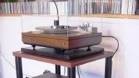](https://vinylnirvana.com/ar-turntable-resources/anthony-scillia-modified-table/ ) Fred Manheck’s AR EB101  [highly modified by Anthony Scillia](https://vinylnirvana.com/ar-turntable-resources/anthony-scillia-modified-table/ )

[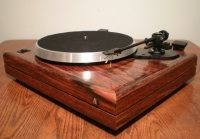](https://vinylnirvana.com/ar-turntable-resources/prototype-ar-turntable-in-rosewood) My own [Prototype AR the Turntable in Rosewood](https://vinylnirvana.com/ar-turntable-resources/prototype-ar-turntable-in-rosewood)

[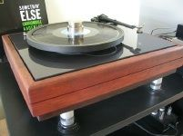](https://vinylnirvana.com/ar-gallery/rick-collins-custom-turntable) Rick Collin’s [Custom Turntable Inspired by the AR ES-1](https://vinylnirvana.com/ar-gallery/rick-collins-custom-turntable)

[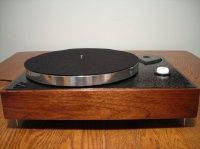](https://vinylnirvana.com/ar-gallery/frosten-xa/) An [AR XA modified by Steve Frosten](https://vinylnirvana.com/ar-gallery/frosten-xa/)

[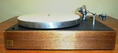](https://vinylnirvana.com/ar-gallery/first-xa-mod/) An AR Turntable that I  [modified](https://vinylnirvana.com/ar-gallery/first-xa-mod/) myself by adding a Mayware Formula 4 tonearm.

[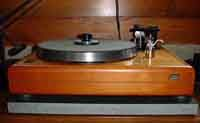](https://vinylnirvana.com/ar-gallery/sadler-es-1/) An AR ES-1 Turntable that was  [modified](https://vinylnirvana.com/ar-gallery/sadler-es-1/) by Joe Sadler featuring a Well Tempered tonearm.

[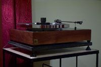](https://vinylnirvana.com/ar-gallery/heirloom-ette) An AR XA Mike Castellana calls his  [Heirloom-ette](https://vinylnirvana.com/ar-gallery/heirloom-ette)

[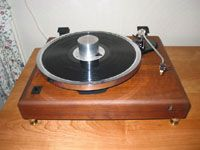](https://vinylnirvana.com/ar-gallery/carsons-es-1/) Carson’s  [Merrill-modified ES1](https://vinylnirvana.com/ar-gallery/carsons-es-1/)

[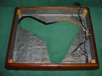](https://vinylnirvana.com/ar-gallery/carsons-es-1-the-parts/) Carson’s  [Merrill-modified ES1: The Parts!](https://vinylnirvana.com/ar-gallery/carsons-es-1-the-parts/)

[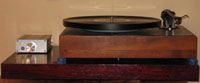](https://vinylnirvana.com/ar-gallery/bradley-ellis-modded-xa/) Brad Ellis’ [Modified AR XA](https://vinylnirvana.com/ar-gallery/bradley-ellis-modded-xa/)

[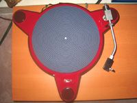](https://vinylnirvana.com/ar-gallery/john-masangkays-golden-orbit/) John Masangkay’s Futuristic AR XA Adaptation:  [Golden Orbit](https://vinylnirvana.com/ar-gallery/john-masangkays-golden-orbit/)

[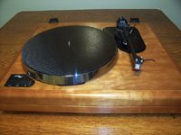](https://vinylnirvana.com/ar-gallery/ar-etl-1-the-research-series) My pride and joy: the elusive  [AR ETL-1, from “The Research Series”](https://vinylnirvana.com/ar-gallery/ar-etl-1-the-research-series)

[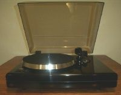](https://vinylnirvana.com/ar-gallery/piano-black-ar…esearch-series/) The exceedingly rare [AR ETL-1 in Piano Black, from “The Research Series”](https://vinylnirvana.com/ar-turntable-resources/piano-black-ar-etl-1-the-research-series/)

[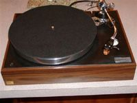](https://vinylnirvana.com/ar-gallery/david-wilsons-…-turntable-003) An AR Turntable modified by the great  [David Wilson](https://vinylnirvana.com/ar-turntable-resources/david-wilsons-s-m-ar-t-turntable-003/)

[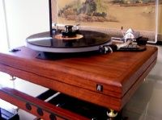](https://vinylnirvana.com/ar-gallery/erics-modded-table/) An AR Turntable modified by [Eric.](https://vinylnirvana.com/ar-gallery/erics-modded-table/)

[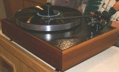](https://vinylnirvana.com/ar-gallery/ar-xa-modified-by-clyde-selsor/) An AR XA Turntable modified by [Clyde Selsor.](https://vinylnirvana.com/ar-gallery/ar-xa-modified-by-clyde-selsor/)

Please contact me at the link below to add your turntable to the gallery.

[Contact Vinyl Nirvana](mailto:dave@vinylnirvana.com)
