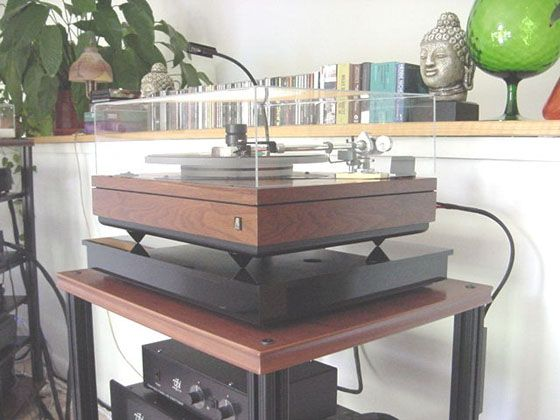
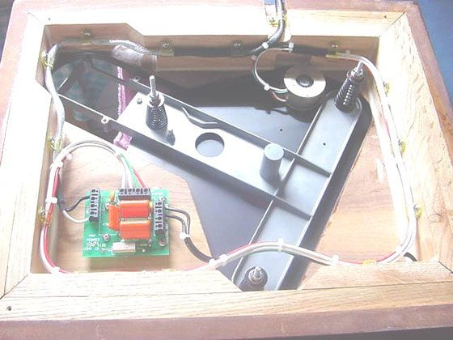
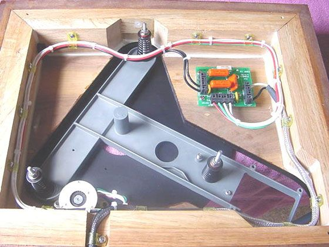
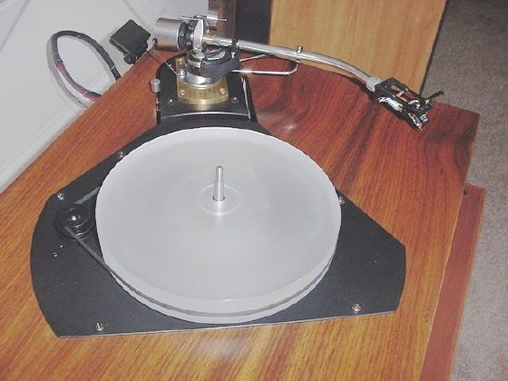
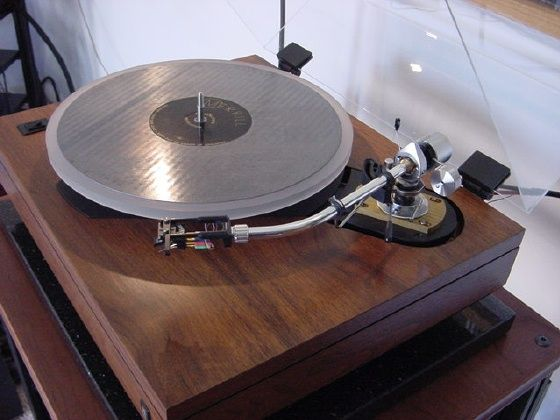
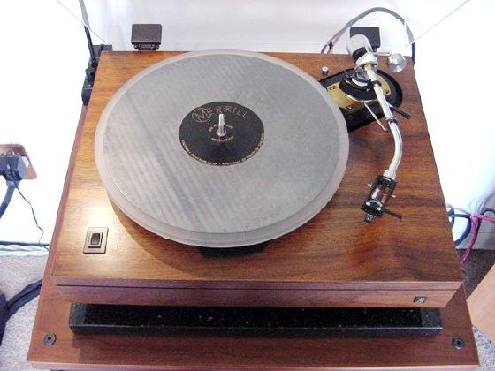
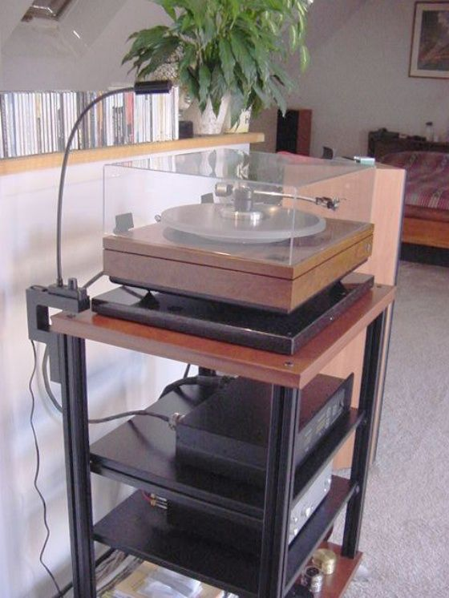

# Anthony Scillia Modified Table

> Archived copy, saved 2026-11-05. Original: <https://vinylnirvana.com/ar-turntable-resources/ar-gallery/anthony-scillia-modified-table>. Site: Vinyl Nirvana. Rights remain with the author and the original site.

Fred Manheck’s Modified EB-101

The work of Anthony Scillia…

Plinth completely refinished.Machined oak to increase thickness to 2.1/4″.3/4″MDF baseboard primed/painted with automotive paint,threaded inserts installed for Blackdiamond cones, Access holes for suspension adjustment. Stainless steel machined subchassie studs,Linn springs/lower grommets,locknut adjusting nuts.

Top and switch plate sandblasted and repainted. New switch.Completely rewired/Linn Basic power supply.

Stainless steel threaded shaft.Stainless steel/co-polymer record clamp.Acrylic inner platter,Merrill outer platter/lead mat. Co-polymer pulley/armboard.

Subchassis glass-beaded.SME arm modified with silver wire,Analog Tube Audio bronze bearing and base machined to work with suspended deck

Custom lexan cover.All new hardware throughout.New motor,VPI SDS.Sumiko Blackbird cartridge is the choice for now

