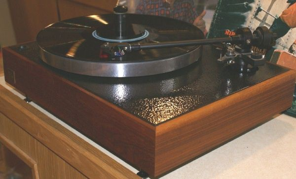
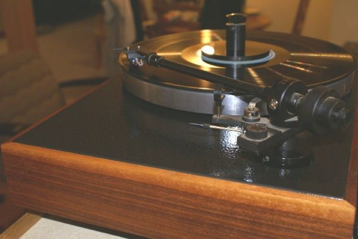
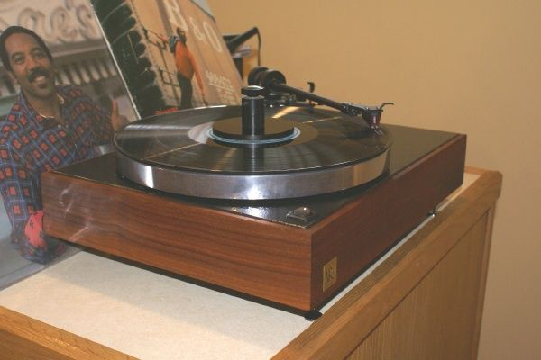
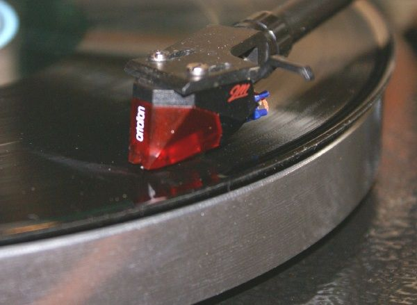
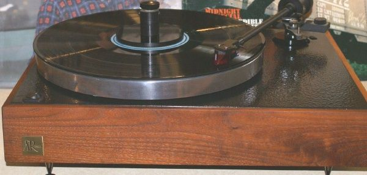
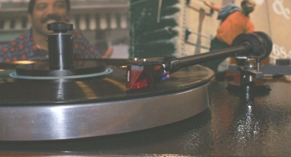

# AR XA Modified by Clyde Selsor

> Archived copy, saved 2026-11-05. Original: <https://vinylnirvana.com/ar-turntable-resources/ar-gallery/ar-xa-modified-by-clyde-selsor>. Site: Vinyl Nirvana. Rights remain with the author and the original site.

AR XA Modified by Clyde Selsor

“First of all, I was given the motor, pecan base, top plate, springs and platter assembly. These parts sat in my garage collecting dust for around five years. Someone from Audio Karma (to which I am a subscribing member) posted a link to your website, and the pictures inspired me to begin modifying my XA. I purchased a used T-bar from a seller on eBay, and once I received it, I began the work.”

“I first cut off the tonearm bearing port and found a 1/8″ thick piece of aluminum stock that fit perfectly between the outer ridges of the t-bar. I already had a Profile tonearm (commonly found on the mid eighties Sonograph turntables) that I wanted to mount, but did not have the mounting template. So I set the tonearm on the top plate with the platter in place and made an estimate using a dB systems protractor, of where to mount the arm! I drilled a 2-3/8″ hole in the top plate to allow the mounting donut supplied with the tonearm, to come through from the bottom. I mounted the donut to the aluminum piece, and then that assembly to the t-bar.” p>

“Next, I drilled a 7/8″ hole for the new power switch, where the old rectangle hole was located. I then sanded the top plate down to bare metal and gave it five coats of grey primer. Next was six coats of Rustoleum black hammertone finish. I was careful to get the coats evenly applied as to maintain a consistent hammertone pattern. I then began sanding the solid wood base, first with 80 grit, then 120, 220 and then 320. I rubbed it down with a tacky cloth and then applied two coats of boiled linseed oil.”

“I replaced the suspension tension rods with stainless steel bolts and added wing nuts for the adjustable tension. I replaced the filter cap that goes across the power switch terminals with a new one (I don’t recall the brand but it was inexpensive). I assembled the turntable and added three spikes to the bottom (two in front, one in back)and installed a new belt, and thanks to your website I learned about the talcum powder treatment! I installed an Ortofon 2m Red cartridge and a rubber mat from an old Technics turntable. I used a strobe disc and was pleasantly surprised that both 33-1/3 and 45 rpm speeds were dead on. I clamped an LP to the platter using a Sota I-clamp and have been really enjoying this turntable ever since.”

