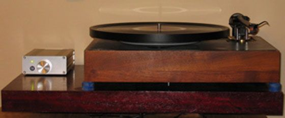
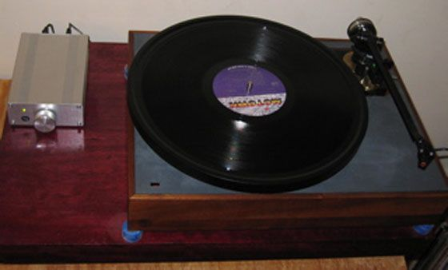
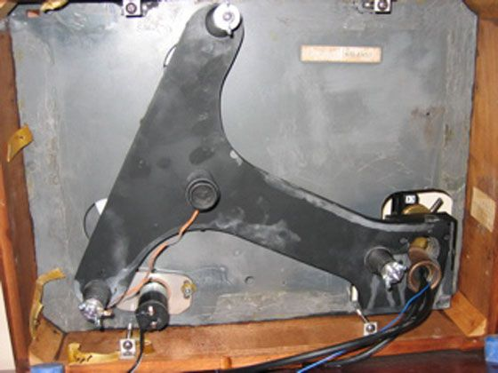
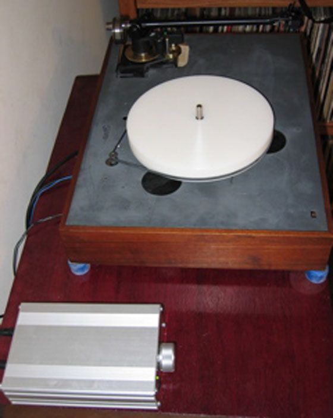

# Bradley Ellis’ Modded XA

> Archived copy, saved 2026-11-05. Original: <https://vinylnirvana.com/ar-turntable-resources/ar-gallery/bradley-ellis-modded-xa>. Site: Vinyl Nirvana. Rights remain with the author and the original site.

AR XA Modified by Bradley Ellis

AR XA upgrade with original walnut hardwood plinth and original top plate. Motor is Origin Lives’ Advanced switch box with DC100 dc motor.

Tone-arm is Origin Lives’ OL1 fully modified. Tone-arm counterweight is Expressimo Audio’s “Heavy Weight.” VTA adjustment is via Pete Riggle’s VTAF.

Sub-chassis, outer platter and peripheral clamp are via George Merrill. Suspension springs and rubber grommets are from Linn.

Delrin II inner drive platter is via Anthony Scillia (as are the stainless steel studs and stainless/nylon adjustment wing nuts for the suspension.)
