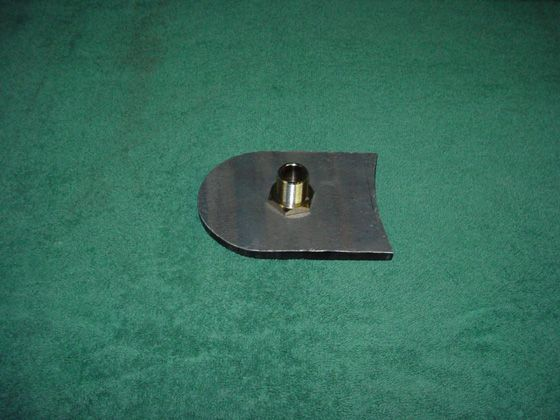
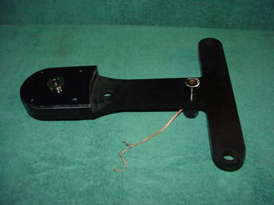
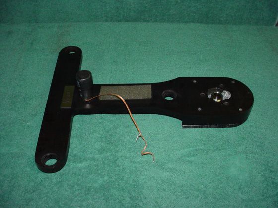
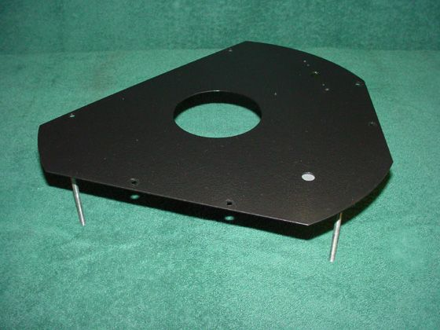
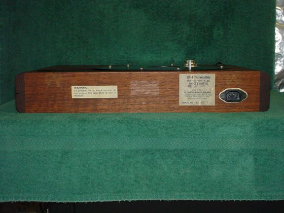
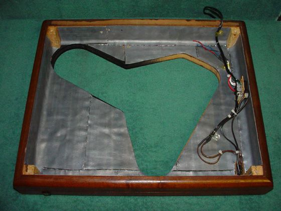
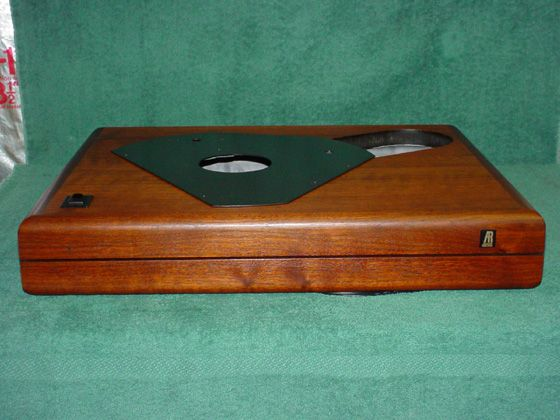
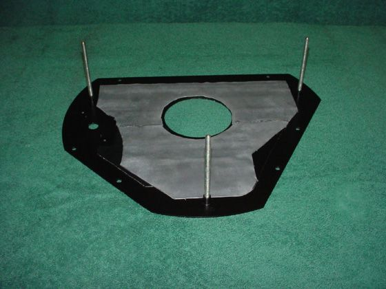
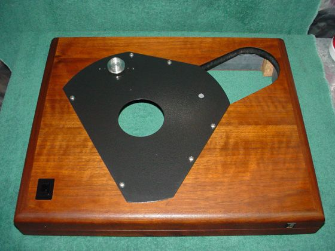
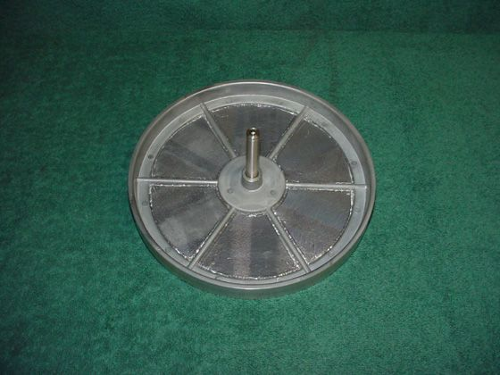

# Carson’s ES-1: The Parts

> Archived copy, saved 2026-11-05. Original: <https://vinylnirvana.com/ar-turntable-resources/ar-gallery/carsons-es-1-the-parts>. Site: Vinyl Nirvana. Rights remain with the author and the original site.

Carson Hanrahan’s Merrill-modified ES-1: The Parts!

Acrylic Armboard with Lead Damping

Merrill Subchassis Top View

Merrill Subchassis Bottom View

Plinth Top with Textured Krylon Paint

Back of Base with Filtered IEC

Underside of Base with Lead damping

Front Side of Base

Plinth Bottom with Audiomat and Lead Damping

Plinth Top View

Inner Platter with Lead Damping
