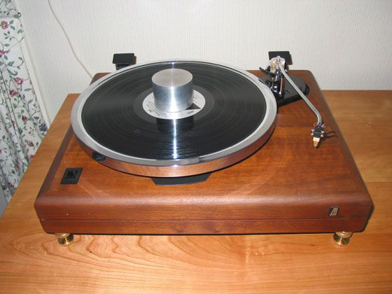
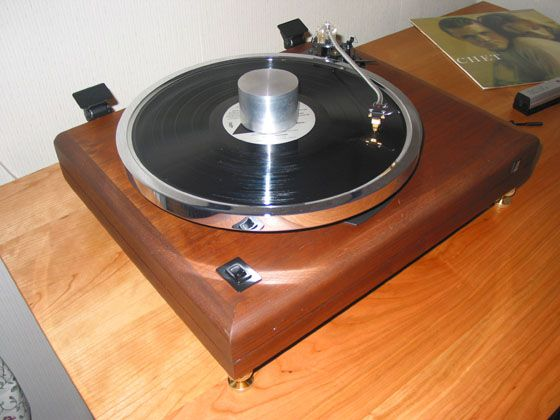
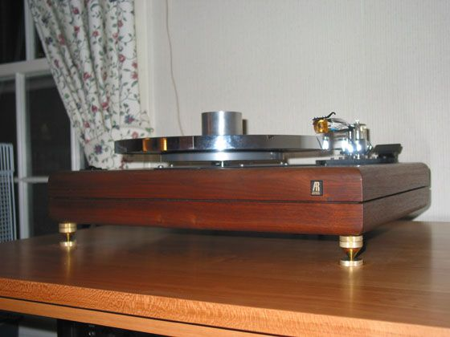

# Carson’s Merrill Modded ES-1

> Archived copy, saved 2026-11-05. Original: <https://vinylnirvana.com/ar-turntable-resources/ar-gallery/carsons-es-1>. Site: Vinyl Nirvana. Rights remain with the author and the original site.

Carson Hanrahan’s Merrill-modified ES-1

AR ES-1 w/Merrill subchassis, bearing, motor, power supply, springs, acrylic outer platter, and lead mat. center weight/clamp; periphery weight/clamp

Inside of plinth fully damped with Audiomat & #8 lead flashing; brass cone feet on solid maple blocks.

Tonearm: Morch UP-4; Cartridge: Benz Micro Glider H2
