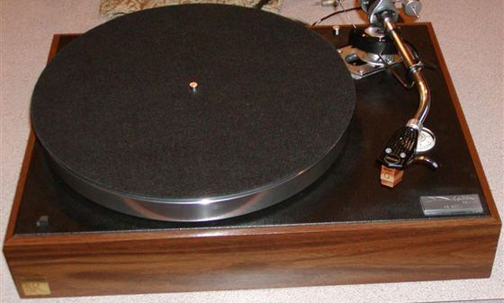
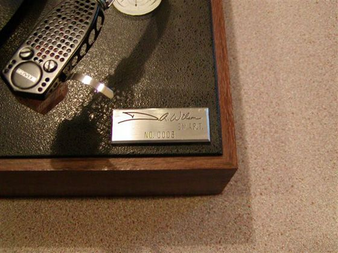
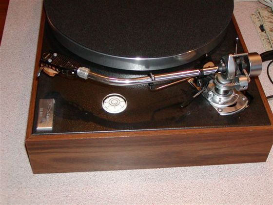
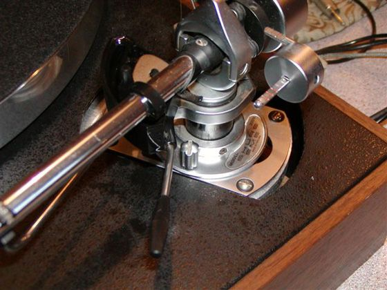
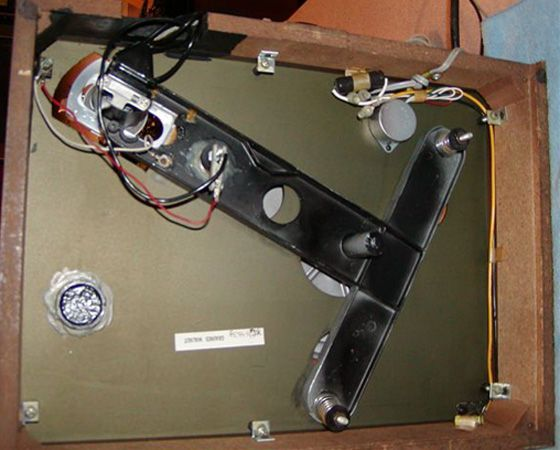
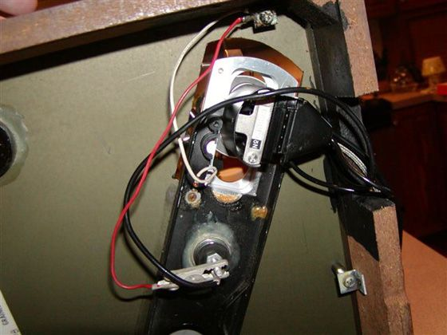
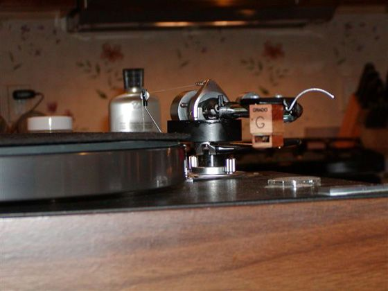

# David Wilson’s S.M.AR.T. Turntable #003

> Archived copy, saved 2026-11-05. Original: <https://vinylnirvana.com/ar-turntable-resources/ar-gallery/david-wilsons-s-m-ar-t-turntable-003>. Site: Vinyl Nirvana. Rights remain with the author and the original site.

David Wilson’s S.M.AR.T. Turntable #003

David Wilson now owns and runs Wilson Audio Specialties. Early in his career, in the 70’s he was into equipment modification. He disliked the crude AR tonearms. He therefore applied a few of his own unique modifications as seen here which allowed the SME 3009 tonearm to be correctly integrated into the AR suspension. Dave made these while living in Illinois during 1973. A total of approximately 20 units were made by David. The current proud owner is Tim Larsen.

Close up of the Wilson badge.

Focus on the SME arm.

Close up of his fine work mounting the arm from above.

The underside.

Close up of the modified suspension.

The Grado Wood Body Cartridge
