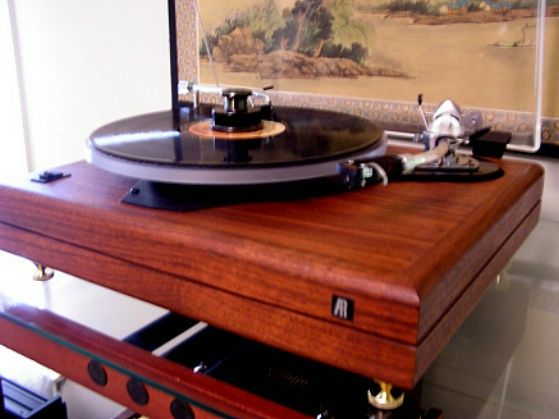
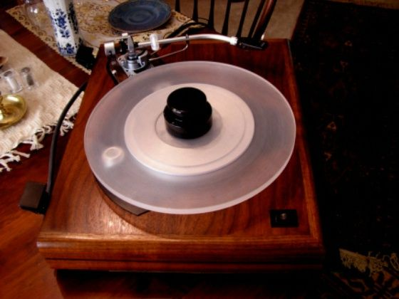
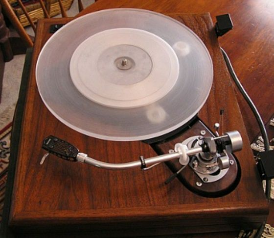
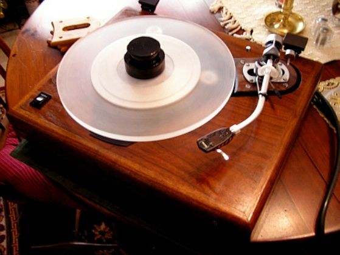
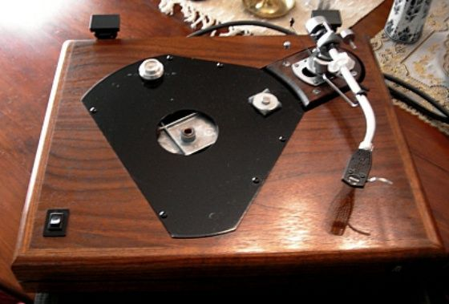
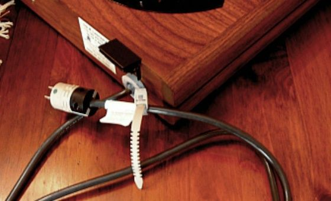
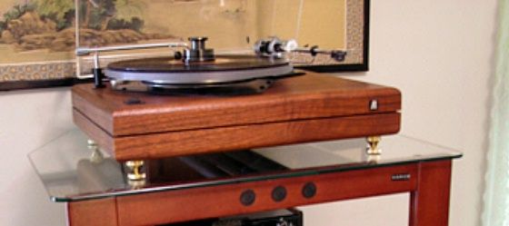

# Eric’s AR “The Turntable” with Mods

> Archived copy, saved 2026-11-05. Original: <https://vinylnirvana.com/ar-turntable-resources/ar-gallery/erics-ar-the-turntable-with-mods>. Site: Vinyl Nirvana. Rights remain with the author and the original site.

Eric’s AR “The Turntable” with Mods

Using several of Anthony’s mods, and some of his own, Eric has modified several AR turntables in recent years. You may have seen some of his auctions on eBay.

Outer acrylic platter (produced by Anthony Scillia of George Merrill fame) and Merrill Lead mat (produced by Anthony Scillia)

SME Series II Improved tone-arm with detachable head-shell and and Herbie damper

SME damped tone arm base (solid hardwood high mass). (Whitacre) Solid Walnut SME base plate.

Spring and lower grommet kit (produced by Anthony Scillia)

Audio/hospital grade power cord mod. (Whitacre) and Sub-chassis custom damped (Whitacre)

Just gorgeous!
