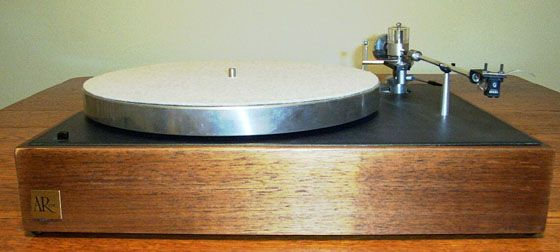
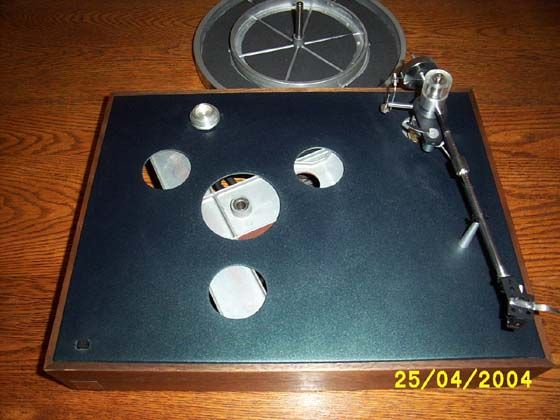
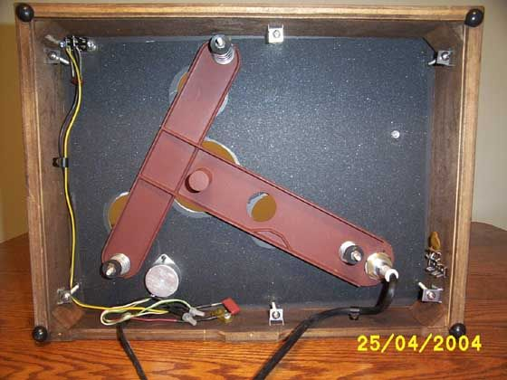
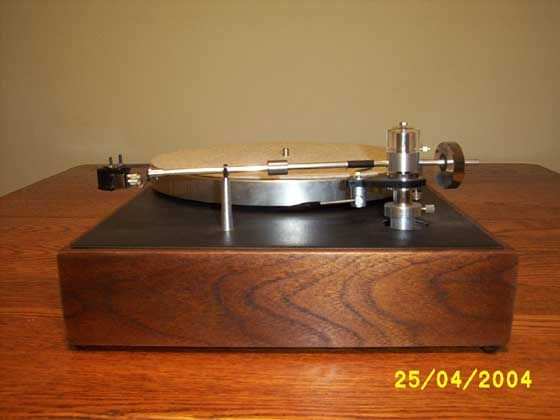
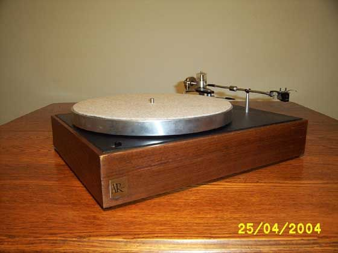

# First XA Mod

> Archived copy, saved 2026-11-05. Original: <https://vinylnirvana.com/ar-turntable-resources/ar-gallery/first-xa-mod>. Site: Vinyl Nirvana. Rights remain with the author and the original site.

My First AR Turntable MOD

This is the finished product with Mayware Formula 4 Tonearm.

A topless picture.

Underneath, I primed the t-bar and damped the underside of the metal plinth with a dynamat-type product.

