# Frosten XA

> Archived copy, saved 2026-11-05. Original: <https://vinylnirvana.com/ar-turntable-resources/ar-gallery/frosten-xa>. Site: Vinyl Nirvana. Rights remain with the author and the original site.

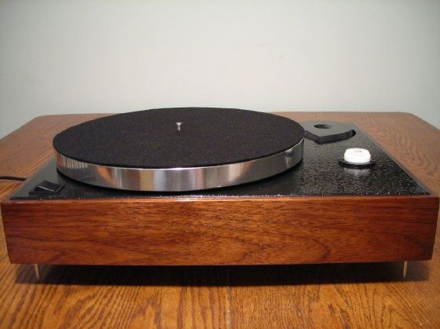

This unit appeared on eBay in October, 2007. I emailed the seller and learned it was modified by Steve Frosten. I’ve seen Steve’s refurbished XAs on ebay before, and I’ve admired his first class approach to restoration. While the auction was in progress, an [interesting thread](http://www.vinylengine.com/phpBB2/viewtopic.php?t=10169&sid=7a2a9916a53d54846f79baba970baf92) started at Vinyl Engine regarding XA mods. Well, it turns out I won the auction for the table modifed by Steve, and this gallery showcases the unit and his approach to changing out an arm on an XA, as well as other upgrades. Enjoy.

Shown armless, the armboard is for a Rega arm.

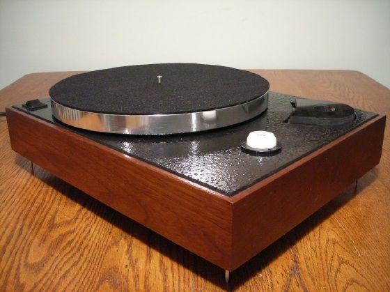

The old XA switch was replaced with a toggle switch. The metal plinth was sanded and painted.

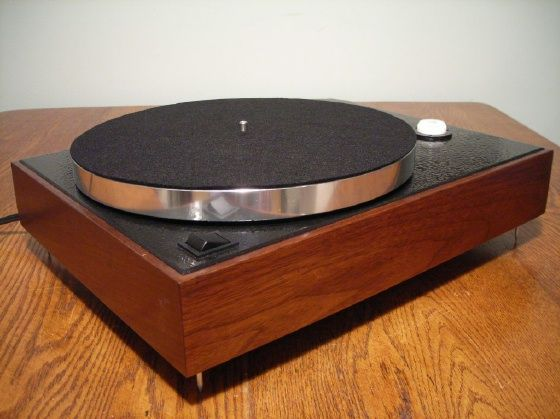

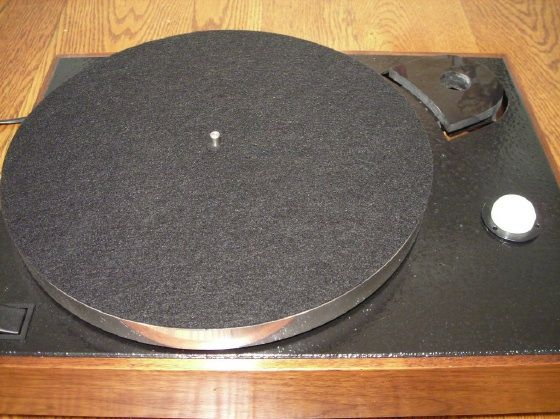

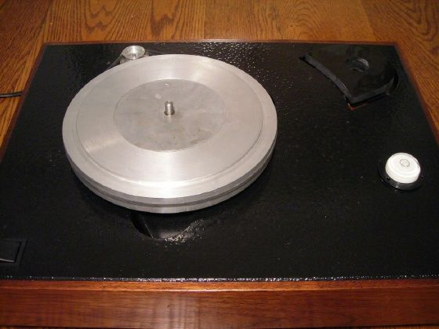

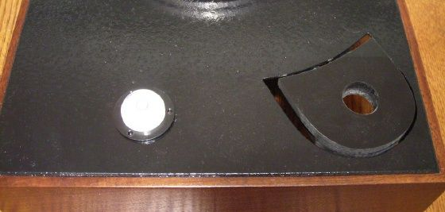

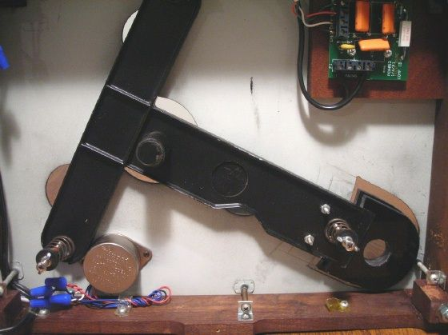

The next series of photos show the modifications to the subchassis. Also, note the Linn power supply, and the upgraded Hurst motor.

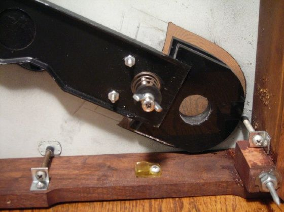

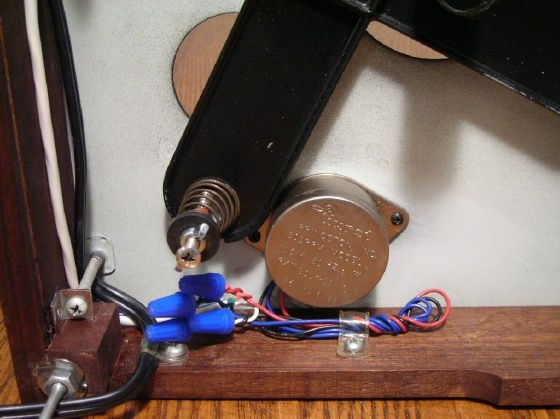

Steve replaced the old XA spring studs/nuts with screws and a finger nut.

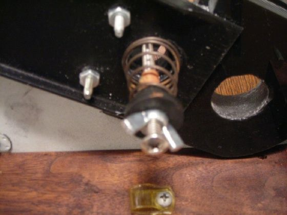

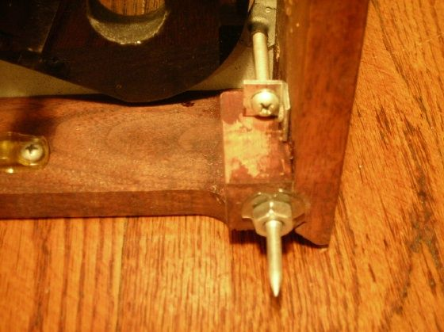

The following photos show numerous angles of the sub-chassis and armboard. Hopefully, a picture is worth a thousand words.

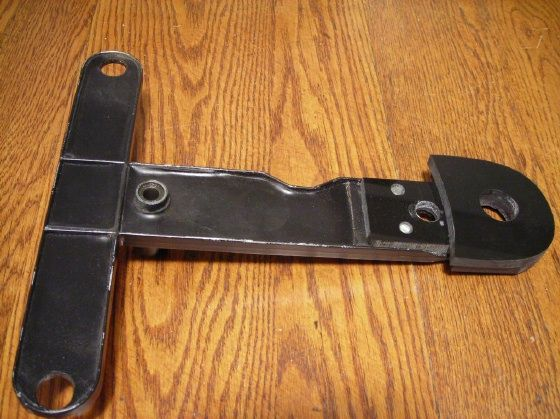

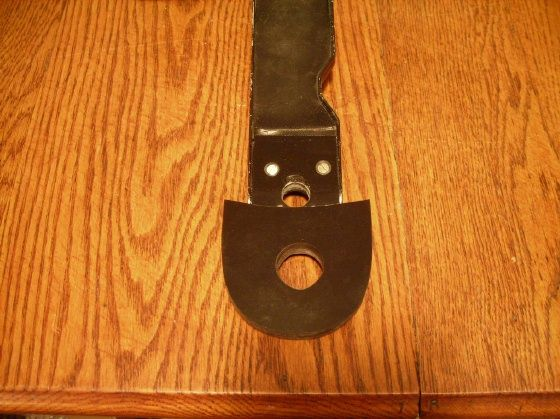

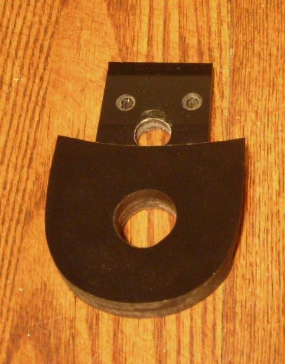

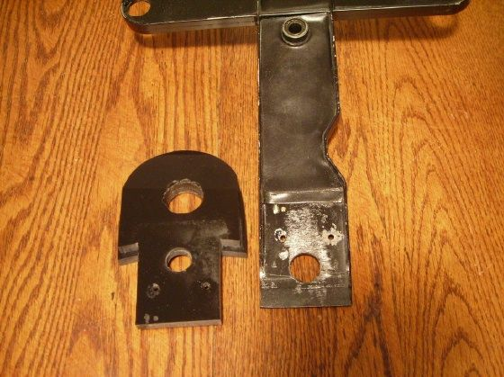

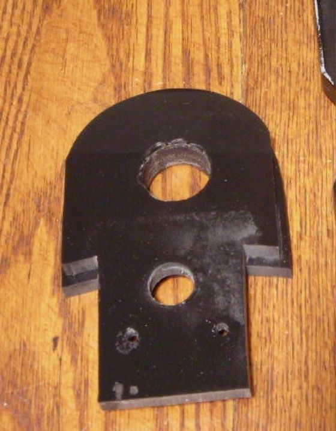

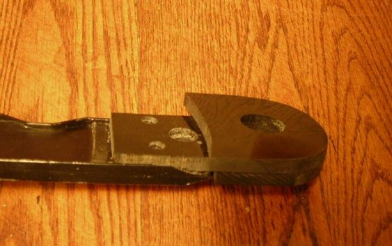

Closeup of the previously mentioned Linn power supply.

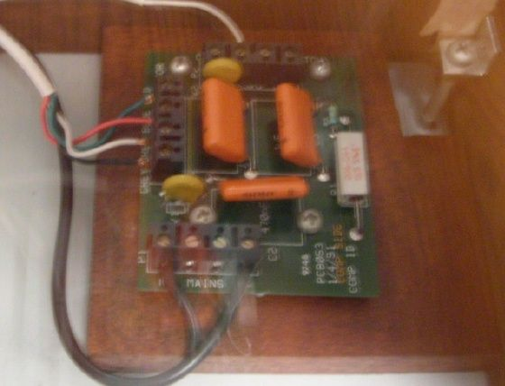
