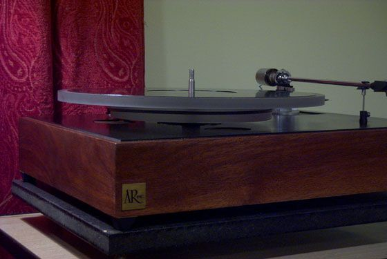
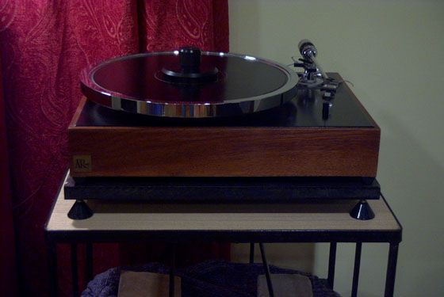
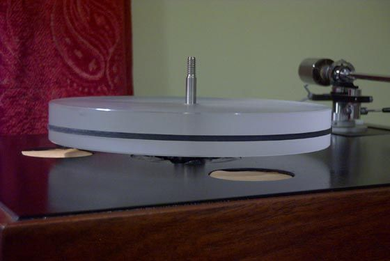
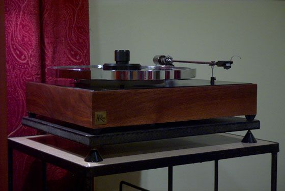

# Mike Castellana’s “Heirloom-ette”

> Archived copy, saved 2026-11-05. Original: <https://vinylnirvana.com/ar-turntable-resources/ar-gallery/heirloom-ette>. Site: Vinyl Nirvana. Rights remain with the author and the original site.

Mike Castellana’s “Heirloom-ette”

This particular AX is kinda’ neat… I call it my “Heirloom-ette”. The only “factory” items left are the deck’s base and top which have both been “undercoated” in dyna-mat. The top especially, in its stock form, is very flimsy and with the sub-chassis supported by springs riding the threaded rods hung from this top… it seems logical that any vibration from the top would be easily transmitted into the sub-chassis.

The sub-chassis and outter platter are also from Mr Merrill. (both are acrylic. outter platter top is lead coated) The acrylic inner platter, new bearing shaft, threaded spindle and two piece delrin inner clamp were made for me by Anthony Scilia. Anthony’s workmanship is top shelf and very reasonably priced.

I also use Merrill’s periphery clamp (HUGE, HUGE improvement!!!). The arm (which I guess is the weak link here) is a Grace 707. The cartridge is the Shure V15VxMR. By the way, the Shure cartridge is NOT compatible with Merrill’s clamp

By the way… when I was simply running an modified AX with the Grace/Shure combo, one of the most significant improvements came when I lost the felt mat and began using Merrill’s lead mat and springs (“A” type)… just beautiful!! For 50 bucks (I think) you can’t go wrong… all AX owners should know this IMVHO
