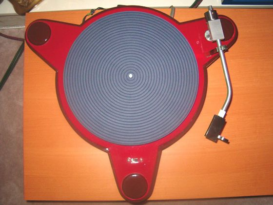
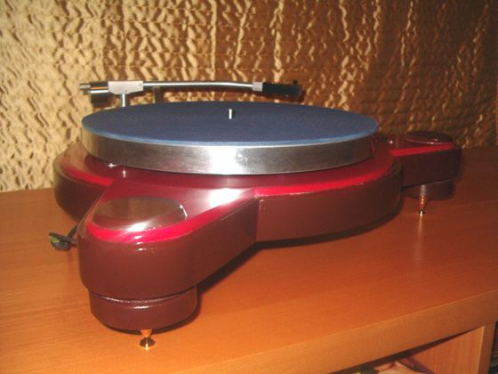
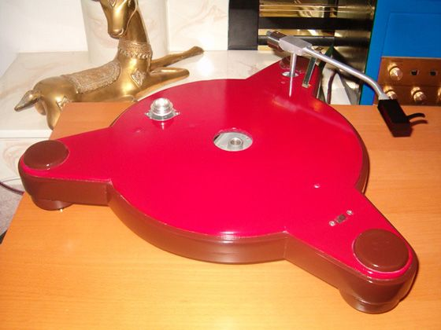
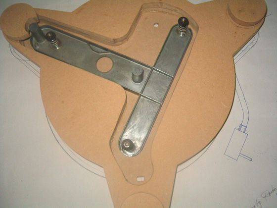
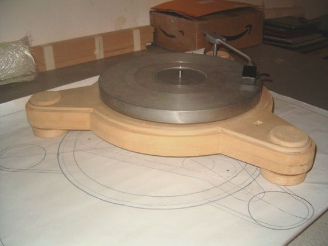
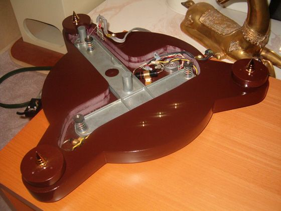
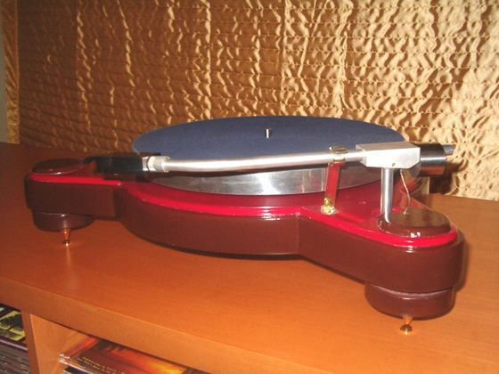

# John Masangkay’s “Golden Orbit”

> Archived copy, saved 2026-11-05. Original: <https://vinylnirvana.com/ar-turntable-resources/ar-gallery/john-masangkays-golden-orbit>. Site: Vinyl Nirvana. Rights remain with the author and the original site.

John Masangkay’s “Golden Orbit”

John calls this AR XA incarnation the “Golden Orbit” because it is “golden of its age, and orbit is its action.”

John states the table was inspired by pricey tables such as Micro Seiki and Oracle. He loves the rounded design.

The “retro combination color” is “espresso” and “old cherry.”

John loves the conflicting elements of the design…the modern form with the vintage electronics and colors.

Purists may snub their noses, but look at the way John has incorporated the original components! Very savvy.

