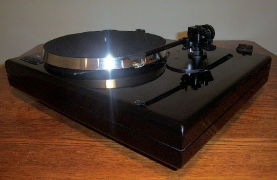
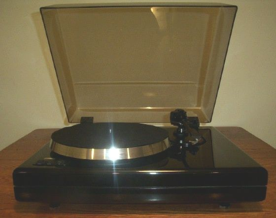
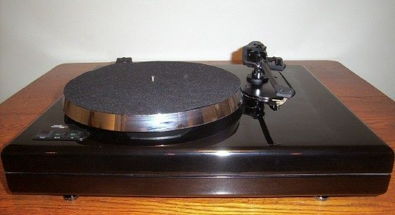
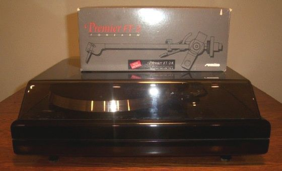
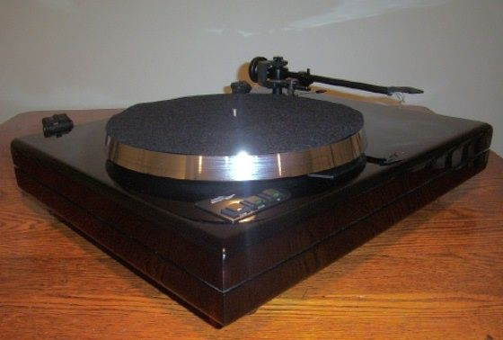
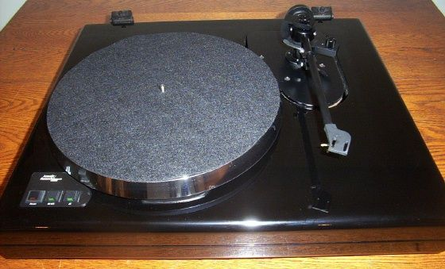
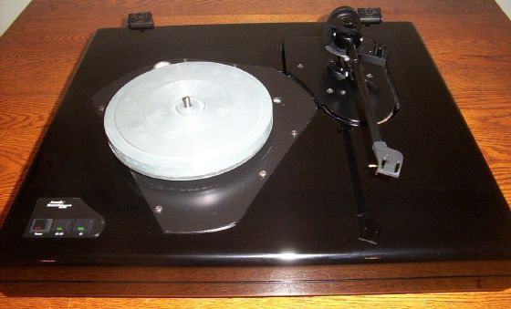
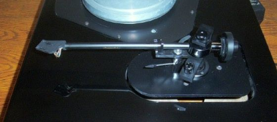

# Piano Black AR ETL-1 “The Research Series”

> Archived copy, saved 2026-11-05. Original: <https://vinylnirvana.com/ar-turntable-resources/ar-gallery/piano-black-ar-etl-1-the-research-series>. Site: Vinyl Nirvana. Rights remain with the author and the original site.

AR ETL-1 “The Research Series”

Details and Specs available on the [AR-ETL-1 Model Page](https://vinylnirvana.com/ar_models_etl1.shtml)

This is the rare Piano Black version. Before this one appeared, I thought maybe it was an error that some folks were claiming the ETL-1 came in Piano Black.

This one comes with the Sumiko FT-3 tonearm.

In case you are wondering, the underside is also painted gloss black.

