# Prototype AR Turntable in Rosewood

> Archived copy, saved 2026-11-05. Original: <https://vinylnirvana.com/ar-turntable-resources/ar-gallery/prototype-ar-turntable-in-rosewood>. Site: Vinyl Nirvana. Rights remain with the author and the original site.

Prototype AR the Turntable in Rosewood

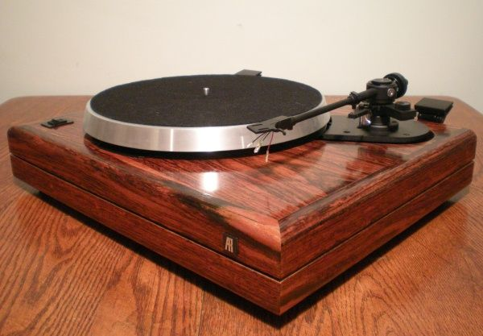

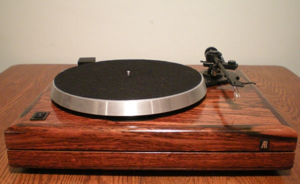

The Story: It takes countless hours of cruising eBay and Audiogon to find deals on turntables. Just lately (Nov, 2008), I have also begun searching Craiglist in my tri-state area. I have been lucky on a few electronics items, but it always seemed like I was hours or days behind any AR turntables to appear. Well, that all changed

It was mid afternoon, when I picked up my laptop to see if anything had come up. I got to the MA Craiglist electronics page, and someone had JUST listed an AR the Turntable. It wass the second item on the page. The description stated it had a “rosewood base.” Attached to the ad was a standard picture of an AR the Turntable in walnut. The ad stated that the picture was not of the table for sale. Of course I knew that AR never made any turntables with Rosewood, so I was thinking it just might be a cherry ES-1 and the guy just didn’t know types of woods.

I ran to the phone and dialed the guy’s number. It went to voicemail. I told him I wanted the table and would pay full price. My only condition would be that the veneer was in great shape.

He called back about an hour later and said the table is mine. I again expressed my concern about the veneer, and he said that it had been in an attic for years, but that when he put it away, the veneer was flawless. We continued our conversation, setting up that I would meet him the next day at his current business.

I got there , and when I walked into his office the turntable was sitting on a conference table. It was NOT a cherry ES-1. It was actually an AR the Turntable with rosewood veneer. It looked just stunning, and I asked, “So at some point did you have the table re-veneered?”

“What do you mean?”he asked

I said, “Well the AR the Turntable only came in walnut veneer.”

He was a little taken aback by my knowledge, and so he said, “I’ll let you in on the secret behind that table.”

He went on to explain that he worked for AR/Teledyne during the eighties, in marketing, and when they were first going to introduce the AR the Turntable, the company commisioned six in a variety of veneers to see how they would look. The rosewood was never chosen but this rosewood model fell into his hands. He had been the only owner since 1984.

Of course, by this time my jaw was dropping to the floor. How long did you work for AR/Teledyne? I asked.

“About ten years,” he answered.

I explained who I was and told him about Vinyl Nirvana. He had never heard of the site. I told him to google AR Turntable sometime and he’ll find it the first hit.

“Really?!” he said incredulously.

We went on to talk for a few more minutes, but he was in his office so I didn’t want to bug him too long. I handed over the money and went to grab the table. He said, “You wouldn’t be interested in the original carton and packing, would you? It’s right over here.”

Yes, it was all there.

Together we packed the table…again he was impressed that I knew just how everything went. I was about to depart and he asked me, “So what is this table really worth?”

I said, “Well, I’ve never seen one like it, and with your story and credentials to authenticate it, I would say it’s at least a grand.”

He winced a bit. I told him, look, I buy these tables because I love them…when you visit the site, you will see that. To me, this table was meant to fall into my hands. I will take plenty of photos for the gallery, and I’ll tell your story along with it. I can’t promise you I won’t ever sell it, but the way I feel right now, it’s not going anywhere.

We said our good byes, and I reminded him to visit the website and if he thought of any info he’d like to add, to send me an email.

So that’s the story.

Who’d a thunk…a rosewood AR??!!

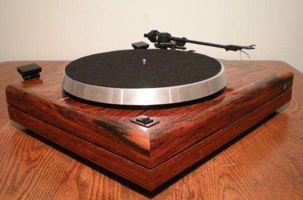

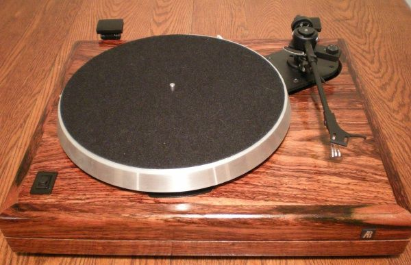

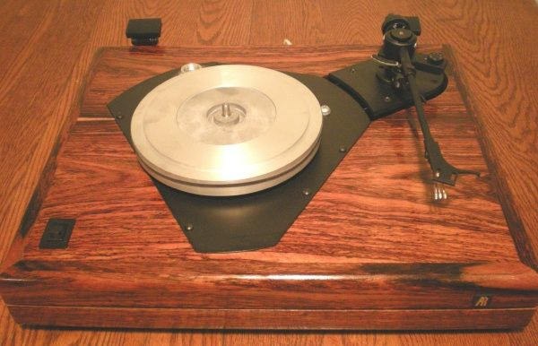

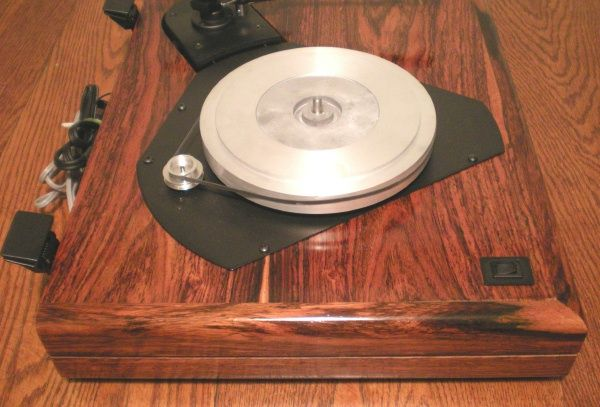

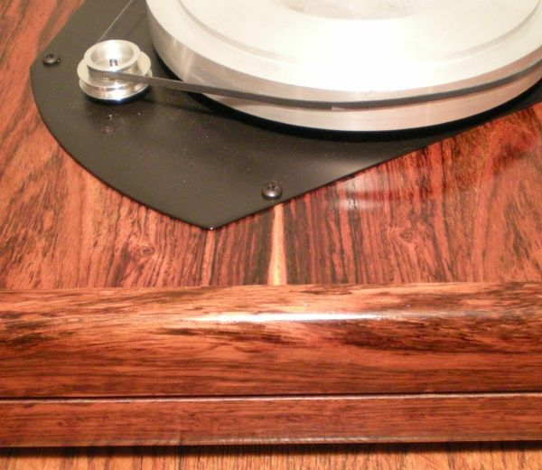

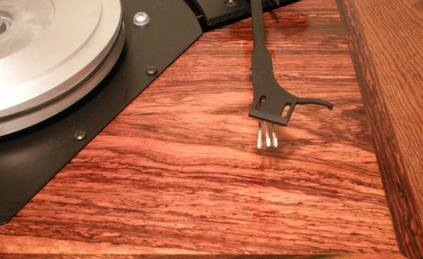

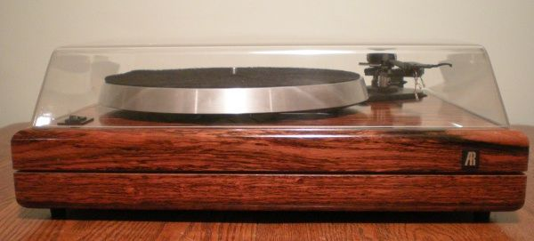

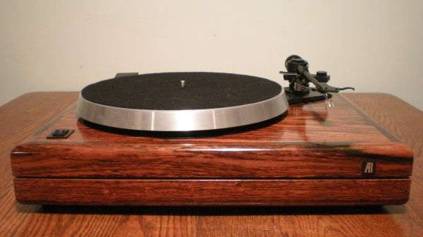

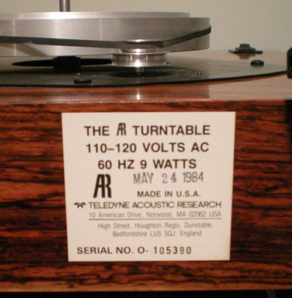
