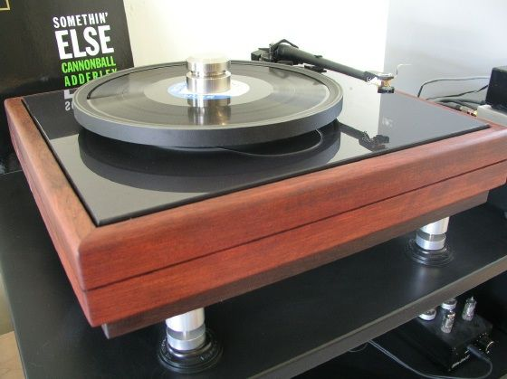
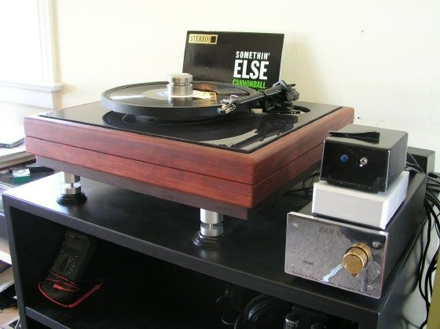
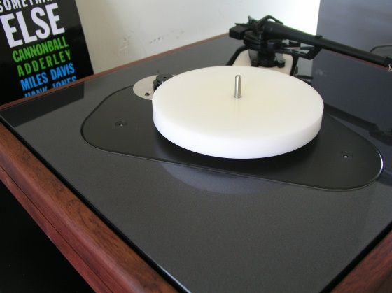
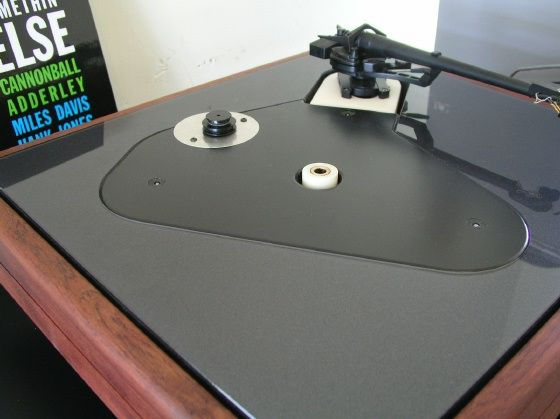
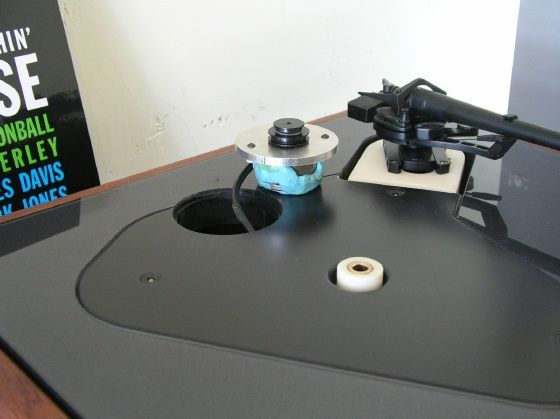
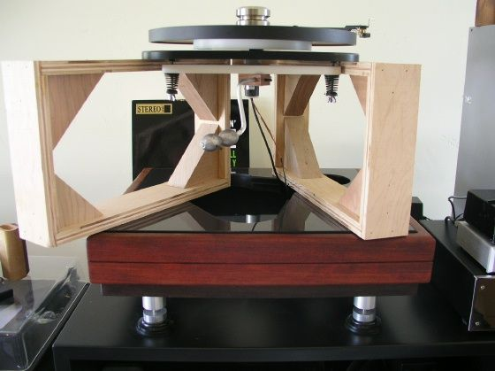
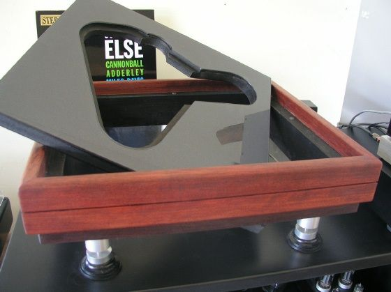

# Rick Collin’s Custom Turntable

> Archived copy, saved 2026-11-05. Original: <https://vinylnirvana.com/ar-turntable-resources/ar-gallery/rick-collins-custom-turntable>. Site: Vinyl Nirvana. Rights remain with the author and the original site.

Rick Collin’s Custom Turntable

Inspired by the AR ES-1

The custom work of Rick Collins using the MS Research mods….

Rick writes: “There are no original parts left on this table so I guess it isnt an AR anymore but that is the platform I started with. I incrementally installed all the MS Research parts and mods. Anthony was an incredible resource and an invaluable help. He helped me with all my technical questions and was more than generous with his time and talent. The first couple shots show the overall TT, the base is bubinga and wenge laminated to 1″ mdf to increase mass. The deck is 1″ mdf laminated on top with vitricore and on the bottom with hpl.”

“The deck sits on 4 small silicon isolation pads and as such the area of contact with the base is less than 12mm sq. The main chassis is made of 1/2″ garolite instead of the sheet metal of the original; it’s very dead sounding and the spring studs are attached with rubber isolated well nuts which are just a light press fit.”

“The next shot shows the motor which is mounted on a 1/2″ aluminium disc a little off center which affords a small amount of belt tension adjustment by rotating the disc in its recess. This base arrangement seems to give a high degree of isolation.”

“The next shot shows the overall suspension with a balancing weight I cobbled from some aluminium bar and a couple fishing weights, this is a temporary fixture until I have time to machine a more gracefull one that Anthony described to me, but in the meantime it allows me to balance the spring tension to a very fine degree.”

“The last shot shows the deck loose, the whole TT can be assembled and disassembled in a few minutes with no tools. I’m borrowing the motor and power supply from my George Merrill modified ES1 which I will soon be replacing with the Sound of the Wood Speed Box and motor.”

“The arm is SME V and the cart I’m listening to now is a Clearaudio Insider. I made an adapter plate and tried it with a couple of Rega arms and it sounded great I also tried several different cartridges and they all sounded good just different flavors.”
