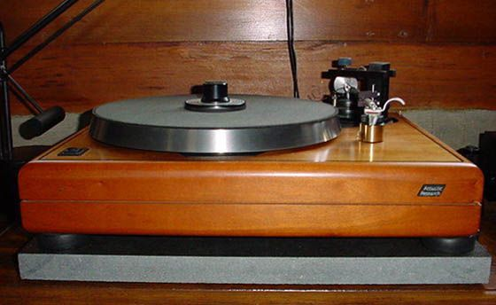
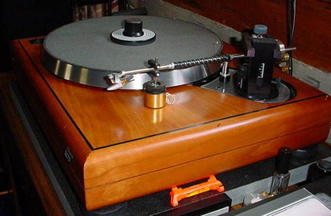
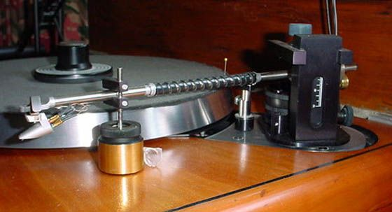

# Sadler ES-1

> Archived copy, saved 2026-11-05. Original: <https://vinylnirvana.com/ar-turntable-resources/ar-gallery/sadler-es-1>. Site: Vinyl Nirvana. Rights remain with the author and the original site.

Joe Sadler’s ES-1 with Well Tempered Tonearm

Platters were damped as well as arm and silicone cup, and base of arm. Custom Acrylic board. Low output Talisman MC with head amp.

Another view

Close up of Arm
