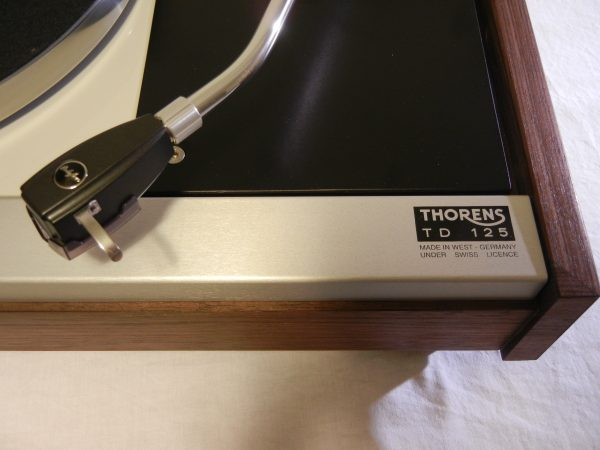
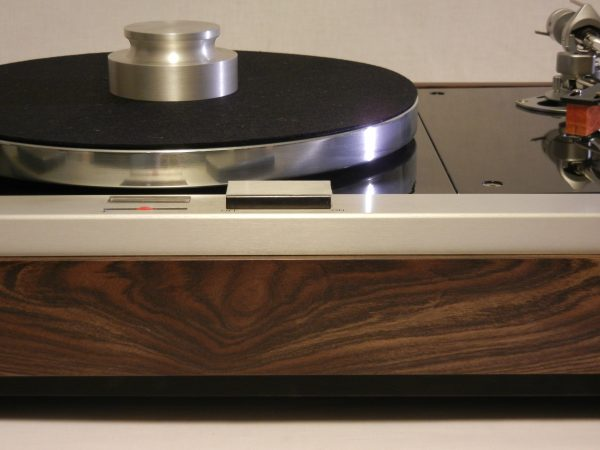
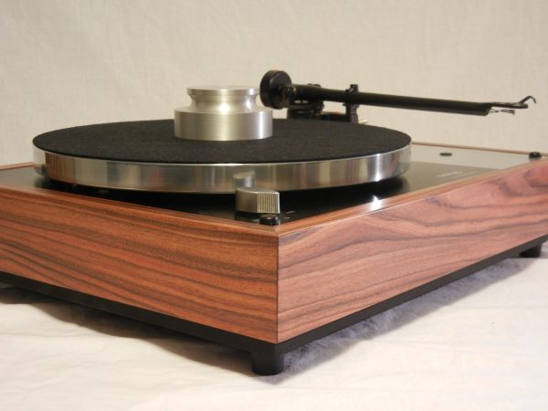
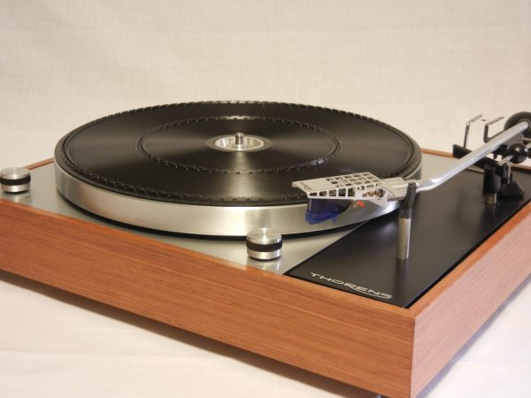
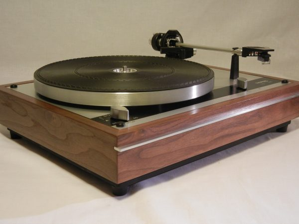
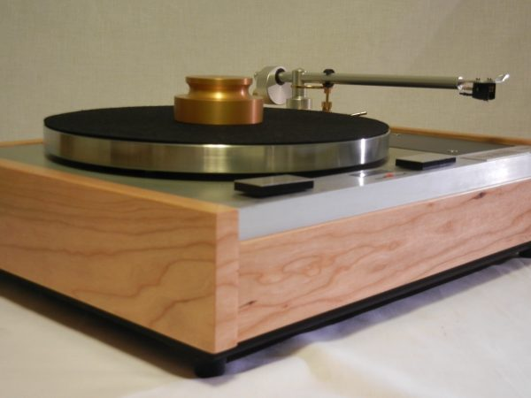
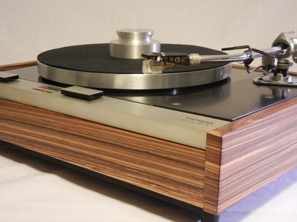

# Top Ten Vintage Turntable Projects of 2013

> Archived copy, saved 2026-11-05. Original: <https://vinylnirvana.com/ar-turntable-resources/ar-gallery/top-ten-vintage-turntable-projects-2013>. Site: Vinyl Nirvana. Rights remain with the author and the original site.

## Top Ten Vintage Turntable Projects of 2013

**With the door closed on 2013, I look back on my favorite projects…**

<https://vinylnirvana.com/vintage-turntables-for-sale/rl-long-base-in-peruvian-walnut/>

**I won’t soon forget getting an email from Ray LaMontagne saying he was interested in buying a Thorens TD-125 Long Base, nor will I forget setting it up with him side-by-side.**

<https://vinylnirvana.com/vintage-turntables-for-sale/the-legend-lives-thorens-td-125-long-base-in-morado-plinth-sme-m2-12r/>

**The grain on this Morado was amazing…and Vinny did an incredible job centering it on the front!**

<https://vinylnirvana.com/baby-grand-ar-the-turntable-in-piano-black-sme-3009-series-ii-many-mods-including-the-new-aluminum-resin-platter/>

**I really enjoy these special painted AR projects!**

<https://vinylnirvana.com/vintage-turntables-for-sale/custom-thorens-td-160bc-mkii-in-solid-caribbean-rosewood-w-new-rega-rb-251-extras/>

**Two words: Amazing grain!**

<https://vinylnirvana.com/restored-vintage-thorens-td-150-turntable/>

**For years, all I had ever done with TD-150s was part out the arm and put on another upgrade one. This was a restoration that forced me to really understand the “Kugel” arm.  I will never dismiss it so easily again!**

<https://vinylnirvana.com/vintage-turntables-for-sale/pristine-thorens-td-160-super-in-solid-brazilian-cherry-wsme-3009-tonearm-extras/>

**Brazilian cherry: the grain is always exciting to me.**

<https://vinylnirvana.com/vintage-turntables-for-sale/vintage-thorens-td-160b-mkii-turntable-w-grace-707-in-custom-bubinga-plinth/>

**Our first in Bubinga…or as Vinny calls it “Rock.” Of course, I always love the black of the MKII BC top as well.**

<https://vinylnirvana.com/black-walnut-td-145/>

**This was an upgrade project for a TD-145. I love the fact that the customer wanted to keep the classic metal trim piece in front. We will do more of these at some point!**

<https://vinylnirvana.com/vintage-turntables-for-sale/stunner-thorens-td-125-wblue-note-u3-arm-custom-cherry-plinth/>

**My first turntable with a Blue Note tonearm…love the elegant look and the “dreamy” cherry grain.**

<https://vinylnirvana.com/darkzebra-td-125-mkii/>

**Love the boldness of zebrawood, always. Check out the amazing finish work by Vinny.**

With special thanks to my “support” team: Vinny, Bill, Andy, Hans, Don & Brodie of Powder Coating Alternatives, Kathy of DMR Industries, Chris of Spray Maine, Jay of  JMK Displays, Jim Campbell, and, of course, my friends and family!
