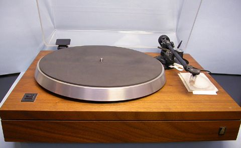

# AR EB-101

> Archived copy, saved 2026-11-05. Original: <https://vinylnirvana.com/ar-turntable-resources/ar-models/ar-eb-101>. Site: Vinyl Nirvana. Rights remain with the author and the original site.

EB-101 (AR Series)

1984-198?

The beginning of the “modern” series. Early Style has solid top and the tonearm comes from a hole that protrudes the base. Later Style has tonearm mounted on an armboard that has a crescent shape in front and round in the rear. Base has square edges where the ES-1 has rounded ones

It is important to note that the “early style” is not suitable for easy modification (esp tonearm upgrade)due to the lack of the crescent armboard. It is also important to note the EB-101 sold in Great Britain appears to have been sourced over there, and contains some cheapened parts. In particular, the black painted version is just about the low point of the mid-80’s AR tables.

(Later unit) Specifications:

Belt Drive

12 Pole Synchronous Motor

3.9lb/1.8kg Platter

Pivoted Arm, Detachable Headshell

3 Point Dual Spring Suspension

Same Subchassis as the ES-1

33 1/3 and 45 RPM

0.05% Wow and Flutter, -72dB Rumble

Walnut Finish

18.19″ W x 7″ H x 15.25″ D with Dust Cover Down, 13.5 lbs

$425 (1988)
