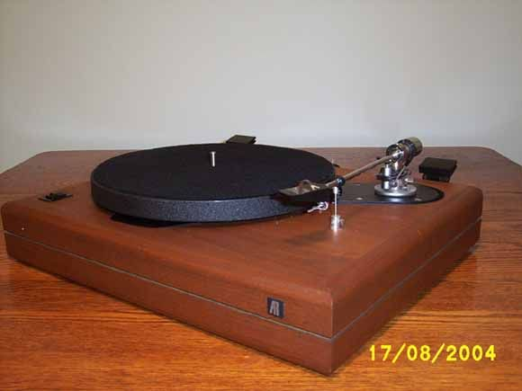

# AR ES-1

> Archived copy, saved 2026-11-05. Original: <https://vinylnirvana.com/ar-turntable-resources/ar-models/ar-es-1>. Site: Vinyl Nirvana. Rights remain with the author and the original site.

ES-1 Photo with Merrill Platter and Grace 707 Arm

ES-1 (Connoisseur Series)

1984-198?

Though the ES-1 and the AR the Turntable look alike there are many differences:

- AR the Turntable was all walnut veneer. The ES-1 has solid wood sides and came in cherry and walnut
- The ES-1 had a sapphire bearing. The ES-1 platter has a concave tip that fits over a loose ball bearing
- The ES-1 was always equipped with a Hurst motor. The AR the Turntable, in early versions, did not have the Hurst.
- As mentioned below, the ES-1 could be purchased without an arm, so was much more likely to have a different arm than the AR the TT.

Specifications:

Belt Drive

24 Pole Synchronous Motor, 3 watt Hurst Motor

3.9lb/1.8kg Platter

\* 1.5 watt Philips Airpax Motor for Early

33 1/3 and 45 RPM

0.04% Wow and Flutter, -78dB Rumble

Cherry or Walnut Finish

18.19″ W x 7″ H x 15.25″ D with Dust Cover Down

With Arm $500 (1988)

Without Arm $375 (1988)

The stock AR arm was an OEM Japanese product that looked very similar to the Sumiko but wasn’t quite as good. They changed a little through the years too but this was the published specs.

Effective Length – 9″ (229 mm)

Overhang – 19/32″(15 mm)

Friction – less than 20mg horizontal and vertical

Effective Mass – 13 grams

Cartridge Weight Range – 3-9 grams

Stylus Pressure Range 0-3 grams

Arm Plus Lead Capacitance 85 pF

Headshell – Carbon fiber reinforced with clamping screw on arm
