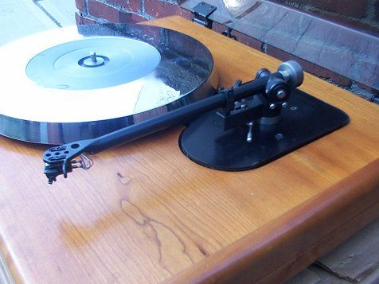

# AR ETL-1

> Archived copy, saved 2026-11-05. Original: <https://vinylnirvana.com/ar-turntable-resources/ar-models/ar-etl-1>. Site: Vinyl Nirvana. Rights remain with the author and the original site.

ETL-1 Photo Courtesy of Bill Morrison

ETL-1 (Connoisseur Series)

198?-198?

Specifications:

Electronic Speed Control

Belt Drive

3 Point Dual Spring Suspension, Adjustable Weights

Adjustable Feet

Sapphire Bearing

8.5 lb Platter

33 1/3 and 45 RPM

0.03% Wow and Flutter, -81dB Rumble

Cherry Finish or Piano Black

20.44″ W x 7.5″ H x 17.5″ D with Dust Cover Down, 29 lbs

$700 (1988), no arm

See additional photos of an ETL-1 on  [this page.](https://vinylnirvana.com/ar-turntable-resources/ar-models/more-details-and-photos-of-etl-1)
