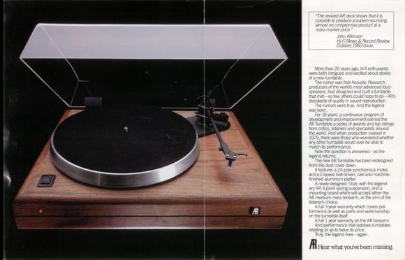

# AR the Turntable

> Archived copy, saved 2026-11-05. Original: <https://vinylnirvana.com/ar-turntable-resources/ar-models/ar-the-turntable>. Site: Vinyl Nirvana. Rights remain with the author and the original site.

AR the Turntable

1984-198?

The beginning of the “modern” series.  This style has the tonearm mounted on an armboard that has a crescent shape in front and round in the rear.  Same essential shape and dimensions as an ES-1.  Many assume that the ES-1 designation came later to differentiate the upgrades with that model.

(Later unit) Specifications:

Belt Drive

12 Pole Synchronous Motor

3.9lb/1.8kg Platter

Pivoted Arm, Detachable Headshell

3 Point Dual Spring Suspension

Same Subchassis as the ES-1

33 1/3 and 45 RPM

0.05% Wow and Flutter, -72dB Rumble

Walnut Finish

18.19″ W x 7″ H x 15.25″ D with Dust Cover Down, 13.5 lbs
