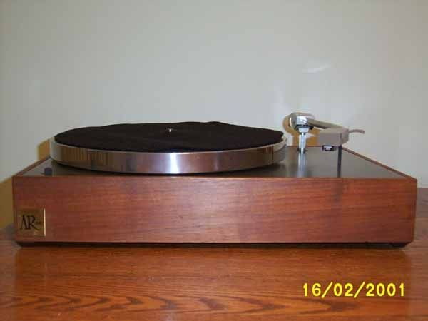

# AR XA Model

> Archived copy, saved 2026-11-05. Original: <https://vinylnirvana.com/ar-turntable-resources/ar-models/ar-xa>. Site: Vinyl Nirvana. Rights remain with the author and the original site.

This is the original AR turntable. (See AR History for more specific background on its development.) It had a two-piece aluminum platter which was driven by a small synchronous motor. Early versions had two motors to add the extra torque needed to start the heavy platter. A spring-suspended subchassis supported the platter and tonearm. The tonearm had manual adjustments for weight, no real anti-skating, and damped cueing which prevented accidentally dropping needle to the record surface. The tonearm was S-shaped with a single pivot point. The table was extremely quiet and immune to rumble.   Early models used solid walnut sides, then they became walnut veneer, and finally walnut looking vinyl veneer.

Note: The AR TA is nearly identical.

Specifications:

Belt Drive

Suspended aluminum platter-2 parts-in oil bearing – 3.9 lbs (1.8kg)

12″ S-Shaped tonearm in oil bearing

AC synchronous motor 110-120 v 60 cycle\*

Wow and Flutter, Speed Accuracy, Rumble see [XA Technical Specifications](https://vinylnirvana.com/ar-models/ar-technical-specifications/)

Plastic Headshell with brass inserts for cartridge screws-Tan, Black

Tonearm rest-Black plastic

Base Finishes: Solid Oiled Walnut, Oiled Walnut Veneer, Vinyl Walnut-look Veneer

Metal Plinth Finishes: Smooth Grey, Textured Brown, Smooth Brown, Textured black

Overall size: 12.75 x 16.75 x 5.25 (with dustcover in place.)

Total Weight 13.5 lbs

\*Early design had two motors, the other one was a “start motor” which forced the “run” motor to start up in the right direction. The start motor was belted to the run motor, and the run motor was then belted to the platter.
