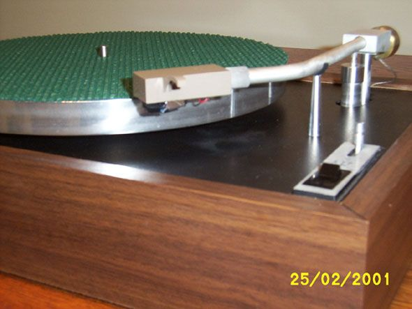

# AR XB

> Archived copy, saved 2026-11-05. Original: <https://vinylnirvana.com/ar-turntable-resources/ar-models/ar-xb>. Site: Vinyl Nirvana. Rights remain with the author and the original site.

The XB was introducted around 1972 for $130 (at this time the XA was $115) with a plywood veneer base, the tonearm lift, no mechanical damping, black plastic headshell, and a stainless steel counterweight. The metal top plate was always black and the power switch was a rocker type on the right side. The brushed steel or aluminum AR logo surrounded the power switch and cueing lever. The tonearm rest was metal.

Specifications:

Belt Drive

Suspended aluminum platter-2 parts-in oil bearing – 3.9 lbs (1.8kg)

12″ S-Shaped tonearm in oil bearing with cueing

Plastic Headshell with brass inserts for cartridge screws-Black

Counterweight-Brass, Stainless Steel

AC synchronous motor 110-120 v 60 cycle

Wow and Flutter, Speed Accuracy, Rumble see [XA Technical Specifications](https://vinylnirvana.com/ar-models/ar-technical-specifications/)

Base Finishes: Vinyl Walnut-look Veneer

Metal Plinth Finishes: Textured black

Overall size: ?

Total Weight ?

(Note: There were also the XA91 and XB91 that came with a Shure M91ED cartridge for an extra $55.)

